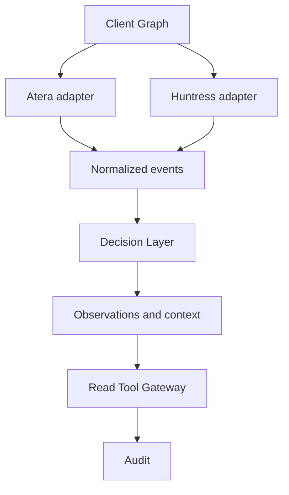

# 01 — Stage 1: Atlas Foundation

## Цель

Atlas должен получить собственный Client Graph, соединить данные Atera и Huntress в контексте одного клиента и сформировать observations с доказательствами, свежестью и аудитом. Decision Layer классифицирует ограниченный контекст; Gateway проверяет права и исполняет только разрешённые read-tools.

Контрольный клиент: **Gasta**. Имя Kari и устройство GASTA-LT-07 в пакете — синтетические фикстуры. Ни одному ID из пакета нельзя приписывать существование в ваших аккаунтах.

## Первый вертикальный сценарий

Пользовательский результат: `getClientContext(Gasta)` показывает, какие alerts, tickets и security incidents относятся к одному клиенту и устройству. Ответ содержит ссылки на исходные записи, source severity и время последнего успешного чтения. Он не выдаёт предположение AI за установленную причину инцидента.

В reference-демо роль источников выполняют фикстуры. В DB-query из пакета пока доступны только граф, observations и connection/sync metadata; отсутствующие live-resources явно отмечены. Эти различия закрываются заданиями 1.3–1.6.

## Входит

- Workspace/client scope; синтетический seed и начальный auth-контракт.
- Client, canonical Entity, Person, Device, ExternalEntity, confirmed/candidate EntityLink и Connection.
- Read-only Atera/Huntress integration contracts; customer/organization mapping.
- Event normalization, durable deduplication, incremental sync и reconciliation.
- DecisionProvider с fixture/rules/OpenAI реализациями; сначала shadow mode.
- Observations, freshness/completeness, deterministic urgency floor.
- Read Tool Registry/Gateway, минимальный Policy Engine, append-only client audit и workspace security audit отказов.
- Row-level security по workspace и клиенту; отдельная runtime-роль БД без BYPASSRLS.
- Единый выходной контракт `ClientContextV1` для фикстур, БД и инструментов.
- NestJS API и worker с PostgreSQL persistence.
- Контракт будущего approval-объекта без его выполнения.

## Следующие slices

Актуальная последовательность поставки и соответствие старому roadmap: [ROADMAP.md](ROADMAP.md).
Следующий срез детализирован в [Stage 2 M365 Correlation](stage2/README.md); статусы ревью указаны отдельно.

| Slice | Сценарий |
|---|---|
| 2 | Huntress incident → device/person → M365 identity/sign-in evidence |
| 3 | Предложение `atera.ticket.create` → policy → approval при необходимости → execute → verify → audit |
| 4 | PowerOffice business context |
| 5 | UI/Ask Atlas и более сложный Responses/Agents orchestrator |

Номер slice не означает срок и не заменяет общий roadmap. Задания 1.1–1.10 — подразделы одной Stage 1; они не относятся к 250 stages D&D-проекта.

## Условия завершения

1. В PostgreSQL есть Gasta → Kari → GASTA-LT-07 и два confirmed external mappings.
2. DB-backed context возвращает нормализованные Atera alerts/open tickets/Huntress incidents; пропущенные или устаревшие ресурсы указаны явно.
3. Повторы одного event revision, включая одновременную обработку разными workers, дают одну observation. Новый revision сохраняется отдельно. Идентичность включает тип ресурса; тот же ID/revision с другим содержанием — видимый конфликт, не потеря.
4. Observation и audit фиксируются одной транзакцией. Перезапуск не теряет событие. Конфликт привязки, временный сбой и неисправимая ошибка после записи дают соответственно review / retry / dead-letter — никогда исчезновение.
5. API другого клиента недоступен; upstream request также ограничен mapped customer/organization, не только результат после получения. RLS через confined runtime role: без контекста — отказ; клиенты одного workspace изолированы; контекст не переживает транзакцию.
6. Decisions outage/refusal/низкая уверенность/неожиданная модель не скрывают событие; HIGH/CRITICAL сохраняют приоритет (`priority = URGENT`), старый CRITICAL не вытесняется новыми событиями из контекста.
7. Каждый read-tool проходит runtime validation, scope/permission check и audit; отказ по scope виден в workspace security audit до любого чтения. Любой write-tool отклоняется.
8. Integration checks на PostgreSQL и fixture API проходят; live read-only smoke-test проводится отдельно после настройки credentials.

Decisions public beta не должна блокировать пункты 1–5 и 7–8. При недоступности провайдера сохраняются детерминированный минимум и visible-review workflow.
