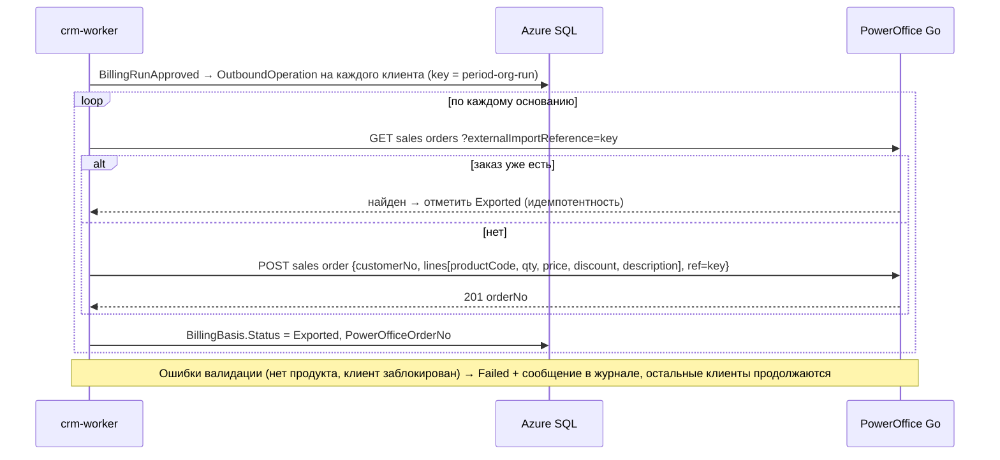

# 05. Интеграции

> Сведения об API актуальны на сентябрь 2026 г. Всё, что помечено **[PoC]**, подтверждается на Этапе 0 на реальных учётных данных Компании до начала разработки.

## 0. Сводка

| Система | Протокол / аутентификация | Направление | Частота | Режим |
|---|---|---|---|---|
| Entra ID | OIDC code + PKCE, сертификат приложения | ← | При входе, обновление каждые 60 мин | Онлайн |
| Graph (свой тенант) | Delegated (от имени пользователя) и Application | ↔ | Пользователи — ночью (delta); почта/календарь — по запросу + change notifications | Онлайн + фон |
| Partner Center API | Secure Application Model, App+User | ← | Подписки — каждые 4 ч; клиенты — ночью | Фон |
| Graph Partner Billing | Application, `PartnerBilling.Read.All` | ← | После выхода инвойса Microsoft (ежемесячно) + unbilled — ежедневно (R2) | Фон, асинхронный экспорт |
| Graph в тенантах клиентов (GDAP) | App+User через GDAP-группу | ← | Ночью (R2) | Фон |
| Atera API v3 | Заголовок `X-API-KEY` | ↔ | Тикеты — каждые 10 мин; время — каждые 30 мин; агенты — ночью; вебхуки — мгновенный триггер | Фон + вебхуки |
| PowerOffice Go API v2 | OAuth 2.0 client credentials (Application Key + Client Key) + `Ocp-Apim-Subscription-Key` | ↔ | Счета/оплаты — каждый час; клиенты — каждые 15 мин; заказы — при выгрузке | Фон |
| Brreg Enhetsregisteret | Открытый API без аутентификации | ← | При вводе оргномера; ночью — лента изменений | Онлайн + фон |

## 1. Microsoft Entra ID и Graph (тенант Компании)

### 1.1 Регистрации приложений

| Приложение | Тип | Назначение |
|---|---|---|
| `Vardahei CRM` (по одному на окружение: `-test`, `-prod`) | Single-tenant, Web | Вход пользователей, Graph своего тенанта, Partner Billing |
| `Vardahei CRM Partner` | Multi-tenant (требование Secure Application Model), Web | Partner Center API и Graph в тенантах клиентов через GDAP |

Разделение сужает последствия компрометации: учётные данные входа пользователей не дают доступа к тенантам клиентов.

### 1.2 Настройки `Vardahei CRM`
- Redirect URI: `https://crm.<домен>/signin-oidc`; front-channel logout: `https://crm.<домен>/signout-oidc`.
- Учётные данные: **сертификат** из Key Vault (автопродление), client secrets запрещены политикой.
- Enterprise application → **Assignment required = Yes**; приложение назначено только группам `CRM-*`.
- App Roles: `Crm.Admin`, `Crm.Management`, `Crm.Sales`, `Crm.Technician`, `Crm.ServiceLead`, `Crm.Finance`, `Crm.ReadOnly`.
- Optional claims: `xms_cc` (CAE), `login_hint`; групп в токене нет (только роли).

### 1.3 Разрешения Graph (минимально необходимые)

| Разрешение | Тип | Релиз | Для чего |
|---|---|---|---|
| `openid`, `profile`, `email`, `offline_access`, `User.Read` | Delegated | R1 | Вход, профиль |
| `User.Read.All` | Application — **выдаётся управляемой идентичности crm-worker** `id-crm-worker-<env>`, не регистрации приложения | R1 | Ежечасная синхронизация пользователей (delta query): отключённые аккаунты, имя, отдел, должность; список отключённых аккаунтов для синхронизации ролей |
| `Application.Read.All` | Application — управляемой идентичности crm-worker | R1 (DEV-10) | Синхронизация ролей: роли и назначения приложения CRM (`appRoleAssignedTo`) |
| `GroupMember.Read.All` | Application — управляемой идентичности crm-worker | R1 (DEV-10) | Синхронизация ролей: прямые члены групп, которым назначены роли CRM |
| `Mail.Send` | Application — управляемой идентичности, **ограничено ящиками** через RBAC for Applications в Exchange Online: общий ящик `crm@` и группа продавцов `crm-quote-senders@` | R1 (сводка), R2 (предложения) | Ежедневная сводка уведомлений из общего ящика (S8); отправка предложения из ящика продавца (S9) |
| `Calendars.ReadWrite` | Delegated | R2 (S10) | Встречи из CRM в календаре организатора и обратное чтение изменений |
| `Mail.Read` | Delegated | R2 (S10) | Переписка с клиентом в карточке (только метаданные) |
| `Mail.Send` | Delegated | R2 (альтернатива) | Отправка предложений от имени вошедшего пользователя — если политика доступа приложения к ящикам продавцов окажется неприемлемой (S10) |
| `Mail.Read` | Application + **RBAC for Applications в Exchange Online**, ограниченный общими ящиками (`support@`, `salg@`) | R2 | Привязка писем общих ящиков |
| `Sites.Selected` | Application | R2 (S10) | Доступ только к сайту SharePoint «Kunder» (выдаётся точечно на сайт) |
| `TeamsActivity.Send` | Application | R2 | Персональные уведомления в ленте активности Teams (требует Teams-приложение CRM) |
| `PartnerBilling.Read.All` | Application | R2 | Экспорт billed/unbilled reconciliation |

Все разрешения уровня Application утверждаются Global/Privileged Role Administrator; перечень пересматривается раз в полгода.

### 1.3a Рассылка уведомлений (S8)
- Сводка уходит через `POST /v1.0/users/{crm@домен}/sendMail` с `saveToSentItems: false`: письмо не оседает в «Отправленных» общего ящика.
- Ящик задаётся в `Notifications:FromAddress`, выключатель — `Notifications:EmailEnabled` (по умолчанию выключен). Без них уведомления остаются только в CRM и помечаются «не отправлено», то есть ничего не теряется молча.
- Тело письма формируется на сервере на норвежском или английском (по языку получателя) из вида уведомления и его параметров; всё, что ввёл пользователь (название сделки, имя пакета часов), экранируется.
- Ссылки в письме строятся от `Notifications:AppBaseUrl`, поэтому в тестовой среде письма ведут в тестовый CRM.

### 1.3b Отправка предложения из ящика продавца (S9)
- `POST /v1.0/users/{upn продавца}/sendMail` с `saveToSentItems: true` и PDF во вложении (`fileAttachment`, base64). Письмо лежит в «Отправленных» у продавца, и ответ клиента приходит ему, а не в общий ящик.
- Адрес отправителя — e-mail профиля вошедшего пользователя; тема и текст правятся в диалоге отправки, язык письма — язык предложения.
- Условия: `Sales:EmailEnabled` включён **и** ящик продавца входит в `ApplicationAccessPolicy` для `Mail.Send` (группа `crm-quote-senders@`). Иначе кнопка отправки отвечает понятным отказом (`SAL_MAIL_DISABLED` / `SAL_SENDER_WITHOUT_MAILBOX`), а PDF скачивают и отправляют из Outlook вручную.
- Альтернатива, если политика доступа к ящикам продавцов не подходит: delegated `Mail.Send` вместе с работой с календарём и письмами в S10.

### 1.4 Сценарии Graph
- **Синхронизация ролей** (задача `entra-role-sync`, каждые 2 минуты, `Integrations:MicrosoftGraph:RoleSyncCron`; DEV-10, [ADR-019](adr/ADR-019-sessions-and-privilege-freshness.md)): `GET /servicePrincipals?$filter=appId eq '<CrmAppId>'` (роли приложения, отключённые не считаются) → `GET /servicePrincipals/{id}/appRoleAssignedTo` → для групп `GET /groups/{id}/members/microsoft.graph.user` (только прямые члены — как в токене Entra; PIM-активация — членство на её срок) → `GET /users?$filter=accountEnabled eq false` (отключённый аккаунт ролей не держит). Результат — подтверждённые роли пользователей CRM в `identity.Users` (изменения — в журнал аудита) и время чтения в `identity.DirectoryRoleConfirmations`. Неудача ничего не подтверждает: через 5 минут привилегированные действия закрываются (runbook 12). В журнал синхронизаций попадают ошибки, изменения и раз в час — запуск без изменений.
- **Синхронизация пользователей** (задача `entra-user-sync`, ежечасно в :15): `GET /users/delta?$select=id,displayName,mail,userPrincipalName,accountEnabled,department,jobTitle` → `identity.User`; delta-ссылка хранится в `integration.SyncCursors`. `accountEnabled=false` или `@removed` → деактивация; запросы деактивированного пользователя отклоняются (`401 USER_INACTIVE`) не позднее чем через 60 с. Создаются только пользователи, уже входившие в CRM.
- **Календарь (S10):** `POST /me/events` с open extension `no.vardahei.crm` (в ней идентификатор активности), `PATCH` при правке, `DELETE` при снятии; обратное чтение — `GET /me/calendarView` за окно по запросу пользователя. Change notifications (публичный эндпоинт + продление подписок) отложены.
- **Почта (S10):** `GET /me/messages?$search="participants:…"` по адресам контактов и доменам клиента, плюс настроенные общие ящики (`GET /users/{ящик}/messages`; 403 — ящик просто пропускается). В CRM попадают только `internetMessageId`, тема, участники, дата и ссылка — и только когда человек сохраняет письмо. Тело не копируется.
- **SharePoint (S10):** сайт «Kunder», библиотека «Dokumenter», папка `{Название} ({оргномер})`; ID папки (`driveItem`) сохраняется в `ExternalLink`; переименование организации → переименование папки.
- **Teams (R2):**
  - Сообщения в каналы («Salg», «Økonomi», «Drift») — через **Workflows webhook** (Power Automate). Коннекторы Office 365 в Teams отключены в мае 2026, поэтому их не используем. Сделано в S10: выигранная сделка дороже порога и утверждённый биллинг-прогон.
  - Персональные уведомления — activity feed через Teams-приложение CRM (личная вкладка с CRM + `TeamsActivity.Send`); требует установленного приложения Teams, поэтому отложено до PoC.

### 1.5 Делегированный доступ (S10)
- Календарь и почта работают **от имени вошедшего сотрудника**: BFF берёт токен из своего кэша (`ITokenAcquisition`), интеграция получает его через `IDelegatedTokenSource`. В worker и при входе в режиме разработки токена нет — функции честно отвечают «не подключено», а не падают.
- Флаги: `Integrations:MicrosoftGraph:CalendarEnabled`, `:MailEnabled`, `:SharedMailboxes` (список общих ящиков), `:SharePoint:{Enabled,SiteId,DriveId|DriveName}`, `:Teams:{Enabled,WonDealThreshold,Channels}`. Всё выключено по умолчанию.
- SharePoint и Teams не требуют пользователя: папки создаёт управляемая идентичность (`Sites.Selected`), сообщения уходят на URL вебхука, который сам по себе является секретом и лежит в Key Vault.

## 2. Microsoft Partner Center (CSP)

### 2.1 Модель участия **[PoC]**
| Модель | Подписки и клиенты | Цены партнёра и сверка |
|---|---|---|
| Direct bill partner | Partner Center API | Price sheet API + Graph Partner Billing |
| Indirect reseller (через дистрибьютора) | Partner Center API (клиенты, подписки) | Прайс и счета дистрибьютора (API/CSV дистрибьютора) |

### 2.2 Аутентификация — Secure Application Model
1. Мульти-тенантное приложение `Vardahei CRM Partner` в партнёрском тенанте.
2. Сервисный аккаунт партнёра (с MFA, без почтового ящика, исключён из интерактивного использования Conditional Access-политикой по расположению) однократно проходит consent App+User → refresh token сохраняется в Key Vault.
3. Worker получает access token для `https://api.partnercenter.microsoft.com` из refresh token; ротация refresh token — при каждом использовании, мониторинг срока жизни (алерт за 14 дней до истечения из-за неактивности).
4. Для GDAP: сервисный аккаунт состоит в группе безопасности, которой в GDAP-связях с клиентами назначена роль **Directory Readers** (минимально; **Global Reader** — только если нужны отчёты об использовании) **[PoC]**.

### 2.3 Используемые операции

| Операция | Эндпоинт (Partner Center REST) | Применение |
|---|---|---|
| Список CSP-клиентов | `GET /v1/customers` (continuation token) | Сопоставление с организациями CRM (домен, название) |
| Подписки клиента | `GET /v1/customers/{customerId}/subscriptions` | `licensing.CspSubscription` |
| Детали подписки | `GET /v1/customers/{customerId}/subscriptions/{subscriptionId}` | Срок, автопродление, дата продления |
| Лицензии клиента | `GET /v1/customers/{customerId}/subscribedskus` | Куплено/использовано (альтернатива Graph через GDAP) **[PoC]** |
| GDAP-связи | Graph `GET /tenantRelationships/delegatedAdminRelationships` | Статус и срок GDAP на вкладке «Среды» |
| Прайс-лист NCE | Price sheet API (рынок `NO`, license-based) | Импорт цен партнёра в каталог (R2) |

### 2.4 Биллинг Microsoft через Graph (R2, только direct)
```
POST /reports/partners/billing/reconciliation/billed/export   { invoiceId, attributeSet: "full" }
  → 202 + Location: /reports/partners/billing/operations/{id}
GET  /reports/partners/billing/operations/{id}  (опрос до status = succeeded)
  → resourceLocation: manifest (blob, SAS)
  → скачать файлы строк (JSON) → integration.ExternalRecord → licensing.MsBilledLine
```
Сверка: затраты Microsoft за месяц сравниваются с выручкой по лицензиям, выставленной клиентам за тот же месяц (`billing.BillingLine` группы `License` в утверждённых прогонах). Расхождения → отчёт Finance «Сверка с Microsoft».

- **Ссылки экспорта (DEV-21, 21.10.2026).** После первого `POST` клиент идёт только по ссылкам из ответов Microsoft: `Location` операции, `resourceLocation` манифеста, ссылки на файлы строк. Это данные извне, поэтому каждая ссылка разрешается относительно `GraphBaseUrl` и проверяется до запроса (`PartnerBillingLinks.cs`). На origin Graph (схема, хост и порт; `Crm.Integrations.Core/GraphLinks`) запрос уходит с токеном Graph. Файл в хранилище экспорта уходит **без** токена — его ключ SAS-подпись (`sig`) в самой ссылке — и только по https, только с подписью и только на хост из `Integrations:PartnerCenter:BillingStorageHostSuffixes` (сам хост или поддомен; не задан — всё `blob.core.windows.net`; заданный список заменяет это значение, а не дополняет его). Пока список — всё `blob.core.windows.net`, правило проверяет вид ссылки, а не владельца хранилища: подменённый ответ мог бы указать на подписанный файл в чужой учётной записи Azure, и его строки попали бы в сверку; доверие здесь — ответ Graph по TLS, а список сужают до учётных записей экспорта, когда тенант их покажет (EXT-03). Любая другая ссылка (чужой хост, другой порт или схема, файл хранилища без подписи или по http) отклоняется до запроса: запуск `partnercenter-billing` падает с `PartnerBillingLinkRefusedException` (в записи запуска только имя типа), текст ошибки не называет ни одной части ссылки. Редиректы клиент по-прежнему не выполняет (M39.0). До исправления опрос операции и чтение манифеста отправляли токен Graph на любой адрес из ответа, а файлы строк скачивались с любого адреса (без токена). Тесты: `PartnerBillingLinksTests`, `PartnerBillingExportTests` (loopback-серверы Graph, хранилища и чужого хоста).
- **Расхождение с документированным контрактом (не исправлено).** Код читает `resourceLocation` как строку-ссылку на манифест, а файлы — из `blobs[].blobUri`/`url`. В документации Microsoft успешная операция отдаёт `resourceLocation@odata.navigationLink` (манифест на Graph, справочник Graph v1.0) или сам манифест объектом `resourceLocation` с `rootDirectory`, `sasToken` и `blobs[].name` (файл = `rootDirectory/name?sasToken`, пример Partner Center v2); файлы — gzip JSON Lines (`dataFormat: compressedJSON`). Пока `BillingReconciliationEnabled` выключен, это ни на что не влияет; перед включением контракт подтверждается на тенанте партнёра (EXT-03), а ссылки нового вида проходят ту же проверку `PartnerBillingLinks`.

### 2.5 Правила синхронизации
- Удалённая/приостановленная подписка не удаляется в CRM: статус меняется, история сохраняется (temporal).
- `CancellationWindowEndsAt` = время покупки или увеличения количества + 168 ч. Увеличение количества распознаётся по разнице со снапшотом.
- Троттлинг (HTTP 429): уважаем `Retry-After`, экспоненциальный backoff, не более 4 параллельных запросов.

### 2.6 Как это реализовано (S6)
- `Crm.Integrations.PartnerCenter` — только чтение. Два задания: `partnercenter-customers` (`40 2 * * *`) сопоставляет CSP-клиентов с организациями (экран «Сопоставления»), `partnercenter-subscriptions` (`15 */4 * * *`) обновляет подписки. Оба идут через `SyncRunner`, изменения определяются по хешу в `integration.ExternalRecord`.
- `PartnerCenterTokenProvider` обменивает refresh token из конфигурации (`user-secrets`/Key Vault) на access token и кеширует его до истечения; ключи никогда не попадают в журналы.
- Ответы читаются защитно: отсутствующие поля дают `Unknown` (срок, период выставления), continuation token обходится до конца, 429 обрабатывается общей политикой повторов.
- Запись в Partner Center (NCE-заказы, изменение количества, отмена) не реализована: раздел закрыт до PoC на ключе заказчика, см. `docs/runbooks/02-integrations.md`.

### 2.7 Как это реализовано (S11)
- `partnercenter-licenses` (`Integrations:PartnerCenter:LicenseSyncCron`, по умолчанию `50 2 * * *`) читает `subscribedskus` только у сопоставленных CSP-клиентов и пишет снимок «куплено / назначено» за сутки (`licensing.LicenseSnapshot`). Тенант без живой GDAP-связи отвечает 403/404 — он просто остаётся без сегодняшней записи, задание не падает. Поля читаются в обоих написаниях: `prepaidUnits.enabled` / `activeUnits` и `consumedUnits` / `assignedUnits`.
- `partnercenter-billing` (`BillingSyncCron`, по умолчанию `20 4 * * *`) включается флагом `BillingReconciliationEnabled`: берёт счета партнёра за два последних месяца (`GET /v1/invoices`), запускает экспорт сверки в Graph, опрашивает операцию, читает манифест и загружает строки в `licensing.MsBilledLine`. Токены для `api.partnercenter.microsoft.com` и `graph.microsoft.com` кешируются раздельно, по аудитории.
- Строки счёта идемпотентны по ключу `источник:счёт:подписка:предложение:период`, поэтому повторный запуск задания или повторный импорт файла ничего не дублируют.

## 3. Atera

### 3.1 Доступ
- Базовый URL: `https://app.atera.com/api/v3`, заголовок `X-API-KEY`. Если Atera переведёт аккаунт на токены, `Integrations:Atera:Authentication=Bearer` отправляет тот же секрет (`ApiKey`) как `Authorization: Bearer <JWT>`; всегда ровно один из двух заголовков (M39.0).
- Клиент не следует перенаправлениям (как клиенты PowerOffice и Partner Center): ответ 3xx — ошибка, `X-API-KEY` не уходит на адрес из `Location` (M39.0, `Crm.Integrations.Core/ProviderHttp.cs`).
- Ключ API — один на аккаунт Atera с широкими правами: хранится только в Key Vault, ротация раз в 6 месяцев и при увольнении администратора Atera.
- Лимит: **700 запросов/мин** на аккаунт — CRM ограничивает себя 600/мин, чтобы оставить запас для других интеграций Atera.
- Пагинация: `page` (с 1) + `itemsInPage` (максимум 50); ответ содержит `totalPages`, `totalItemCount`, `nextLink`.
- Отдельной песочницы нет → запись в Atera выключена по умолчанию (`WriteEnabled=false`); для первой проверки — `WriteAllowedCustomerIds` с id тестового клиента. Публичная спецификация закрыта логином, поэтому чтение устойчиво к вариантам имён полей, а перечень проверок на ключе заказчика — в [runbook 02 §2.2](runbooks/02-integrations.md#22-проверка-poc-до-включения-записи) **[PoC]**.

### 3.2 Сущности и направление

| Сущность Atera | Операции CRM | Мапинг в CRM | Частота |
|---|---|---|---|
| Customers | GET, POST, PUT | `Organization` + `CustomerEnvironment(AteraCustomer)`; при активации MSP-контракта — создание | Каждые 15 мин + по событию |
| Contacts | GET, POST | `Contact` + `OrganizationContact` | Каждые 15 мин + при создании тикета |
| Tickets | GET (`ticketStatus`), POST; POST `/tickets/{id}` (статус, приоритет, техник) — действием (M39) | `service.Ticket` (зеркало; меняется только через действие у Atera и последующее чтение) | Открытые — каждые 10 мин; проход по недавним (60 дней) — каждый час |
| Ticket comments | GET `/tickets/lastmodified?includeComments`, GET/POST `/tickets/{id}/comments` — ответ и внутренняя заметка действием (M39) | `service.TicketComments` (переписка, [§3.6](#36-действия-и-переписка-m39)) | Каждые 5 мин (`TicketConversationSyncCron`) + перечитывание открытых |
| Ticket work hours / billable durations | GET `/tickets/{id}/workhoursrecords`; POST `/tickets/{id}/workhours` — собственные часы из CRM действием `time.record` (M39.3) | `time.TimeEntry` (Source = Atera), техник — через `identity.TechnicianMapping`; строки с маркером CRM не импортируются | Каждые 30 мин по тикетам, открытым или изменённым за 60 дней |
| Agents | GET | `service.Device` + ежедневный `DeviceCountSnapshot` по типам (Workstation/Server/Network/Other из `OSType`/`OS`) | Ночью (01:30) |
| Alerts | GET (`alertStatus=Open`), все клиенты одним постраничным списком | `service.Alerts` с жизненным циклом ([§3.5](#35-оповещения-жизненный-цикл-m38)): Critical/Warning сопоставленных клиентов, постоянный id, закрытие только по полному чтению | Каждые 30 мин (`AlertSyncCron`, `5,35 * * * *`) |
| Custom values (customer) | GET, PUT `/customvalues/customerfield/{customerId}/{fieldName}` | Уровень SLA активного контракта (поле из `Integrations:Atera:SlaCustomFieldName`; реализовано, запись выключена до PoC); номер контракта и менеджер — позже | При активации, приостановке, завершении контракта и смене SLA |
| Contracts (Atera) | GET | Только для первичной миграции | Однократно |

### 3.3 Алгоритм синхронизации тикетов и часов
1. Запросить открытые тикеты (фильтр по статусу) постранично → upsert.
2. Запросить тикеты, отсортированные по дате изменения/создания, до достижения курсора `lastSyncedAt − 1 ч` (перекрытие окна защищает от гонок) **[PoC: доступность сортировки/фильтра по дате изменения; при отсутствии — ночной полный проход за 60 дней]**.
3. Для каждого изменённого тикета — запросить рабочие часы; сравнить хэш с `ExternalRecord`; изменения → команда `ImportTimeEntries`.
4. Техник Atera → пользователь CRM по сопоставлению (`identity.TechnicianMapping`); не сопоставленные → запись с флагом и уведомление Admin.
5. Вебхук (тарифы Atera Enterprise/Superpower, настраивается правилом автоматизации тикетов на создание/обновление/закрытие): `POST /webhooks/atera/{secret}` с `TicketID` → внеочередная синхронизация этого тикета.

### 3.4 Создание тикета из CRM
```
POST /tickets { TicketTitle, Description, TicketPriority, TicketImpact, TicketStatus: "Open",
                TicketType, EndUserID (Atera contact), TechnicianContactID? }
```
Если контакт не связан с Atera — сначала `POST /contacts` с `CustomerID` клиента. Операция идёт через `OutboundOperation` с ключом идемпотентности; ответ сохраняется в `ExternalLink`.

### 3.5 Оповещения: жизненный цикл (M38)
До M38 каждое чтение удаляло открытые оповещения клиента и вставляло их заново. Теперь оповещение живёт в `service.Alerts` от чтения к чтению (миграция `20261021102012_AlertLifecycle`; подробности — [M38](../../../docs/migration/M38-OPERATIONS-IN-CRM.md#оповещения-atera-жизненный-цикл-c4)):
- Строка: постоянный CRM-id, уникальность `System` + `ExternalId`; `State` — `Open`, `Acknowledged` или `Resolved`; `Kind` — `Monitoring` (Atera), `Security` (Huntress), `Backup` (CloudAlly); внешний id клиента, имя и id устройства, ссылка, время у источника, `LastSeenAt`, `ResolvedAt`. Аудита нет: система учёта — источник.
- Задание `atera-alerts` читает открытые оповещения **всех** клиентов одним постраничным списком и передаёт снимок в `IServiceApi.ApplyAlertSnapshotAsync`. Перечисленные оповещения записываются как открытые; закрытое ранее открывается снова, отметка `Acknowledged` сохраняется. Хранимое `Open`/`Acknowledged` становится `Resolved` только тогда, когда **полное** чтение его больше не перечисляет.
- Неполное или упавшее чтение ничего не меняет. Поэтому чтение падает целиком: на странице, которую не удалось прочитать или разобрать, и на оповещении без id; соседняя предыдущая страница перечитывается, чтобы сдвиг списка ничего не потерял.
- Оповещение клиента Atera без связи с организацией не записывается и не трогается: открытое у Atera, но не сопоставленное, не считается решённым. Счётчик пропущенных — в сообщении прогона.
- Устройство ставится, только если ровно одно текущее устройство того же клиента и источника носит это имя (без учёта регистра); иначе оповещение остаётся без устройства.
- Ссылка в Atera строится только по `Integrations:Atera:AlertUrlTemplate` (`{0}` — id оповещения; по умолчанию пусто, адрес страницы оповещения не подтверждён).
- Запись снимка — одна транзакция под app lock `service-alerts:<system>`: ручной запуск рядом с плановым ждёт, а не вставляет то же оповещение дважды.
- Чтение (`service.read`): `GET /api/v1/service/alerts?organizationId&state&severity&deviceId&q&cursor&limit` → `{items, nextCursor, totalCount, critical, warning}` — открытые по умолчанию, новые первыми, keyset-курсор, 25 по умолчанию и до 100, итоги по всему фильтру; `GET /api/v1/service/alerts/urgent?limit=5` → `{items, totalCount, critical, warning, reads: [{system, startedAt, complete}]}` — самые важные, среди них самые старые; `reads` говорит, полным ли было последнее чтение источника.
- Макет Atera (`tools/dev-mocks/atera.mjs`) даёт тестам свои клиенты, агенты и оповещения и закрывает оповещение маршрутами `/_mock/atera/*` ([README макетов](../tools/dev-mocks/README.md)).
- Закрытие оповещения в Atera, скрытие до даты, пробелы покрытия и чистка решённых — этап M40.

### 3.6 Действия и переписка (M39)
Подробности — [M39](../../../docs/migration/M39-VENDOR-ACTIONS-TICKETS.md).
- Любое изменение в Atera из CRM — действие (`integration.VendorActions`): предпросмотр из сохранённых данных с подписанным токеном (10 мин), подтверждение по уровню, команда с ключом идемпотентности, отправка Worker'ом (цикл 5 с) после повторного чтения переключателей и живого состояния. Неповторяемое действие без ясного ответа (`Uncertain`) не отправляется снова — человек проверяет у Atera и записывает итог в журнале на `/connections`.
- Виды Atera: `ticket.reply`, `ticket.note`, `ticket.status`, `ticket.priority`, `ticket.technician`, `ticket.close`, `time.record`. Пишутся от имени техника, сопоставленного человеку (`identity.TechnicianMappings`); заявка, ушедшая к другому клиенту, — `VND_TICKET_MOVED`. Включение: `WriteEnabled` (или `DryRun`) и вид в `EnabledActions`; `WriteAllowedCustomerIds` ограничивает клиентов.
- Переписка: задание `atera-ticket-conversations` читает `/tickets/lastmodified` от курсора (перекрытие 5 мин, первый проход 14 дней) и перечитывает до 25 открытых заявок, чья переписка старше 60 мин; курсор двигается только после полного прогона.
- Часы из CRM: `POST /tickets/{id}/workhours` с маркером `[CRM-TE:<id записи>]` в комментарии; повтор находит строку по маркеру (`Skipped`), импорт часов пропускает строки с маркером и квитанции действий — часы не считаются дважды.

## 4. PowerOffice Go

### 4.1 Доступ
- Регистрация разработчика → **Application Key** (фиксирован для приложения CRM) и **Subscription Key** (заголовок `Ocp-Apim-Subscription-Key` во всех вызовах v2).
- Компания в своём клиенте PowerOffice Go добавляет интеграцию → **Client Key** (секрет, хранится в Key Vault).
- Токен: OAuth 2.0 client credentials — Basic-аутентификация `ApplicationKey:ClientKey` на эндпоинт токена; ответ — JWT с перечнем доступных привилегий. Токен кэшируется до `exp − 60 с`.
- Окружения: **Demo** — API `https://goapi.poweroffice.net/Demo/v2`, токен `https://goapi.poweroffice.net/Demo/OAuth/Token`; **Production** — `https://goapi.poweroffice.net/v2`, `https://goapi.poweroffice.net/OAuth/Token`. Токен живёт 20 минут.
- Лимит: 10 запросов в секунду на subscription key (CRM — 8). Списки: `PageNumber`/`PageSize` (по умолчанию 5 000, максимум 20 000), пустая страница — `204 No Content`; изменения — фильтр `lastChangedDateTimeOffsetGreaterThan`. Обновления — `PATCH` с `application/json-patch+json` (RFC 6902). `POST /Customers` не вызывается параллельно для одного клиента (иначе `503`).
- Реализация и проверка: OpenAPI-спецификации swagger.poweroffice.net (Customers, Contact Persons, Products); контрактные тесты на WireMock; локальная заглушка `tools/dev-mocks/external-apis.mjs`. Подключение — [runbook 02](runbooks/02-integrations.md).
- Привилегии v2 задаются на уровне Application Key и требуют соответствующих подписок Go у клиента (модули «Faktura», «Salgsordre» и т. д.) **[PoC]**.

### 4.2 Сущности и направление

| Сущность PowerOffice | Операции | Мапинг | Частота |
|---|---|---|---|
| Customers | GET (фильтр по оргномеру, e-mail), POST, PATCH | `Organization` (финансовые поля) ↔ `ExternalLink(PowerOffice, Customer)` | Каждые 15 мин (изменения по `lastChangedDateTimeOffset`) + при активации контракта |
| Contact persons | GET `/ContactPersons`, POST `/ContactPersons/{customerId}`, PATCH `/ContactPersons/{customerId}/{id}` | `Contact` ↔ `ExternalLink(PowerOffice, ContactPerson)`; создаются контакты с ролью «Счета», `ExternalCode = crm:<id>` для идемпотентности; обновляются имя, e-mail, телефон | Каждый час + при изменении контакта |
| Products | GET | `catalog.Product` по артикулу = код продукта; импорт недостающих | Ночью |
| Sales orders | POST (создание), GET (проверка по внешней ссылке) | `billing.BillingBasis` → заказ | При выгрузке прогона |
| Outgoing invoices / credit notes | GET (`balanceLastChangedDateTimeOffsetGreaterThan`) + `/OutgoingInvoices/{UUID}/Lines`; CustomerId → подтверждённая организация | `billing.Invoice` + атомарный HistoryJson со строками + наблюдаемые `InvoicePayment` | Каждый час |
| Подтверждённые платежи / клиентские операции | GET `Customerledger/Statement`, полный диапазон проводок и все match/unmatch | `billing.CustomerLedgerEntries/Versions/Snapshots`; исходные платежи отдельно от наблюдений остатка | Opt-in, каждый час |
| Time tracking entries | — (не используется; учёт времени в Atera и CRM) | — | — |

### 4.3 Выгрузка биллинга
Вариант по умолчанию — **заказы на продажу (salgsordre)**; Finance преобразует их в счета в PowerOffice пакетно. Альтернатива — создание черновиков исходящих счетов напрямую (решить на Этапе 0).



Правила:
- Ставки MVA берутся из продукта PowerOffice; CRM передаёт цены без MVA.
- Строки описания ≤ ограничения поля PowerOffice (усечение с «…» + полная детализация во вложении при необходимости).
- Клиент создаётся/обновляется в PowerOffice **до** выгрузки заказа; номер клиента PowerOffice хранится в `ExternalLink`.

### 4.3a Как это реализовано (S7)
- Перед утверждением прогона биллинг спрашивает у интеграции (`IBillingTargetSystem`), какие клиенты и продукты вообще можно выставить: клиент должен быть связан с клиентом PowerOffice, продукт — с продуктом PowerOffice. Несвязанные попадают в аномалии (BR-BIL-03), и до утверждения их видно на экране прогона.
- Утверждение прогона ставит по одному исходящему заказу на клиента в очередь (`poweroffice/create-sales-order`). Обработчик: `GET SalesOrders?externalImportReferences={ключ}` → если заказ есть, основание помечается выгруженным без повторного создания (BR-BIL-05); иначе `POST SalesOrders` с `CustomerId`, `OrderDate` = конец периода, `ExternalImportReference` = `{период}-{клиент}-{прогон}`, `CustomerReference` из контракта и строками (код продукта, описание с периодом, количество, цена без MVA, скидка).
- **Код продукта в заказе — это артикул (SKU) продукта CRM**: в PowerOffice артикул совпадает с кодом продукта (§4.2), связь через `ExternalLink` лишь подтверждает, что продукт там есть.
- Ошибки валидации (нет связи с клиентом, нет продукта в PowerOffice, пустое основание) — постоянные: основание получает статус «Ошибка» с текстом в журнале попыток, остальные клиенты продолжаются. «Отправить снова» ставит основание обратно в очередь.
- Исходящие счета и кредит-ноты читаются ежечасно (`poweroffice-invoices`, по умолчанию `20 * * * *`): исторический stream `invoice-history-v1`, UUID источника, постраничные строки и CustomerId → подтверждённая организация. Основание по внешней ссылке/заказу добавляется только для того же клиента. `Balance` и posted-суммы — в валюте учёта клиента; документная валюта и суммы хранятся отдельно. Изменение остатка — наблюдаемое движение (`BalanceDecrease` / `CreditNote` / `BalanceIncrease`), не доказанная оплата; `Payment`/`WriteOff` не пишутся. Неполные строки помечаются явно, PDF пока не загружаются. Подтверждённые операции загружает отдельный opt-in Customer Ledger import; он не переписывает наблюдения остатка. Подробности и ограничения legacy-сверки: [M37 history](../../../docs/migration/M37-POWEROFFICE-INVOICE-HISTORY.md).
- Локальные заглушки (`tools/dev-mocks/external-apis.mjs`) повторяют оба эндпоинта: созданный заказ сразу превращается в исходящий счёт с MVA 25 %, поэтому всю цепочку можно проверить без ключей.

## 5. Brønnøysundregistrene (Enhetsregisteret)
- Поиск: `GET https://data.brreg.no/enhetsregisteret/api/enheter?navn={строка}` и `GET .../enheter/{orgnr}`; подразделения — `.../underenheter?overordnetEnhet={orgnr}`.
- Ночная проверка: лента изменений `GET .../oppdateringer/enheter?dato={ISO}` → для организаций CRM обновить адрес/название (если не переопределены вручную) и флаги `konkurs`, `underAvvikling`, `slettedato`.
- Кэш ответов поиска — 24 ч. API открытый, но с вежливым ограничением частоты (≤ 5 запросов/с из CRM).

## 6. Дистрибьютор CSP (если индирект)
- R1 (сделано в S6): `POST /api/v1/licensing/import` принимает CSV как `text/csv`; `?dryRun=true` возвращает предпросмотр «создать / обновить / без изменений», ничего не записывая.
  - Разделитель определяется автоматически (`;` или `,`), кавычки поддерживаются, заголовки сопоставляются без учёта регистра, пробелов и подчёркиваний.
  - Норвежские и английские заголовки: `Kundeid/CustomerId`, `Kunde/Kundenavn/CustomerName`, `Organisasjonsnummer/OrgNr`, `AbonnementsID/SubscriptionId`, `Produktid/ProductId/OfferId`, `Produktnavn/OfferName`, `Antall/Quantity/Licenses`, `Status`, `Bindingstid/Term`, `Faktureringsperiode/BillingCycle`, `Startdato`, `Sluttdato/CommitmentEndDate`, `Fornyelsesdato/RenewalDate`, `Autofornyelse/AutoRenew` (`ja/nei`), `Kjøpsdato/PurchaseDate`, `Partnerpris/PartnerPrice`.
  - Обязательны `customerid`, `subscriptionid`, `offerid`, `quantity`; их отсутствие — ошибка 400 `LIC_IMPORT_INVALID`. Неизвестные столбцы и плохие строки перечисляются в предупреждениях, остальные строки импортируются.
  - Даты принимаются как `dd.MM.yyyy` и `yyyy-MM-dd`, десятичные — с запятой и точкой. Факт импорта пишется в журнал аудита (`Import`/`CspSubscription`).
- R2 (сделано в S11): `POST /api/v1/licensing/ms-billing/import` принимает файл затрат дистрибьютора как `text/csv` (право `finance.cost.read`); `?dryRun=true` показывает «создать / обновить / без изменений / без клиента», ничего не записывая.
  - Заголовки: `CustomerId/CspCustomerId/KundeID`, `CustomerName/Kundenavn`, `SubscriptionId/EntitlementId`, `OfferId/ProductId/SkuId`, `OfferName/Produktnavn`, `Quantity/Antall`, `UnitPrice/EffectiveUnitPrice/Enhetspris`, `Total/Subtotal/Beløp`, `Currency/Valuta`, `InvoiceId/Fakturanummer`, `ChargeStartDate/BillingPeriodStartDate`, `ChargeEndDate`.
  - Обязательны `customerid`, `offerid`, `total`; файл без периода читается как предыдущий месяц. Цена за единицу выводится из суммы и количества, если её нет в файле.
  - Строка привязывается к организации через CSP-подписку (по `SubscriptionId`, иначе по `CspCustomerId`); непривязанные считаются отдельно и попадают в предупреждения.
- R2: API дистрибьютора (зависит от поставщика) **[PoC]**.

## 7. Обработка ошибок и повторы

| Класс ошибки | Поведение |
|---|---|
| 408, 429, 5xx, сетевые | Повтор: экспонента с джиттером (до 4 попыток в клиентах PowerOffice и Atera), для чтения. **Запись (POST/PUT/PATCH) HTTP-слой повторяет только при 429** (DEV-19, `ShouldRetry` в `PowerOfficeModule`/`AteraModule`): 5xx и таймаут записи не доказывают, что эффекта нет, поэтому исход решает поиск по ссылке/маркёру перед повторной отправкой (журнал внешних эффектов, [evidence DEV-19](claude-opus/evidence/DEV-19.md)). *Исходный план — задержки 2с → 4с → 8с → 16с → 32с и circuit breaker при 50 % ошибок за 30 с: circuit breaker в модулях интеграций (`grep CircuitBreaker src/Integrations`) не найден — не реализован; `Retry-After` учитывает клиент Atera (`ShouldRetryAfterHeader`), для PowerOffice см. evidence DEV-19.* |
| 401 | Сброс кэша токена, одна повторная попытка; далее — алерт «интеграция не авторизована» |
| 400/422 (валидация) | Без повтора; ошибка по записи в `SyncRunItemError`, запись доступна для ручного повтора после исправления |
| 404 при обновлении | Проверка, удалена ли запись во внешней системе; связь помечается «разорвана», уведомление Admin |
| Конфликт мастера данных | Логирование расхождения, значение мастера побеждает ([03 § 7.3](03-architecture.md#73-разрешение-конфликтов)) |

Исходящая операция после 10 неудачных попыток → статус `DeadLetter`, видна в Admin с кнопками «Повторить» и «Отменить».

## 8. Контрактные тесты интеграций
- Для каждого адаптера — набор записанных ответов реальных API (обезличенных) и тесты на WireMock.Net.
- Ночной «smoke» в `test`: чтение 1 страницы каждой сущности из PowerOffice Demo, Atera (тестовый клиент), Partner Center (только чтение) — ранний сигнал об изменении API.
- Подписка на changelog PowerOffice API и уведомления Partner Center/Message Center; ответственный — техлид.

M37 Customer Ledger: [контракт, связи и локальные проверки](../../../docs/migration/M37-POWEROFFICE-CUSTOMER-LEDGER.md). `CustomerLedgerSyncEnabled=false` по умолчанию; Source.Kind Payment/WriteOff не смешивается со старым InvoiceMovementKind.
