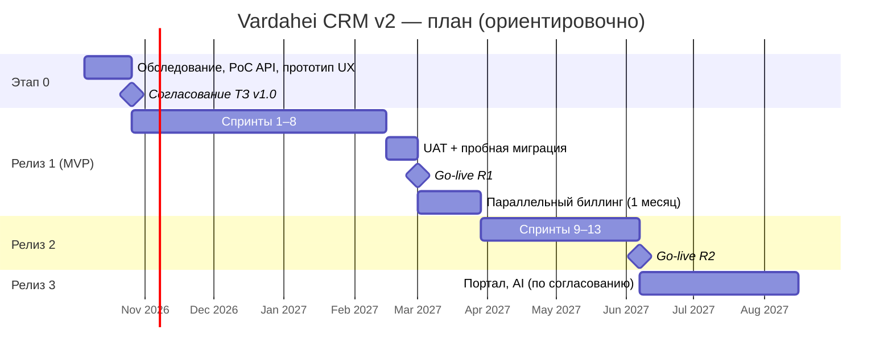

# 08. План работ и релизы

## 0. Состояние на 05.10.2026

**Пакет не выпущен и не принят.** Допуск к эксплуатации — [GO_LIVE](claude-opus/GO_LIVE.md): все условия `not_run`/NOT READY; сводка по gate DEV-23 — `claude-opus/evidence/DEV-23/gate-summary.md` (на момент записи файла ещё нет — DEV-23 не закрыт). Журнал работ — [PROGRESS](claude-opus/PROGRESS.md), сквозная трассировка — [TRACEABILITY](claude-opus/TRACEABILITY.md), задания — [backlog.json](claude-opus/backlog.json).

- **Сделано локально (статус `code_verified` в backlog.json):** DEV-00…DEV-22 (аудит 03.10.2026: [10-audit](10-audit-2026-10-03.md)). `code_verified` значит «проверено на локальной среде и синтетических данных разработчиком», а не «принято»: приёмка — UAT, независимая проверка и реальные среды ниже.
- **DEV-23** (допуск к выпуску и сопровождение): досье подготовлено (`code_verified`), допуск не дан — NO-GO по фактам досье.
- **Внешние gate** (копия из [external-gates.json](claude-opus/external-gates.json), ни один не `passed`; mock и локальные прогоны их не закрывают):

| Gate | Тема | Статус |
|---|---|---|
| EXT-01 | Бизнес-правила, данные и владельцы исключений | blocked |
| EXT-02 | Реальный Entra tenant и отзыв прав | blocked |
| EXT-03 | Контракты реальных поставщиков и сверка эффектов | blocked |
| EXT-04 | Учение восстановления и RPO/RTO | not_run |
| EXT-05 | Целевой масштаб и нагрузка | blocked |
| EXT-06 | Независимая проверка безопасности | blocked |
| EXT-07 | Персональные данные, retention и legal holds | not_run |
| EXT-08 | Обновление Power BI Service | not_run |
| EXT-09 | Репетиция миграции и сверка | blocked |
| EXT-10 | UAT и полный месячный параллельный биллинг | blocked |
| EXT-11 | Проверенная конфигурация выпуска и поддержка | not_run |

- Таблицы статусов спринтов в § 3.1a (на 16.09.2026) и § 5.1 (на 25.09.2026) — **исторические**: «Выполнен» означает, что функция реализована на ту дату. Что изменили DEV-01…DEV-22 после них, указано в примечаниях под таблицами. Определения готовности R1 (§ 3.3) — **не достигнуты**: нет UAT, параллельного биллинга, нагрузочного теста на согласованном объёме (EXT-05), независимой проверки (EXT-06).

## 1. Обзор

Даты сдвигаются вместе с датой старта; длительности — ориентир при команде из § 4.

## 2. Этап 0 — Обследование и PoC (3 недели)

| Работа | Результат |
|---|---|
| Интервью: руководство, продажи, сервис, финансы (по 1–2 сессии) | Карта процессов «как есть» и «как будет», подтверждённые роли |
| Разбор биллинга за последние 3 месяца на реальных данных | Каталог моделей цены, эталонные клиенты для «золотых» тестов |
| PoC Entra ID + BFF | Работающий вход с ролями в `test` |
| PoC Atera | Подтверждены: фильтры тикетов по дате, выгрузка рабочих часов, лимиты, наличие вебхуков на тарифе |
| PoC PowerOffice Go v2 | Получен Application Key; создание клиента и заказа в Demo; поиск заказа по внешней ссылке; чтение счетов/оплат |
| PoC Partner Center | Модель CSP (direct/indirect); SAM-consent; чтение подписок; GDAP-роль |
| Решение по ADR-001 (build vs Dynamics 365) | Сравнение стоимости владения на 3 года |
| UX-прототип (Figma): карточка 360°, воронка, прогон биллинга, табель | Согласованный прототип |
| DPIA, сроки хранения, юр. проверка | Протокол, согласованные сроки |
| Уточнённая оценка | ТЗ v1.0, бэклог R1 с оценками |

**Критерий выхода:** все пункты [PoC] в [05-integrations](05-integrations.md) подтверждены или имеют принятый обходной путь.

## 3. Релиз 1 — MVP

### 3.1 Спринты (по 2 недели)

| Спринт | Цель спринта | Ключевые требования |
|---|---|---|
| S1 | Фундамент | Репозиторий, CI/CD, Bicep `test`, Aspire, BFF-вход, роли, layout Fluent UI, аудит, i18n — FR-AUTH-01..03, FR-ADM-03 |
| S2 | Клиенты | Организации, контакты, Brreg, глобальный поиск, дубликаты, ядро интеграций (ExternalLink, SyncRun, rate limit) — FR-CUS-01..06, FR-GEN-01 |
| S3 | Связка с PowerOffice и Atera (клиенты) | Синхронизация клиентов/контактов/продуктов, экран сопоставлений, скрипты миграции v1 — INT-PO-01 (часть), INT-ATERA-01 (часть), FR-ADM-01/02 |
| S4 | Каталог и контракты | Продукты, прайс-листы, контракты, SLA, пакеты часов, продления — FR-CAT-01/02/04, FR-CON-01..04 |
| S5 | Сервис и время | Тикеты, агенты, алерты, рабочие часы из Atera, ручной ввод, согласование, тарификация — FR-SRV-01..03, FR-TIM-01..04 |
| S6 | Лицензии и продажи | CSP-подписки, импорт дистрибьютора, окно отмены и продления; лиды, сделки, воронка — FR-LIC-01/02/05, FR-SAL-01/02, FR-ACT-01 |
| S7 | Биллинг | Прогон: сбор, аномалии, проверка, утверждение, выгрузка в PowerOffice, синхронизация счетов и оплат — FR-BIL-01..04 |
| S8 | Готовность к запуску | Дашборды, экспорт, уведомления e-mail, нагрузочный тест, пентест, исправления, пробная миграция на `prod`-копии — FR-RPT-01, FR-GEN-02 |

### 3.1a Статус выполнения (на 16.09.2026)

| Спринт | Статус | Что сделано / что осталось |
|---|---|---|
| S1 Фундамент | ✅ Выполнен | Модульный монолит (.NET 10), BFF-вход через Entra ID + режим разработки, роли → права, CSRF и заголовки безопасности, журнал аудита, outbox, Hangfire, оболочка React/Fluent UI (nb/en/ru), Bicep (Container Apps, приватные SQL/Key Vault/Storage), CI/CD в GitHub Actions, миграции через Container Apps Job, скрипт регистрации в Entra, runbook первого развёртывания |
| S2 Клиенты | ✅ Выполнен | Организации (CRUD, оргномер MOD11, адреса, домены, мягкое удаление), контакты с ролями и связью с несколькими организациями, поиск в Brreg и ночная проверка статуса, карточка с историей изменений, «Мой день»; дубликаты (название без орг. формы, домен, почтовый домен, телефон), слияние с переносом контактов и отменой в течение 30 дней (FR-CUS-06); глобальный поиск по организациям и контактам (FR-GEN-01); экспорт в Excel с аудитом и лимитом 10 в час (FR-GEN-02); ежечасная синхронизация пользователей из Entra ID через Graph delta с блокировкой отключённых ≤ 60 с (BR-AUTH-05); журнал запусков интеграций и ручной запуск задач. Отложено: слияние дубликатов контактов без e-mail; Full-Text Search (сейчас LIKE — достаточно для объёмов NFR-04) |
| S3 Связка с PowerOffice и Atera | ✅ Выполнен (Atera — чтение) | Слой интеграций: внешние связи, снимки записей, очередь исходящих операций с повторами и dead letter. PowerOffice Go v2 по OpenAPI: токен, лимит 10 rps, инкрементальная синхронизация клиентов, контактных лиц и продуктов, автосвязь по оргномеру, создание клиента (с проверкой на существующий) и обновление JSON Patch только по полям CRM. Atera v3: синхронизация клиентов и контактов, автосвязь по оргномеру и e-mail; запись реализована, но выключена до PoC на ключе заказчика. Экран сопоставлений с подсказками, массовый импорт с предпросмотром (первичная миграция), связи в карточке, перенос связей при слиянии, настройка мастера реквизитов для счетов. Осталось: подтвердить на реальных ключах (runbook 02); исходящие контакты и custom values Atera перенесены и сделаны в S4 |
| Качество UI | ✅ Выполнен | Ленивые маршруты (первая загрузка 270 КБ gzip, бюджет в сборке); 13 сквозных тестов Playwright в CI; axe без серьёзных нарушений в обеих темах; работа с клавиатуры; карточки вместо таблиц на телефоне. Исправлено по находкам: падение журнала аудита на записях экспорта, потеря выбора языка при быстрой перезагрузке, подписи флажков ролей, возврат фокуса из диалогов, неразличимые кнопки «Оставить эту» и меню контактов, безымянные панели, смещение таблицы при потере фокуса поиском, страница ошибки вместо технического экрана |
| S4 Каталог и контракты | ✅ Выполнен | Каталог: продукты всех типов (лицензии Microsoft, сервисы, почасовые, пакеты часов, оборудование, пакеты из продуктов), себестоимость и маржа только для Finance/Management, запрет удаления используемых продуктов (BR-CAT-03), категории клиентов с наценкой, прайс-листы с периодом, запретом пересечения активных листов категории (BR-CAT-01), копированием с индексацией и расчётом цены лицензии от цены партнёра × курс × наценка (BR-CAT-02); сопоставление продуктов с PowerOffice по артикулу, импорт продуктов, предупреждение о несвязанном продукте (FR-CAT-04). Контракты: номера K-ГГГГ-NNNN, статусы Черновик → Активен → Приостановлен → Уведомление → Завершён, срок уведомления с проверкой самой ранней даты, автопродление и завершение ежедневной задачей (BR-CON-04), позиции с моделями количества и версиями при изменении цены (BR-CON-03), цена из контракта / прайс-листа / базовая, сумма в месяц (скрыта без finance.read); SLA-политики P1–P4; пакеты часов с журналом движений, списанием сверх остатка и напоминанием ниже 20 % (BR-CON-05); напоминания за 60/30/7 дней и о сроке уведомления в «Моём дне» (FR-CON-04); перенос контрактов при слиянии организаций. Интеграции: уровень SLA в поле Atera (выключено до PoC), контактные лица для счетов в PowerOffice (создание и JSON Patch). Отложено: подсчёт количества по Atera/M365/CSP — S5/S6 (сейчас оценочное количество); письмо контакту-ЛПР о малом остатке и e-mail-напоминания — S8; индексация (FR-CON-05) — R2 |
| S5 Сервис и время | ✅ Выполнен | Модуль Service: зеркало тикетов Atera (открытые — каждые 10 мин, недавние — ежечасно), устройства с ежедневным снимком количества по типам (BR-SRV-03) для позиций «за устройство», открытые критические алерты и предупреждения (BR-SRV-04), создание тикета из карточки клиента с созданием контакта в Atera при необходимости (BR-SRV-02; выключено до PoC — заявка получает понятную причину отказа). Модуль TimeTracking: импорт рабочих часов из тикетов (FR-TIM-01) с сопоставлением техников Atera и пользователей CRM по e-mail и вручную (BR-TIM-01), ручной учёт времени и недельный табель (FR-TIM-02), согласование ServiceLead с тарификацией по правилам BR-TIM-03 (не выставляется → покрыто SLA в пределах месячного лимита → пакет часов с делением записи → по ставке: контракт → прайс-лист → базовая), округление до 15 мин и минимальный выезд 1 ч (BR-TIM-04), коэффициент вне часов поддержки по календарю SLA (BR-TIM-06), отмена согласования с возвратом часов в пакет, закрытие и повторное открытие периода Finance с указанием причины (BR-TIM-05), поведение при изменении часов в Atera после согласования или выставления (BR-TIM-02). Первая загрузка снижена до 269 КБ — переводы грузятся по выбранному языку. Отложено: вебхуки Atera (тариф заказчика), SLA-отчёт (FR-SRV-04, R2), подсчёт лицензий M365 и CSP — S6 |
| S6 Лицензии и продажи | ✅ Выполнен | Модуль Licensing: CSP-подписки из Partner Center (только чтение: клиенты — ежедневно 02:40, подписки — каждые 4 часа) и импорт выгрузки дистрибьютора CSV с предпросмотром «что изменится» (BR-LIC-05; разделитель `;` или `,`, норвежские заголовки, неизвестные столбцы игнорируются с предупреждением), привязка к организации по сопоставленному клиенту → другой подписке того же клиента → точному совпадению по орг. номеру и названию (BR-LIC-01), окно отмены от даты покупки (BR-LIC-02, по умолчанию 168 ч — настраивается), предупреждение о продлении за 30 дней, признак «не выставляется» для подписок без продукта или без живой позиции контракта (BR-LIC-03); партнёрская цена только для finance.cost.read. Модуль Sales: этапы воронки с вероятностью (сеяные Квалификация 10 % … Выиграно/Проиграно), лиды с квалификацией, дисквалификацией и преобразованием в клиента вместе с первой сделкой, сделки с направлением и взвешенным прогнозом = (разовая сумма + MRR × min(срок, 12)) × вероятность (BR-SAL-01), обязательная причина проигрыша из справочника (BR-SAL-02), повторное открытие, отметка «нет активности 30 дней» (BR-SAL-03) в «Моём дне», доска воронки и прогноз по месяцам (суммы скрыты без finance.read). Модуль Activities: задачи, звонки, встречи и заметки по клиенту с необязательной привязкой к сделке или контракту, «Мои задачи» в «Моём дне», активность обновляет дату последней активности сделки. Отложено: запись в Partner Center (NCE-заказы, изменение количества, отмена) — R2, требуется PoC на ключе заказчика; подсчёт количества лицензий для позиций контракта «по CSP» — S7 (биллинг); e-mail-напоминания о продлении — S8 |
| S7 Биллинг | ✅ Выполнен | Модуль Billing: прогон за период (Черновик → Собран → На проверке → Утверждён → Выгружается → Выгружен / Выгружен с ошибками → Закрыт), один открытый прогон на период (BR-BIL-01). Сбор основания по клиенту: абонплата по позициям контрактов с учётом периодичности и предоплаты/постоплаты (месяц / квартал / год от месяца начала контракта), лицензии Microsoft с количеством из CSP-подписок на дату снимка, устройства из снимка Atera, часы «по ставке» из согласованных записей времени (детализация: дата, тикет, техник — BR-BIL-07), покупки пакетов часов, разовые позиции вручную; покрытые контрактом и списанные из пакета часы показываются информационно с нулевой суммой. Пересборка сохраняет ручные корректировки (BR-BIL-02); аномалии до утверждения: изменение суммы > ±20 %, позиция без цены, продукт или клиент без связи с PowerOffice, CSP-подписка без позиции контракта (BR-BIL-03). Утверждает Finance, суммы свыше порога (по умолчанию 200 000 NOK, настраивается) требуют второго утверждения Management (BR-BIL-04). После утверждения основание неизменяемо (BR-BIL-10) и уходит в очередь исходящих операций: заказ на продажу в PowerOffice с ключом `{период}-{клиент}-{прогон}` как внешней ссылкой — повторная отправка находит существующий заказ (BR-BIL-05), один заказ на клиента (BR-BIL-06), журнал попыток с причиной отказа и повторная отправка. Выгруженные часы получают статус «Выставлена» (BR-BIL-08); отмена основания возможна, пока заказ не создан (BR-BIL-09). Обратная синхронизация: исходящие счета PowerOffice раз в час (`20 * * * *`) с номером, датами, суммой и остатком; оплаты выводятся из уменьшения остатка; счета видны в карточке клиента и на экране «Счета» с задолженностью и просрочкой. Отложено: пропорциональный расчёт при изменении количества в середине периода (BR-BIL-05 спецификации, R2), подсчёт пользователей M365 через GDAP (R2, сейчас оценка из контракта с пометкой аномалии), сверка биллинга Microsoft (R2), кредит-ноты из CRM (R2) |
| S8 Готовность к запуску | ✅ Выполнен | Модуль Notifications: уведомления привязаны к человеку и хранятся как вид + параметры, поэтому читаются на языке получателя; напоминания по контрактам и пакетам часов приходят событием `ReminderRaised` сразу при создании, а ежедневный обход (`notification-scan`, 06:30) добавляет окна отмены и продления CSP, «замолчавшие» сделки (раз в неделю) и просроченные счета — получатель берётся из ответственного по контракту или менеджера клиента, повторы исключены ключом дедупликации. Ежечасная рассылка (`notification-digest`) собирает одно письмо на человека в выбранный им час (Europe/Oslo) и отправляет его через Microsoft Graph `sendMail` из общего ящика (`Notifications:FromAddress`, флаг `Notifications:EmailEnabled` выключен по умолчанию); если почта не настроена или вид уведомления отключён читателем, запись помечается «не отправлено», но остаётся в CRM. В интерфейсе: колокольчик в шапке со счётчиком и списком, страница «Уведомления» (Varsler) с настройками (письмо да/нет, час сводки, какие виды присылать). Модуль Reports: дашборд (FR-RPT-01) собирается из контрактов, биллинга, продаж, лицензий, сервиса и учёта времени через их контракты — своей схемы у модуля нет. Плитки MRR/ARR, задолженность и просрочка, взвешенный прогноз, лицензии и тикеты; столбчатая диаграмма выставленного по месяцам (SVG вручную, с таблицей для скринридеров), список продлений на 90 дней, загрузка техников с долей оплачиваемых часов, сводка по воронке и сервису. Суммы скрыты без `finance.read`, доступ — по праву `reports.read` (Admin, Management, Sales, ServiceLead, Finance). Нагрузочный тест: сценарий k6 «рабочий день» (`tools/load-test/workday.js`) с порогами NFR-01/01b. Исправлено по ходу: события с enum не доставлялись из outbox (строковые значения читались без конвертера), а повторяющийся номер заказа ломал синхронизацию счетов целиком. Отложено: Teams-уведомления и календарь/письма Outlook (R2, FR-ACT-02..04), пентест и пробная миграция на копии prod — организационные задачи Этапа приёмки |

> **Примечание после DEV-01…DEV-22 (история таблицы выше не переписана).** Ряд описанных здесь поведений изменён: ключ `{период}-{клиент}-{прогон}` больше не гарантирует отсутствие дублей между прогонами — уникальность начислений держит реестр (DEV-01/03, ADR-011/013); подписи Finance/Management привязаны к ревизии расчёта и двум разным людям (DEV-02, ADR-012); неизменяемость утверждённых оснований и аудита обеспечена правами БД и триггерами (DEV-04, ADR-014); события и повторы — DEV-07 (ADR-016); проверка `/health/ready` и heartbeat — DEV-06; «пентест, нагрузочный тест, пробная миграция» в S8 остаются внешними (EXT-06, EXT-05, EXT-09).

### 3.2 Запуск
1. UAT (2 недели) по сценариям уровня M.
2. Финальная миграция данных (выходные), сверка количества и ключевых сумм.
3. Go-live: все роли начинают работу в CRM; Atera и PowerOffice — без изменений процессов для техников и бухгалтерии, кроме выгрузки заказов.
4. **Параллельный биллинг** — 1 месячный цикл: счёт готовится старым способом и через CRM, расхождения разбираются ежедневно. Отказ от старого процесса — после нулевого (или объяснённого) расхождения.

### 3.3 Критерии готовности R1 (Definition of Done релиза)
- Все требования R1 с приоритетом M реализованы и приняты на UAT.
- Параллельный биллинг завершён без необъяснённых расхождений.
- NFR-01..04 подтверждены нагрузочным тестом; пентест без Critical/High.
- Runbooks 1–7 ([07 § 4.4](07-nfr-devops.md#44-runbooks-обязательны-к-запуску-r1)) написаны и один раз отработаны.
- Пользователи обучены (по ролям), руководство администратора передано.

## 4. Команда и трудоёмкость

| Роль | Этап 0 | R1 | R2 |
|---|---|---|---|
| Product Owner (со стороны Компании) | 0,5 | 0,2 | 0,2 |
| Техлид / архитектор (.NET, Azure, DevOps) | 1,0 | 1,0 | 1,0 |
| Backend-разработчик (.NET) | — | 1,0 | 1,0 |
| Full-stack разработчик (React + .NET) | 0,5 (прототип) | 1,0 | 1,0 |
| QA-инженер (автотесты) | — | 0,5 | 0,5 |
| Бизнес-аналитик / UX | 1,0 | 0,5 | 0,3 |
| Ключевые пользователи (Finance, ServiceLead, Sales) | 0,3 | 0,2 (демо, UAT) | 0,1 |

**Ориентировочная трудоёмкость разработки (без PO и ключевых пользователей):**
- Этап 0: ~3 чел.-нед.
- R1: ~16 недель × 4 FTE ≈ **64 чел.-нед. (≈ 2 400 ч)**, неопределённость ±30 % до завершения Этапа 0.
- R2: ~10 недель × 3,8 FTE ≈ **38 чел.-нед. (≈ 1 450 ч)**.

## 5. Релиз 2

| Спринт | Цель | Требования |
|---|---|---|
| S9 | Предложения | Редактор, шаблоны PDF, версии, утверждение скидок, отправка через Outlook — FR-SAL-03..05 |
| S10 | Microsoft 365 для сотрудников | Календарь, письма, SharePoint-папки, Teams-уведомления (Workflows + activity feed) — FR-ACT-02..04, FR-DOC-01 |
| S11 | Лицензии+ | GDAP «куплено/назначено», `PerM365User`, импорт прайс-листа NCE, сверка Microsoft billing — FR-LIC-03/04, FR-CAT-03 |
| S12 | Проекты и контракты+ | Проекты, индексация KPI, proration, иерархия организаций — FR-PRJ-01, FR-CON-05, FR-BIL-05, FR-CUS-07 |
| S13 | Аналитика | SLA-отчёт, маржинальность, витрина Power BI, пользовательские поля — FR-SRV-04, FR-RPT-02/03, FR-ADM-04 |

### 5.1 Статус выполнения R2 (на 25.09.2026)

| Спринт | Статус | Что сделано / что осталось |
|---|---|---|
| S9 Предложения | ✅ Выполнен | Предложения в модуле Sales: номер `T-ГГГГ-NNNN`, версии (одна запись на версию, общий `RootId`; править можно только черновик, отправленная версия неизменяема — BR-SAL-04), позиции из каталога или свободным текстом с зафиксированной ценой прайс-листа категории клиента (BR-SAL-06), разделение на месячные и разовые. Скидка выше `Sales:DiscountLimitPercent` (15 %) требует согласования правом `sales.discount.approve` — до согласования документа нет (BR-SAL-05), отклонение возвращает предложение в черновик с причиной. PDF формируется из версии при скачивании собственным писателем (ядровые шрифты Helvetica, nb/en) — без внешней библиотеки и лицензии; шаблоны вступления, условий и колонтитула по языкам правит администратор. Отправка (FR-SAL-04) — Graph `sendMail` из ящика продавца с PDF во вложении и `saveToSentItems: true` (флаг `Sales:EmailEnabled`, ящик должен быть в политике доступа приложения); иначе PDF скачивают и отправляют из Outlook. «Принято» (BR-SAL-07) выигрывает сделку, создаёт контракт-черновик из месячных позиций и ставит разовые в очередь `billing.PendingCharges`, которую забирает ближайший прогон и закрывает только после выгрузки заказа. Ежедневная задача `quote-expiry` помечает просроченные. В интерфейсе: список с очередью согласования, редактор с суммами и предупреждением о превышении скидки, история версий, панель предложений в карточке клиента и в сделке, экран шаблонов. Отложено: подпись клиента онлайн и портал (R3), отправка через delegated `Mail.Send` (S10, если политика доступа к ящикам продавцов не подойдёт) |
| S10 Microsoft 365 для сотрудников | ✅ Выполнен | Делегированный доступ к Graph от имени вошедшего сотрудника (токен из кэша BFF; в worker и в режиме разработки его нет, и функции отвечают «не подключено»). Встречи (FR-ACT-02): длительность, место и переключатель «Добавить в мой календарь Outlook» — событие создаётся у организатора с приглашением контакта, идентификатор активности лежит в открытом расширении `no.vardahei.crm`, правка и удаление доходят до Outlook, кнопка «Получить изменения из Outlook» переносит в CRM перенос, переименование и отмену. Почта (FR-ACT-03): вкладка «Почта» читает ящик сотрудника и настроенные общие ящики по адресам контактов и доменам клиента; «Сохранить в CRM» создаёт активность-письмо с темой, отправителем, временем и ссылкой — без тела, одно письмо сохраняется один раз. Документы (FR-DOC-01): папка `Название (оргномер)` создаётся в библиотеке SharePoint, когда организация становится клиентом или партнёром, переименовывается вслед за организацией, связь — в `ExternalLink`; вкладка «Документы» показывает содержимое и ведёт в SharePoint. Teams (FR-ACT-04): сообщения в каналы через вебхук Power Automate Workflows — выигранная сделка дороже порога в «Salg», утверждённый прогон в «Økonomi». Всё выключено по умолчанию (`CalendarEnabled`, `MailEnabled`, `SharePoint:Enabled`, `Teams:Enabled`). Отложено: персональные уведомления в ленте активности Teams (нужно приложение Teams и PoC), change notifications календаря (публичный эндпоинт и продление подписок — R3), привязка писем из общих ящиков без прав сотрудника |
| S11 Лицензии+ | ✅ Выполнен | «Куплено / назначено» по SKU из тенантов клиентов через GDAP (`partnercenter-licenses`, `subscribedskus`, снимок раз в сутки на клиента и SKU): вкладка «Использование лицензий» с фильтром «только неиспользуемые 30 дней» — рекомендация видна лишь когда снимки покрывают весь период (BR-LIC-04). Эти же числа берёт биллинг: `PerM365User` считает назначенные лицензии на дату прогона, без снимка — оценка контракта и аномалия `BIL_ESTIMATED_QUANTITY` (BR-CON-02). Сверка с Microsoft (FR-LIC-04): `partnercenter-billing` тянет экспорт `billed reconciliation` через Graph по счетам за два последних месяца (флаг `BillingReconciliationEnabled`), индиректная модель грузит файл дистрибьютора — строки идемпотентны по ключу `источник:счёт:подписка:предложение:период` и привязываются к организации через CSP-подписку; отчёт за месяц показывает затраты, выставленную выручку, маржу и строку «не выставлено» (право `finance.cost.read`). Импорт прайс-листа NCE (FR-CAT-03): продукты находятся по Microsoft offer id (`ProductId:SkuId`), строка выбирается по сроку обязательства, цена считается по BR-CAT-02 с явным курсом и наценкой категории, `?dryRun=true` показывает новые цены — запись только в черновик прайс-листа. Отложено: изменение количества подписок из CRM (R3), Price sheet API вместо файла (после PoC модели участия), сверка построчно «позиция Microsoft ↔ позиция счёта клиента» |
| S12 Проекты и контракты+ | ✅ Выполнен | Модуль Projects (FR-PRJ-01): проект `P-ГГГГ-NNNN` с типом, руководителем, бюджетом часов и денег, этапами и задачами; часы живут в модуле времени и ссылаются на проект, поэтому план/факт совпадает с табелем (BR-PRJ-01), этап не закрыть с открытыми задачами (BR-PRJ-02), а завершение этапа с суммой ставит разовую позицию в `billing.PendingCharges` — как принятое предложение — и возврат этапа в работу её снимает, пока прогон не выгружен (BR-PRJ-03). Индексация цен (FR-CON-05): экран с процентом и датой, предпросмотр «было/стало» по месяцу для контрактов с индексацией, у которых подошёл срок; меняются только позиции с собственной ценой, каждая получает новую версию с даты, срок следующей индексации сдвигается на год (BR-CON-06). Пропорциональный расчёт (FR-BIL-05): позиция, действующая часть периода, считается по дням, изменение в середине периода даёт две версии, доли которых в сумме дают один период (BR-BIL-11). Иерархия организаций (FR-CUS-07): дерево «концерн → дочерние» без циклов, флаг «счёт выставляется материнской» переносит позиции дочерней в основание материнской с префиксом названия (BR-CUS-08, BR-BIL-12). Отложено: шаблоны проектов с типовыми задачами (R3), пропорция при изменении количества CSP-подписки в середине периода (нужна история количеств из Partner Center) |
| S13 Аналитика | ✅ Выполнен | SLA-отчёт (FR-SRV-04): время реакции и решения считается только внутри окна поддержки политики SLA контракта и никогда в выходные и норвежские праздники (BR-SRV-05) — праздники вычисляются от Пасхи, приоритеты Atera сопоставлены с P1–P4, у клиента без политики заявки считаются отдельно. Маржа по клиентам (FR-RPT-02): выставлено − затраты Microsoft (из строк FR-LIC-04) − часы × внутренняя стоимость часа (`Reports:InternalHourlyCost`), клиент с выставленными лицензиями без загруженных затрат помечается, окно 1/3/6/12 месяцев. Витрина для Power BI (FR-RPT-03): `GET /api/v1/reports/mart/{набор}` в JSON или CSV, восемь наборов, право `reports.mart` и общий лимит экспорта; прямого доступа к SQL нет, всё идёт через контракты модулей, поэтому у отчёта и модуля не может быть разных чисел. Свои поля (FR-ADM-04): новый модуль `customfields` — определения для клиентов, сделок и контрактов (текст, число, дата, да/нет, список) с ключом, порядком, подсказкой и обязательностью; значения проверяются по типу и живут по `(тип записи, id)` без внешних ключей, так что ни один модуль о них не знает. Отложено: конструктор дашбордов и выгрузка отчётов в PDF (R3), пакетная выгрузка витрины через OData (после PoC у аналитика) |
| Готовность к запуску | ✅ Выполнен | Работы, которые R2 оставил на «перед запуском»: миграция клиентов из старых систем (экран «Миграция», ТЗ §6.6 — сопоставление по оргномеру → домену → названию, неоднозначные строки в отчёт, `?dryRun=true`, право `customers.delete`, запись в аудит), приостановка интеграции во время инцидента без деплоя (задания пишут прогон «Пропущено», очередь исходящих ждёт — runbook 05) и `/health/integrations` для мониторинга (последний прогон, пауза, операции с ошибками; readiness не трогает — NFR §4.3). Написаны runbooks 03–07: восстановление БД на момент времени, неполная биллинг-выгрузка, пауза интеграции, инцидент безопасности, ручной биллинг. Осталось организационное: пентест, нагрузочный тест на боевых объёмах, пробная миграция на копии prod, UAT и месяц параллельного биллинга |

> **Примечание после DEV-01…DEV-22 (история таблицы выше не переписана).** PDF предложения больше не формируется при скачивании: при выпуске версии сохраняется неизменяемый документ с SHA-256, скачивание и вложение читают его (DEV-08, ADR-017). Для Power BI Service целевой путь — `/api/v1/bi/v1` с Entra-токеном и снимки закрытых месяцев (DEV-14, ADR-022); `/api/v1/reports/mart` остаётся прежним cookie-путём. Видимость предложений и проектов зависит от записевого охвата (DEV-09, ADR-018). Что «осталось организационное» (пентест, нагрузка, пробная миграция, UAT, параллельный биллинг) — по-прежнему открыто: EXT-06, EXT-05, EXT-09, EXT-10; инструменты и сценарии для них подготовлены локально (DEV-16, DEV-20, DEV-21, DEV-22).

## 6. Релиз 3 (кандидаты, требуют отдельной оценки)
- Клиентский портал (Entra External ID): счета, лицензии, тикеты, заявки на изменение количества лицензий.
- Изменение количества CSP-подписок из CRM/портала через Partner Center API (с утверждением).
- AI-ассистент: сводка по клиенту, черновик ответа/предложения, поиск по базе знаний (Azure OpenAI, EU Data Zone).
- Outlook add-in «Сохранить письмо в CRM», Teams-вкладка с карточкой клиента.

## 7. Риски

| # | Риск | Вероятность | Влияние | Митигирующие меры |
|---|---|---|---|---|
| R-01 | API Atera не даёт инкрементальной выборки тикетов/часов или ограничен тарифом | Средняя | Высокое | PoC на Этапе 0; ночной полный проход за окно 60 дней; бюджет запросов под 700/мин |
| R-02 | Привилегии PowerOffice v2 не покрывают нужные операции (заказы, поиск по внешней ссылке) | Низкая–средняя | Высокое | PoC в Demo; альтернатива — черновики исходящих счетов; контакт go-api@poweroffice.no |
| R-03 | Сложность Secure Application Model / индиректная модель CSP без billing API | Средняя | Среднее | Импорт от дистрибьютора в R1; SAM — отдельная задача PoC |
| R-04 | Низкое качество исходных данных, сложное сопоставление клиентов между системами | Высокая | Среднее | Очередь ручного сопоставления, отчёт расхождений, оргномер как главный ключ, пробная миграция |
| R-05 | Ошибки биллинга подрывают доверие | Средняя | Высокое | «Золотые» тесты, аномалии, двойное утверждение, параллельный биллинг |
| R-06 | Расползание объёма R1 | Высокая | Высокое | MoSCoW, PO принимает решения, изменения — только через бэклог R2 |
| R-07 | Широкие права API-ключа Atera (RMM) — последствия утечки | Низкая | Критическое | Key Vault, минимум мест использования, мониторинг объёма, ротация, изоляция `test` |
| R-08 | Изменения API Microsoft/Atera/PowerOffice | Средняя | Среднее | Anti-corruption layer, ночной smoke, подписка на changelog |
| R-09 | Зависимость от одного техлида | Средняя | Высокое | ADR и документация в репозитории, парная работа, code review |
| R-10 | Низкое принятие пользователями | Средняя | Среднее | Прототип с ключевыми пользователями, демо каждые 2 недели, «Мой день» как стартовая страница, интеграция в Teams (R2) |
| R-11 | Стоимость Dynamics 365 оказывается ниже TCO разработки | Низкая–средняя | Высокое | Решение по ADR-001 до начала R1 |
