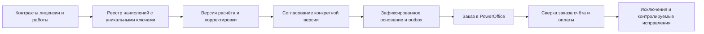

# Аудит Vardahei CRM v2 и план готовности к концу 2026 года

Дата оценки: **3 октября 2026 года**. Адресат: руководитель компании, владелец продукта и команда разработки.

**Вывод: проект имеет хорошую архитектурную и функциональную основу, но пока не готов быть единственным доверенным источником расчётов для рабочего биллинга.** Воспроизведены ошибки повторного начисления и согласования. Эксплуатационные гарантии частично существуют только в документации. Рекомендация — сохранить модульный монолит и выделить оставшуюся часть 2026 года на финансовую корректность, безопасность и проверяемую эксплуатационную готовность.

Проект уже охватывает основную цепочку IT-компании: клиент → продажа → предложение → контракт → лицензии и работы → расчёт → заказ в PowerOffice → статус счёта. Полноценность продукта должна означать надёжность этой цепочки, объяснимость каждой суммы и удобство ежедневной работы. Количество экранов само по себе этого не доказывает.

Конец 2026 года — целевой горизонт. Этот отчёт использует стандарты и источники, доступные на дату проверки; будущие изменения нормативных требований не предполагаются известными.

## Область и доказательства проверки

Проверены документация, структура модулей, выборочные критические пути серверного кода, интерфейс и его тесты, миграции, инфраструктура Bicep, процессы CI/CD и инструкции эксплуатации. Особое внимание уделено деньгам, правам, повторной обработке событий и восстановлению.

Выполнены локальная сборка и существующие автоматические проверки. Интеграционные тесты использовали отдельный SQL Server в Testcontainers и заглушки API. Браузерные тесты запускались на новой временной базе с локальными заглушками; контейнер после проверки удалён. Для найденных дефектов биллинга дополнительно выполнены четыре небольших воспроизведения на собранных доменных классах без рабочих данных.

| Проверка | Фактический результат |
|---|---|
| Сборка решения .NET, Debug | Успешна, 0 ошибок и 0 предупреждений |
| Серверные unit-тесты | 252 из 252 прошли |
| Архитектурные тесты | 54 из 54 прошли |
| Интеграционные тесты | 80 из 80 прошли |
| Проверка интерфейса | ESLint и TypeScript прошли |
| Unit-тесты интерфейса | 29 из 29 прошли, 9 файлов |
| Production-сборка интерфейса | Успешна; начальная загрузка по штатному скрипту 282,7 КБ gzip при бюджете 300 КБ |
| Полный браузерный прогон | 37 из 38 прошли; один сценарий столкнулся с уже занятым периодом 2040-01 |
| Повтор упавшего сценария отдельно | Прошёл; проблема общего прогона связана с изоляцией тестовых данных |
| Bicep, основной шаблон и параметры test/prod | Локальная компиляция успешна; развёртывание в Azure не выполнялось |
| NuGet, включая транзитивные зависимости | Проверка сообщила об отсутствии известных уязвимых пакетов в доступных источниках |
| npm audit, включая зависимости разработки | 0 известных уязвимостей; выполнен после разрешения пользователя на отправку метаданных пакетов |
| Дополнительные воспроизведения биллинга | Подтверждены все четыре проверенные ошибки; результаты ниже |

Это **не** измерение фактического SLA и не полный пентест. Не проверялись действующая конфигурация Azure/Entra, реальные ключи и контракты API Atera/PowerOffice/Microsoft, производственные данные, юридические документы компании, восстановление облачной базы и нагрузка целевого масштаба. Полный UI/UX-аудит с пользователями и ручная проверка доступности также не выполнялись. Успех сканеров зависимостей означает отсутствие известных находок в этих проверках, а не отсутствие уязвимостей вообще.

В предоставленном локальном Git-репозитории **нет ни одного коммита**, исходники не отслеживаются. Поэтому оценка относится к содержимому рабочей папки на момент проверки, а не к воспроизводимому релизу с идентификатором коммита. Это не доказывает отсутствие истории или резервной копии в другом месте.

## Сильные стороны

1. **Подходящая архитектура для заявленного масштаба.** Модульный монолит, отдельные контексты и схемы данных, публичные контракты модулей и отдельный worker позволяют развивать систему небольшой командой. Для предполагаемых 10–100 сотрудников переход к микросервисам сейчас не обоснован измерениями.
2. **Хорошо выбран центр бизнес-ценности.** Контракты, лицензии и отработанные часы связаны с выставлением счетов. В документации уже есть измеримые цели: не терять оплачиваемые работы, укладывать биллинг в два рабочих дня, контролировать продления.
3. **Разделены системы — владельцы данных.** CRM управляет клиентскими и договорными данными, Atera остаётся сервисной системой, PowerOffice — бухгалтерской. Это снижает объём дублируемых функций и число конфликтов ответственности.
4. **Содержательная основа безопасности.** Entra/BFF, серверное хранение токенов, защищённая cookie, CSRF-заголовок, серверное скрытие финансовых полей, права API, проверки конкурентных изменений. Режим свободного выбора роли запрещён вне Development. Защиту нужно довести до согласованных гарантий, но начинать с нуля не требуется.
5. **Интеграции спроектированы с учётом сбоев.** Есть outbox, очередь исходящих операций, попытки, журналы синхронизации, курсоры, сопоставления, предпросмотр импорта, флаги записи и пауза интеграции. Отдельно ценен подход с сохранением метаданных почты вместо копирования почтовых тел.
6. **Качество уже проверяется автоматически.** Реальные SQL-интеграционные тесты, браузерные сценарии, проверки доступности, тёмной темы и мобильного представления; ограничения размера интерфейса и компиляция инфраструктуры. Документация и runbooks существенно полнее, чем у обычного раннего прототипа.

## Оценка зрелости продукта

| Область | Оценка по фактическим свидетельствам | Что требуется для доверия |
|---|---|---|
| Архитектура | Хорошая основа | Закрыть пробелы в правилах границ и транзакционных гарантиях |
| Функциональное покрытие | Широкое для IT-компании | Подтвердить процессы и исключения с Finance, Sales и ServiceLead |
| Финансовая корректность | Есть блокеры эксплуатации | Исправить повторные начисления и согласования; провести параллельный расчёт |
| Безопасность | Базовые механизмы реализованы | Права на записи, отзыв ролей, защита аудита, проверка реальной Entra-конфигурации |
| Эксплуатация | Подготовлена, но не доказана | Рабочая readiness, алерты, восстановление, выпуск только проверенных сборок |
| Интерфейс | Автоматические сценарии в основном проходят | UAT по ролям, полная пагинация, понятные итоги, реальные браузеры пользователей |
| Управление продуктом | Хорошая спецификация, много допущений | Владельцы процессов, подтверждённый объём, журнал приёмки и границы релиза |

Проценты готовности не присваиваются: в репозитории нет полной трассировки «требование → реализация → проверка → приёмка заказчиком», на которой можно было бы построить такую оценку.

## Приоритетные дефекты и решения

**P1** здесь означает препятствие безопасному запуску соответствующей функции. Это приоритет продукта, а не CVSS-оценка. **P2** — значимый недостаток, который нужно устранить до заявленной полноты соответствующей функции или масштабирования.

### Повторное начисление при пересборке расчёта

**A01 · P1 · Воспроизведено.** Исходная позиция на 1 000 NOK корректируется вручную до 900 NOK. Повторный сбор сохраняет изменённую строку и добавляет исходную снова. Получается **две строки на 1 900 NOK** вместо сохранённой корректировки на 900 NOK.

Причина: [BillingBasis.cs:79](/Users/vardahei/Vardahei_CRM_V2/src/Modules/Billing/Crm.Billing/Domain/BillingBasis.cs:79) исключает вручную изменённые позиции из удаления, но затем без сопоставления добавляет все новые исходные позиции. Один флаг ManuallyAdjusted обозначает и самостоятельную ручную строку, и корректировку строки источника.

**Решение:** ввести стабильный идентификатор начисления по источнику и покрываемому периоду; отдельно хранить исходный расчёт и ручную корректировку с причиной. Пересборка должна обновлять исходный расчёт по ключу, сохранять корректировку и не создавать второе начисление. Проверить идемпотентность повторного сбора, изменения количества, цены и удаления строки.

### Нарушение правил согласования

**A02 · P1 · Три сценария воспроизведены на доменных классах; маршруты и сервисы проверены по коду.**

| Сценарий | Полученный результат | Почему это опасно |
|---|---|---|
| Один пользователь сначала выполняет второе утверждение, затем первое | Approved, идентификаторы согласующих одинаковы | Проверка разных людей работает только в одном порядке вызовов; сценарий доступен роли Admin или сочетанию прав |
| Первое утверждение → пересборка → утверждение другим человеком | Approved, первое согласование сохранено | Согласование относится к предыдущему содержимому расчёта |
| Сбор ниже порога → ручная строка на 300 000 NOK → первое утверждение | Approved, RequiresSecondApproval = false | Превышение порога после ручной правки не запускает второе согласование |

Доказательства: [BillingRun.cs:65](/Users/vardahei/Vardahei_CRM_V2/src/Modules/Billing/Crm.Billing/Domain/BillingRun.cs:65), [BillingRun.cs:88](/Users/vardahei/Vardahei_CRM_V2/src/Modules/Billing/Crm.Billing/Domain/BillingRun.cs:88), [BillingService.cs:334](/Users/vardahei/Vardahei_CRM_V2/src/Modules/Billing/Crm.Billing/Features/BillingService.cs:334), [BillingCollector.cs:234](/Users/vardahei/Vardahei_CRM_V2/src/Modules/Billing/Crm.Billing/Features/BillingCollector.cs:234). Штатный unit-тест проверяет совпадение людей только при обычном порядке согласования.

**Решение:** согласовывать конкретную ревизию расчёта. Любое изменение состава или суммы аннулирует согласования. Проверять разных людей при обоих переходах, отклонять пустого согласующего, определять необходимость второго утверждения по текущей сумме внутри транзакции утверждения. Передавать и проверять версию расчёта в командах согласования. Добавить проверки перестановок действий и конкурентных изменений.

### Повторный расчёт закрытого месяца

**A03 · P1 · Статический анализ, отдельный сквозной сценарий не выполнялся.** После закрытия прогона сервис позволяет создать другой прогон за тот же месяц. Контрактные начисления и покупки пакетов часов выбираются заново по периоду. Их уже состоявшееся выставление в другом прогоне не исключается. Новый runId создаёт новый ключ экспорта, поэтому защита от повторной отправки одного основания не защищает от повторного экономического начисления.

Доказательства: [BillingService.cs:74](/Users/vardahei/Vardahei_CRM_V2/src/Modules/Billing/Crm.Billing/Features/BillingService.cs:74), [BillingCollector.cs:40](/Users/vardahei/Vardahei_CRM_V2/src/Modules/Billing/Crm.Billing/Features/BillingCollector.cs:40), [ReminderFeatures.cs:328](/Users/vardahei/Vardahei_CRM_V2/src/Modules/Contracts/Crm.Contracts/Features/ReminderFeatures.cs:328), [ReminderFeatures.cs:495](/Users/vardahei/Vardahei_CRM_V2/src/Modules/Contracts/Crm.Contracts/Features/ReminderFeatures.cs:495), [BillingBasis.cs:66](/Users/vardahei/Vardahei_CRM_V2/src/Modules/Billing/Crm.Billing/Domain/BillingBasis.cs:66).

**Решение:** до появления корректирующего механизма запрещать повторное обычное начисление за закрытый период. Затем ввести журнал начислений с уникальностью по источнику, периоду услуги и виду начисления; дополнительный прогон должен брать только невыставленные начисления либо оформлять явную корректировку. Отдельно проверить аванс, квартальные/годовые платежи, proration и повторные покупки пакетов.

### Журнал аудита не защищён от изменения в базе

**A04 · P1 · Подтверждено кодом назначения прав.** Приложение получает db_datawriter на базу. Это даёт возможность обновлять и удалять строки аудита; исключение для audit.AuditEntries не найдено. Заявленные в документации запреты удаления аудита и триггер неизменяемости финансовых оснований отсутствуют в просмотренных миграциях.

Доказательства: [DatabaseMigrator.cs:58](/Users/vardahei/Vardahei_CRM_V2/src/Hosts/Crm.Web/Http/DatabaseMigrator.cs:58), [требования безопасности](/Users/vardahei/Vardahei_CRM_V2/docs/06-security.md). Речь о правах SQL-идентичности приложения; это не утверждение о наличии пользовательской кнопки удаления аудита.

**Решение:** явные права по схемам/таблицам, приложению — INSERT и необходимый SELECT на аудит, запрет UPDATE/DELETE; отдельная контролируемая роль для регламентного хранения. Защитить зафиксированные финансовые снимки на уровне БД. Добавить тесты с реальной ролью приложения, независимый экспорт событий и контроль целостности. Разделить web и worker по необходимым полномочиям: сейчас они используют общую managed identity.

### Выпуск не зависит от успешной проверки версии

**A05 · P1 · Подтверждено workflow.** CI и Deploy независимо запускаются при push в main. Ручной production-выпуск также не проверяет успешный CI именно для выбранного коммита и заново собирает образы. Требование обязательного согласования prod описано комментарием; наличие reviewers в настройках GitHub из файлов подтвердить нельзя.

Доказательство: [deploy.yml:4](/Users/vardahei/Vardahei_CRM_V2/.github/workflows/deploy.yml:4).

**Решение:** единая цепочка проверка → неизменяемый артефакт → test → smoke/UAT → prod. Продвигать один и тот же digest контейнера. Проверять ветку и происхождение артефакта, записывать состав релиза, иметь SBOM и план отката. Миграции выполнять по expand/contract и проверять совместимость с предыдущей версией. Сохранить исходный baseline в Git после проверки секретов и настроить защиту ветки.

### Готовность сервиса не отражает доступность базы

**A06 · P1 · Подтверждено регистрацией health checks.** Зарегистрирована только self-проверка, всегда возвращающая Healthy. Readiness включает эту же проверку; проверок SQL и актуальности схем не найдено. Поэтому контейнер может пройти deployment smoke test, хотя пользовательские операции с базой не работают.

Доказательство: [ServiceDefaultsExtensions.cs:25](/Users/vardahei/Vardahei_CRM_V2/src/Hosts/Crm.ServiceDefaults/ServiceDefaultsExtensions.cs:25).

**Решение:** отделить жизнеспособность процесса от готовности принимать запросы. Для readiness проверять SQL и необходимые локальные зависимости с коротким таймаутом; для worker отдельно отслеживать heartbeat, возраст очереди и выполнений заданий. Недоступность Atera/PowerOffice не должна сама по себе выключать независимые функции CRM. Дополнить smoke test реальным чтением и контролируемой записью в тестовой среде.

### События перестают обрабатываться после исчерпания попыток

**A07 · P1 · Подтверждено кодом outbox.** После десяти неудач доменное событие больше не выбирается обработчиком. Оно остаётся в таблице, но не найден штатный интерфейс его разбора и повторного запуска. Возможности dead letter у очереди исходящих интеграционных операций не закрывают этот отдельный путь доставки. В инфраструктуре мониторинга найдены хранилище логов и Application Insights, но не правила оповещения и адресаты для этих отказов.

Доказательства: [OutboxProcessor.cs:73](/Users/vardahei/Vardahei_CRM_V2/src/BuildingBlocks/Crm.Infrastructure/Outbox/OutboxProcessor.cs:73), [monitoring.bicep](/Users/vardahei/Vardahei_CRM_V2/infra/modules/monitoring.bicep).

**Решение:** состояние dead letter и безопасный replay для outbox, контролируемые задержки повторов, метрики глубины/возраста/неуспеха и ответственный за алерты. Для каждого потребителя — уникальность результата по идентификатору события или inbox. Испытать остановку worker до и после внешнего эффекта, истечение аренды сообщения, обработку двумя исполнителями и возвращение внешнего API после длительного сбоя.

## Остальные существенные риски

| ID и приоритет | Что найдено и основание | Предлагаемое решение |
|---|---|---|
| A08 · P1 для документов предложений | PDF отправленной версии получает текущие реквизиты клиента, контакт, владельца, footer текущего шаблона и настройки компании. Изменение этих данных меняет повторно скачанный документ. [QuoteService.cs:416](/Users/vardahei/Vardahei_CRM_V2/src/Modules/Sales/Crm.Sales/Features/QuoteService.cs:416) | При выпуске фиксировать весь документный снимок и версию шаблона; хранить отправленный PDF и его hash. Это также защищает от изменения рендера в будущей версии кода |
| A09 · P1 при заявленном ограничении на свои записи | SEC-AZ-03 обещает Sales только свои предложения и Technician назначенные проекты. Фильтр MineOnly добровольный; обработка по id не реализует это ограничение. В проектах фильтр исполнителя не найден. [QuoteService.cs:111](/Users/vardahei/Vardahei_CRM_V2/src/Modules/Sales/Crm.Sales/Features/QuoteService.cs:111), [ProjectFeatures.cs:175](/Users/vardahei/Vardahei_CRM_V2/src/Modules/Projects/Crm.Projects/Features/ProjectFeatures.cs:175) | Согласовать модель видимости: компания, команда, ответственный. Применять обязательную проверку к спискам, карточкам, поиску, экспорту, документам и изменениям. Если всей компании разрешено видеть все записи, явно исправить требования |
| A10 · P1 до широкого переноса персональных данных | Не обнаружены законченные процедуры выгрузки всех данных субъекта, анонимизации и автоматического применения сроков хранения, обещанные SEC-GDPR-03/04/05. В аудит также пишутся значения изменённых полей | Реализовать поиск данных субъекта по модулям, выгрузку, ограничение обработки, анонимизацию и регламент удаления. Учесть аудит, external snapshots, очереди и резервные копии; исключения для сохраняемых финансовых документов согласовать с ответственным за персональные данные |
| A11 · P2, финансовая отчётность | Сумма задолженности и просрочки на странице счетов считается после Take, по умолчанию по 100 записям, максимум по 500. Это не общий итог фильтра. [BillingService.cs:289](/Users/vardahei/Vardahei_CRM_V2/src/Modules/Billing/Crm.Billing/Features/BillingService.cs:289) | Агрегаты считать отдельным SQL-запросом до пагинации. Выдавать totalCount и курсор. Проверить страницу на 501+ счетах и явно подписывать область любых частичных итогов |
| A12 · P1 для восстановления | Runbook предлагает оставить web работающим после остановки worker, но не переводит API в read-only. Имена ресурсов не совпадают с шаблонами: crm-worker против ca-crm-worker-prod; у SQL-шаблона есть суффикс. [runbook восстановления:7](/Users/vardahei/Vardahei_CRM_V2/docs/runbooks/03-database-restore.md:7) | Сделать проверяемую процедуру с обнаружением имён ресурсов, запретом всех записей, журналом внешних эффектов и сверкой PowerOffice перед повторной обработкой. Выполнить учение и измерить RTO/RPO |
| A13 · P2 для Power BI | Витрина выдаёт JSON/CSV за интерактивной BFF-cookie; отдельной проверки bearer-токена и подтверждённого обновления из Power BI Service не найдено. Сам endpoint ещё не доказывает работающую BI-интеграцию. [ReportsModule.cs:36](/Users/vardahei/Vardahei_CRM_V2/src/Modules/Reports/Crm.Reports/ReportsModule.cs:36) | Проверить реальное плановое обновление. Выбрать защищённый read API с Entra audience/scopes и подходящим коннектором либо контролируемую выгрузку в аналитическое хранилище. Исторические снимки и определения показателей хранить явно |
| A14 · P2 для достоверности тестов | Браузерные тесты одновременно выбирают свободный месяц без его резервирования. Полный прогон дал BIL_PERIOD_BUSY; одиночный прошёл. Projects и CustomFields отсутствуют в списке модулей архитектурных проверок. Порог покрытия NFR-10 не контролируется CI | Изолировать базу/диапазоны периодов по исполнителям или резервировать период атомарно; не маскировать проблему повторами. Автоматически обнаруживать модули. Добавить покрытие и тесты финансовых инвариантов, не ориентироваться только на число тестов |
| A15 · P1 для привилегированных ролей | При обновлении сессии проверяется доступ к Graph User.Read, но роли в principal не пересоздаются. Синхронизация пользователей проверяет активность учётной записи, а не отзыв CRM App Roles. [AuthenticationSetup.cs:141](/Users/vardahei/Vardahei_CRM_V2/src/Hosts/Crm.Web/Auth/AuthenticationSetup.cs:141) | Сделать отзыв/изменение полномочий отдельным контролем: версия разрешений или серверная инвалидизация сессий, повторная проверка назначений. Проверить живую сессию после снятия Finance/Admin. При отсутствии внешнего отзыва старые роли могут сохраняться до абсолютного срока сессии, по умолчанию 12 часов |
| A16 · P2 до подтверждения масштаба | В цикле по клиентам повторно запрашивается общий набор подписок; встречаются списки с фиксированным Take без полноценной пагинации. Нагрузочный сценарий в основном читает данные, по умолчанию 20 пользователей/2 минуты, без полного расчётного цикла. [BillingCollector.cs:515](/Users/vardahei/Vardahei_CRM_V2/src/Modules/Billing/Crm.Billing/Features/BillingCollector.cs:515), [workday.js](/Users/vardahei/Vardahei_CRM_V2/tools/load-test/workday.js) | Получать общие наборы один раз, агрегировать и фильтровать в БД, добавить курсоры. Измерить 50 пользователей, запись, поиск, 500 клиентов в биллинге и заявленные объёмы истории |

По A13 это архитектурный вывод, а не результат запуска Power BI. Microsoft отдельно указывает, что OAuth/Entra для произвольного Web-источника требует совместимой конфигурации или собственного коннектора: [Power Query Web connector](https://learn.microsoft.com/en-us/power-query/connectors/web/web-troubleshoot).

По A10 установлено расхождение реализации с собственными требованиями проекта, а не юридический вывод о деятельности компании. Обязанность обеспечивать корректировку и удаление подтверждает [Datatilsynet](https://www.datatilsynet.no/rettigheter-og-plikter/virksomhetenes-plikter/retting-og-sletting/); конкретные основания и сроки хранения необходимо закрепить для фактических процессов компании.

Дополнительно до запуска необходимо подтвердить реальную конфигурацию Conditional Access/MFA, доступы Graph, работу отзыва сессии и интеграций на разрешённых тестовых аккаунтах. SQL и среда Container Apps в шаблонах имеют zoneRedundant = false: межзонная устойчивость не обеспечена этой конфигурацией и должна оцениваться вместе с требуемым SLA и стоимостью. Наличие PITR/LTR в шаблоне не является результатом учения по восстановлению.

## Целевое решение

### Сохранить архитектуру и укрепить финансовое ядро

Сохранить .NET, React, SQL Server, модульные границы, BFF и отдельный worker. Основное изменение — добавить проверяемые финансовые инварианты внутри существующего Billing, а не распределять проблемную логику по новым сервисам.

Каждая строка должна отвечать на вопросы: за что, за какой период, из какого источника, по какой цене, кто изменил и кто утвердил. Уникальность начисления должна переживать повторную синхронизацию, пересборку прогона, перезапуск worker и восстановление базы. Транспортный ключ одной отправки решает только часть этой задачи.

После утверждения основание фиксируется; изменения оформляются новой корректировкой с обратной ссылкой. Заказ, счёт, оплата, кредитование и списание задолженности должны иметь разные состояния: уменьшение остатка само по себе не доказывает получение денег. Учёт бухгалтерских документов остаётся в PowerOffice, а CRM показывает происхождение и время последней сверки.

### Сделать эксплуатационное состояние видимым

Нужен один рабочий экран контроля: дата последней успешной синхронизации, непривязанные записи, зависшие начисления, неполные данные, очередь на разбор и владелец исключения. У состояния должны быть последствия: например, устаревший снимок количества лицензий требует явного подтверждения Finance перед выставлением.

Параметры доступности нужно согласовать как обязательства продукта. Действующие цели 99,5% в рабочие часы, RPO до часа и RTO до четырёх часов могут быть приемлемы при рабочем резервном процессе; их следует подтвердить измерениями. Повышение цели до 99,9% имеет смысл после оценки ущерба и стоимости отказоустойчивости. Универсального обязательного процента для всех CRM нет.

### Довести CRM до ежедневного рабочего инструмента

Приоритетные пользовательские улучшения: полные списки с фильтрами и сохранёнными представлениями, явные общие итоги, массовая работа с исключениями, назначение следующего действия по клиенту, история важных решений, понятное состояние сохранения и конфликтов, роли с действительно нужной видимостью. Проверить эти сценарии на реальной работе продавца, техника, руководителя сервиса и бухгалтера.

Следующий функциональный объём определить по интервью: несколько юрлиц, валюты, потребление Azure, комиссии дистрибьютора, возвраты/кредит-ноты, электронное принятие предложения, совместная работа с общими почтовыми ящиками, миграция истории. Наличие необходимости в каждом из этих пунктов сейчас не подтверждено. Клиентский портал и AI не являются условиями надёжности базовой CRM; их приоритет следует оценивать после стабилизации основной цепочки.

## Базовые стандарты для целевого релиза

| Область | Предлагаемый ориентир | Изменение в проекте |
|---|---|---|
| Безопасность приложения | OWASP ASVS 5.0.0 Level 2, с выбранными усиленными контролями для денег и администрирования | Обновить текущую ссылку на ASVS 4.0; составить матрицу требований и доказательств, провести независимую проверку |
| Безопасная разработка | Практики NIST SSDF | Защищённый репозиторий, происхождение сборки, контроль зависимостей, секретов и исправления уязвимостей |
| Доступность интерфейса | WCAG 2.2 AA как целевой инженерный уровень | Дополнить текущую цель WCAG 2.1 и автоматические проверки ручной проверкой клавиатуры, фокуса, масштаба, touch и assistive technology |
| Защита персональных данных | Требования GDPR для фактических процессов компании | Реестр обработки, основания, доступы, сроки, права субъектов, обработка инцидентов и договоры с поставщиками |
| Надёжность | Согласованные SLO, RPO/RTO и измеримые инварианты биллинга | Алерты, учения по восстановлению, нагрузочные испытания и параллельный расчёт |

ASVS 5.0.0 указан OWASP как стабильная версия: [OWASP ASVS](https://owasp.org/projects/asvs). W3C рекомендует WCAG 2.2 для актуальных работ по доступности: [WCAG 2.2](https://www.w3.org/TR/WCAG22/). Основа практик безопасной разработки: [NIST SP 800-218](https://csrc.nist.gov/pubs/sp/800/218/final). Это предлагаемый технический baseline; таблица не означает сертификацию проекта и не утверждает применимость каждого стандарта как обязательной нормы закона.

## План до конца 2026 года

Это предварительный план при наличии двух разработчиков с опытом .NET/React, QA минимум на половину времени, участия DevOps/security и выделенных Finance/Product Owner. Оценка порядка **10–12 недель** относится к стабилизации существующего объёма. Она требует пересмотра после согласования процессов и проверки реальных интеграций; новые крупные модули в неё не входят.

| Срок | Работы | Ответственные роли | Условие завершения |
|---|---|---|---|
| 5–16 октября | Baseline в Git и проверяемый выпуск; A01–A03, защита аудита, согласование модели доступа | Техлид, backend, Finance | Все четыре воспроизведённых дефекта закрыты регрессионными тестами; повторное начисление периода исключено |
| 19 октября – 6 ноября | Outbox/replay, readiness, алерты, отзыв прав, документы-снимки, персональные данные, пагинация и итоги | Backend, frontend, DevOps, ответственный за персональные данные | Контроли подтверждаются автоматическими проверками и демонстрацией; нет незавершённых P1 в запускаемом объёме |
| 9 ноября – 11 декабря | Тестовые подключения к реальным поставщикам, пробная миграция, нагрузка, восстановление, независимая проверка безопасности и UAT; полный месячный параллельный биллинг | QA, DevOps, Finance, Sales, ServiceLead | Сверены все клиенты и начисления; нет необъяснённых расхождений; RTO/RPO и нагрузка измерены |
| 14–18 декабря | Решение о запуске по критериям, ограниченное внедрение и обучение | Product Owner, Finance, техлид | Подписана приёмка; дежурство, резервный процесс и откат готовы |
| 21–31 декабря | Резерв на устранение замечаний и стабилизацию | Команда сопровождения | Критерии не ослабляются ради календарной даты; при их невыполнении продолжается пилот |

Реальные тестовые доступы и интервью нужно начать получать с первой недели, чтобы не ждать их до ноября. Параллельный расчёт длится полный месячный цикл и не заменяется единственной демонстрацией экспорта заказа.

## Критерии допуска к рабочей эксплуатации

1. **Деньги:** повторный импорт, повторный сбор, повторный запуск и восстановление после сбоя не создают дублей и не теряют начисления. Ручная корректировка имеет автора, основание и связь с источником. Изменение расчёта сбрасывает утверждения. Ни один согласующий не заменяет двух людей.
2. **Сверка:** все клиентские начисления пилотного месяца сопоставлены с независимым расчётом и документами PowerOffice. По каждому расхождению есть объяснение и решение Finance; необъяснённых расхождений нет. Несвязанные лицензии и часы не исчезают из контроля.
3. **Доступ:** проверены все роли, чужие записи, отчёты, PDF, экспорт, поиск, снятие роли и деактивация пользователя. Нет известных незакрытых критических/высоких находок независимой проверки в запускаемом контуре.
4. **Эксплуатация:** SQL-отказ отражается в readiness; задержка очередей вызывает доставленный алерт. На репетиции достигаются RPO ≤ 1 ч и RTO ≤ 4 ч, включая сверку внешних эффектов. Есть назначенный дежурный и отработанный ручной биллинг.
5. **Нагрузка:** на согласованном наборе данных 50 пользователей; p95 чтения ≤ 500 мс, записи ≤ 1 с, поиск ≤ 1 с; расчёт 500 клиентов ≤ 5 минут, экспорт ≤ 30 минут либо отдельно согласованная граница внешнего API.
6. **Качество релиза:** выпуск использует тот же артефакт, который прошёл CI и приёмку. Браузерные сценарии проходят без конфликтов тестовых данных. Есть проверка Edge/Chrome, Firefox и Safari/WebKit согласно заявленной поддержке. Измеряется покрытие критической доменной логики.
7. **Работа сотрудников:** Sales, Finance, ServiceLead и Technician проходят свои сценарии без помощи разработчика; обучение и инструкции проверены на новых пользователях. Владелец продукта подтверждает достаточность данных и функций.

После запуска контролировать не только технический uptime, но и длительность месячного биллинга, долю начислений с ручной правкой, сумму необъяснённых расхождений, возраст необработанных интеграционных ошибок, пропущенные продления и фактическое использование CRM по ролям. Начальные значения этих показателей нужно снять у компании, а не принимать из предположений.

## Решения которые должен закрепить владелец продукта

Документ [допущений](/Users/vardahei/Vardahei_CRM_V2/docs/09-assumptions-questions.md) прямо сообщает, что исходная спецификация составлена без интервью с компанией. Перед окончательной оценкой срока необходимо подтвердить:

- действительное число сотрудников, клиентов, договоров и источники миграции;
- одно или несколько юрлиц и клиентов PowerOffice, валюты и модели расчёта;
- direct/indirect CSP, дистрибьютора, GDAP и потребление Azure;
- правила видимости клиентской базы и право согласования денежных операций;
- обязательные сценарии корректировки, кредитования, продления и расторжения;
- владельцев данных, персональных данных, эксплуатации и бизнес-приёмки;
- бюджет сопровождения, допустимый простой и наличие резервного процесса.

**Рекомендуемое решение на дату аудита:** разрешать подготовку и контролируемый пилот с тестовыми либо специально разрешёнными данными; не делать текущий биллинг единственным рабочим способом расчёта. Полный запуск проводить после устранения P1 и получения перечисленных доказательств. Текущая архитектура позволяет двигаться к этой цели без полной переписи системы.

## Материалы проверки

- [Краткий протокол проверок и воспроизведений](/Users/vardahei/Vardahei_CRM_V2/docs/audits/2026-10-03/validation.txt).
- [Журнал полного браузерного прогона](/Users/vardahei/Vardahei_CRM_V2/docs/audits/2026-10-03/e2e.log).
- [Журнал отдельного повтора сценария биллинга](/Users/vardahei/Vardahei_CRM_V2/docs/audits/2026-10-03/e2e-retry.log).
- [Отчёт проверки NuGet](/Users/vardahei/Vardahei_CRM_V2/docs/audits/2026-10-03/dotnet-vulnerabilities.log).
- [Отчёт npm audit](/Users/vardahei/Vardahei_CRM_V2/docs/audits/2026-10-03/npm-audit.json).

Изменения кода продукта в рамках этого аудита не вносились. Сохранены отчёт и свидетельства проверки; предложенные исправления ещё предстоит реализовать.

## Результаты устранения

Текст выше — исторический документ аудита от 03.10.2026; он не переписывался, и описанные в нём находки отражают состояние на дату аудита. Что сделано после него и что ещё открыто:

- сквозная связь находок, заданий и доказательств — [TRACEABILITY](claude-opus/TRACEABILITY.md);
- сводка по внешним gate (EXT-01…11) — `claude-opus/evidence/DEV-23/gate-summary.md` (файл появится при закрытии DEV-23; до тех пор — [external-gates.json](claude-opus/external-gates.json));
- допуск к эксплуатации — [GO_LIVE](claude-opus/GO_LIVE.md): релиз не выпущен и не принят, внешние gate открыты; текущий статус — [08-roadmap § 0](08-roadmap.md#0-состояние-на-05102026) и [PROGRESS](claude-opus/PROGRESS.md).
