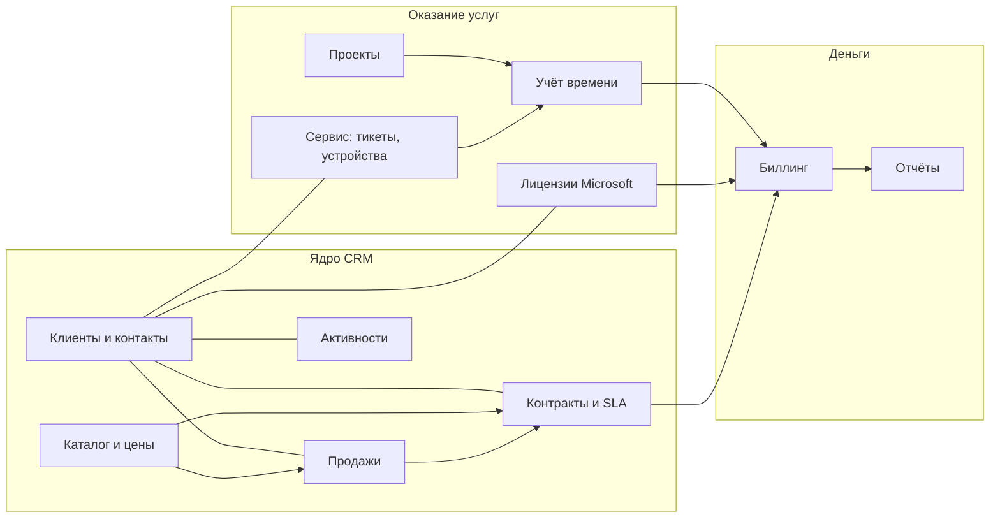
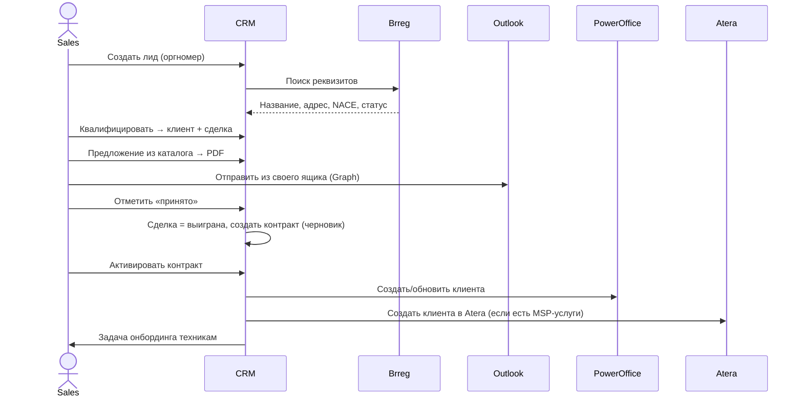
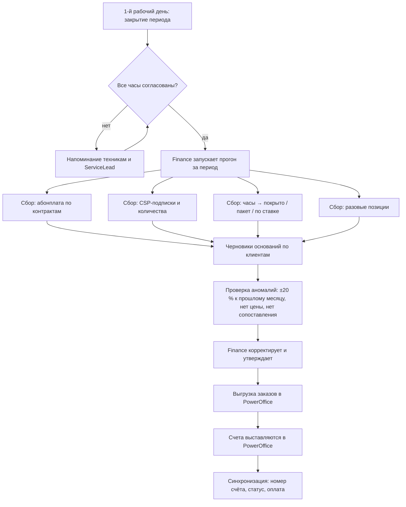
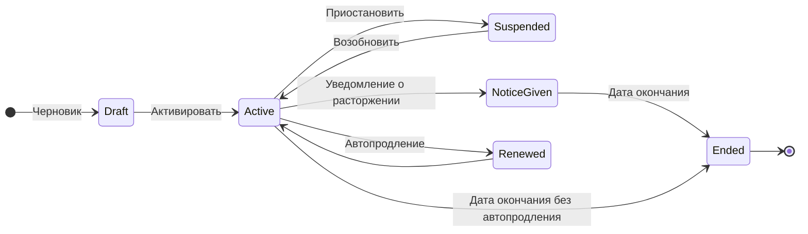
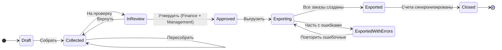
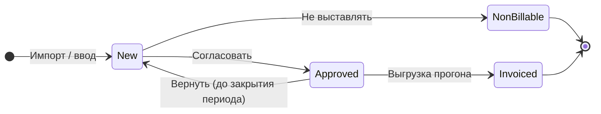

# 02. Функциональная спецификация

Документ детализирует требования из [ТЗ § 6.1](01-technical-assignment.md#61-функциональные-требования-сводно). Формат: назначение модуля → экраны → бизнес-правила (`BR-…`) → сценарии с критериями приёмки.

## 1. Карта модулей

## 2. Роли и матрица доступа

Обозначения: **RW** — чтение и запись, **R** — чтение, **R*** — чтение без финансовых полей (себестоимость, маржа, суммы счетов), **A** — утверждение, **—** — нет доступа. «Свои» — записи, где пользователь — ответственный.

| Объект / действие | Admin | Management | Sales | Technician | ServiceLead | Finance | ReadOnly |
|---|---|---|---|---|---|---|---|
| Клиенты, контакты | RW | RW | RW | R* (+ контакты RW) | R* (+ контакты RW) | R | R* |
| Лиды, сделки | RW | RW | RW | R* | R* | R | R* |
| Коммерческие предложения | RW | RW + A (скидки) | RW (свои) | — | — | R | — |
| Каталог, прайс-листы | RW | R | R (без себестоимости) | R* | R* | RW | R* |
| Контракты | RW | RW | RW | R* | R* | RW | R* |
| CSP-подписки | RW | R | R | R* | R* | R | R* |
| Тикеты, устройства (зеркало Atera) | R + создать | R | R + создать | R + создать | R + создать | R | R |
| Учёт времени | RW | R | RW (свои) | RW (свои) | RW + A | R | — |
| Биллинг-прогоны | RW | R + A | R (свои клиенты) | — | R | RW + A | — |
| Счета и задолженность | R | R | R | — | — | R | — |
| Проекты | RW | RW | RW | RW (назначенные) | RW | R | R* |
| Отчёты: маржа, выручка | R | R | R (свои клиенты, без маржи) | — | R (загрузка, SLA) | R | — |
| Витрина для Power BI (`reports.mart`) | R | R | — | — | — | R | — |
| Свои поля: определения / значения | RW / RW | — / RW | — / RW | — / — | — / — | — / R | — / — |
| Настройки интеграций, пользователи | RW | — | — | — | — | — | — |
| Журнал аудита | R | R | — | — | — | R (финансы) | — |

**BR-ACC-01.** Права проверяются на сервере для каждого запроса; интерфейс лишь скрывает недоступные элементы.
**BR-ACC-02.** Финансовые поля удаляются из ответа API на сервере, если у роли нет права `finance.read` (не маскируются на клиенте).
**BR-ACC-03.** Пользователь с несколькими ролями получает объединение прав.

## 3. Сквозные процессы

### 3.1 От лида до контракта

### 3.2 Ежемесячный биллинг

### 3.3 Онбординг клиента на managed services
1. Контракт с MSP-позициями активирован → CRM создаёт клиента в Atera (или связывает существующего) и сохраняет `AteraCustomerId`.
2. CRM создаёт задачу онбординга по шаблону (установить агентов, настроить политики, передать контакты).
3. После появления агентов в Atera количество устройств подтягивается в контракт для позиций «за устройство».

### 3.4 Продление CSP-подписки (NCE)
1. Ежедневная синхронизация подписок из Partner Center.
2. За 60/30/7 дней до даты продления — задача аккаунт-менеджеру и уведомление.
3. После покупки/увеличения количества — таймер окна отмены (7 × 24 ч); в карточке виден остаток окна.
4. Изменения количества попадают в следующий биллинг-прогон (с пропорцией в R2).

## 4. Модули

### 4.1 Авторизация и профиль (AUTH)

**Экраны:** страница входа (кнопка «Войти с Microsoft»), профиль (язык, часовой пояс, уведомления), страница «Нет доступа».

**Бизнес-правила**
- **BR-AUTH-01.** Локальных учётных записей нет. Пользователь без App Role видит страницу «Нет доступа» с контактом администратора.
- **BR-AUTH-02.** При первом входе создаётся профиль: `ObjectId` (oid), `TenantId` (tid), UPN, имя, e-mail, отдел, должность из Graph.
- **BR-AUTH-03.** Пользователь идентифицируется по паре `tid + oid`, а не по e-mail (e-mail может меняться).
- **BR-AUTH-04.** Роли берутся из claim `roles` при каждом входе и обновлении сессии; изменения в Entra применяются не позднее истечения сессии (≤ 1 ч).
- **BR-AUTH-05.** Ночная синхронизация пользователей через Graph: отключённые в Entra аккаунты помечаются неактивными, их сессии аннулируются, открытые записи остаются за ними с флагом «ответственный неактивен».

**Критерии приёмки**
- *Дано* сотрудник в группе `CRM-Sales`, *когда* он входит через Microsoft, *тогда* он попадает на дашборд продаж и не видит раздел «Администрирование».
- *Дано* аккаунт отключён в Entra ID, *когда* пользователь с активной сессией выполняет любое действие через ≤ 1 ч, *тогда* он получает 401 и перенаправление на вход, который не проходит.
- *Дано* гостевой пользователь (B2B guest) из другого тенанта, *когда* он пытается войти, *тогда* доступ запрещён (если не назначен явно).

### 4.2 Клиенты и контакты (CUS)

**Экраны:** список организаций, карточка 360°, форма создания (с поиском Brreg), список контактов, карточка контакта, очередь дубликатов.

**Карточка клиента 360° — вкладки**

| Вкладка | Содержимое | Источник |
|---|---|---|
| Обзор | Статус, ответственный, MRR, задолженность, открытые тикеты, продления ≤ 60 дней, последние активности | CRM + агрегаты |
| Контакты | Список контактов с ролями | CRM (↔ Atera, PowerOffice) |
| Среды | Тенант M365 (домены, GDAP-статус), клиент Atera, клиент PowerOffice Go (модули, версия) | CRM + Partner Center + Atera |
| Сделки и предложения | Открытые/закрытые | CRM |
| Контракты | Активные, архив, пакеты часов | CRM |
| Лицензии | CSP-подписки; в R2 — «куплено / назначено» | Partner Center, Graph (GDAP) |
| Сервис | Тикеты, устройства, критические алерты | Atera |
| Время | Часы за период, остаток пакета | Atera + CRM |
| Финансы | Счета, оплаты, задолженность, основания | PowerOffice + CRM |
| Документы | Папка SharePoint (R2) | SharePoint |
| История | Активности и журнал изменений | CRM |

**Основные поля организации:** название, оргномер, тип (AS, ENK, …), статус, отрасль (NACE), адреса (почтовый, для счетов, для выезда), e-mail для счетов, EHF-получатель (да/нет), домены e-mail, ответственный менеджер, ответственный техник, сегмент (S/M/L), источник, теги.

**Бизнес-правила**
- **BR-CUS-01.** Оргномер уникален среди активных организаций; проверка контрольной суммы (MOD11).
- **BR-CUS-02.** При вводе оргномера данные подтягиваются из Brreg; ручные изменения названия/адреса помечаются и не перезаписываются ночной синхронизацией.
- **BR-CUS-03.** Ночная проверка Brreg: при статусе «konkurs», «under avvikling» или «slettet» — предупреждение на карточке и задача ответственному.
- **BR-CUS-04.** Статус «клиент» устанавливается автоматически при активации первого контракта или появлении CSP-подписки; «бывший клиент» — через 90 дней после окончания последнего контракта и подписки (с подтверждением ответственного).
- **BR-CUS-05.** Контакт уникален по e-mail в рамках организации; один человек может быть контактом нескольких организаций (разные записи-связи).
- **BR-CUS-06.** Дубликаты ищутся по оргномеру, нормализованному названию, домену сайта/e-mail. Слияние переносит все связанные записи и внешние ID; операция логируется и отменяется в течение 30 дней.
- **BR-CUS-07.** Поля, мастером которых является внешняя система (например, адрес для счетов, если выбран режим «PowerOffice — мастер»), в CRM доступны только на чтение. Таблица владения — [04-data-model § 3](04-data-model.md#3-владение-данными-system-of-record).
- **BR-CUS-08.** Организации образуют дерево (концерн → дочерние): у дочерней указывается материнская, циклы запрещены. Флаг «счёт выставляется материнской» переносит её позиции в основание материнской компании при ближайшем прогоне (BR-BIL-12); без флага компания остаётся в группе, но получает свой счёт.

**Критерии приёмки**
- *Дано* введён оргномер существующей в Brreg компании, *когда* пользователь нажимает «Найти», *тогда* название, адрес, тип организации и NACE заполняются ≤ 2 с.
- *Дано* организация с этим оргномером уже есть, *когда* пользователь сохраняет новую, *тогда* система блокирует сохранение и предлагает открыть существующую.
- *Дано* клиент связан с Atera и PowerOffice, *когда* открыта вкладка «Обзор», *тогда* видны открытые тикеты и задолженность с временем последней синхронизации.

### 4.3 Продажи (SAL)

**Экраны:** лиды (список/канбан), сделки (канбан по этапам, список, прогноз), карточка сделки, редактор предложения, шаблоны предложений (Admin).

**Этапы воронки по умолчанию** (настраиваются): Квалификация (10 %) → Выявление потребностей (25 %) → Предложение отправлено (50 %) → Переговоры (75 %) → Выиграна (100 %) / Проиграна (0 %).

**Поля сделки:** организация, контакт, название, направление (Microsoft / Atera-MSP / PowerOffice / Смешанное), этап, вероятность, ожидаемая дата закрытия, разовая сумма, MRR, срок контракта, ответственный, источник, конкурент, причина проигрыша.

**Бизнес-правила**
- **BR-SAL-01.** Прогнозная выручка = разовая сумма × вероятность + MRR × min(срок, 12) × вероятность.
- **BR-SAL-02.** Перевод в «Проиграна» требует причины из справочника.
- **BR-SAL-03.** Сделка без активности > 30 дней помечается «застывшей», ответственный получает напоминание.
- **BR-SAL-04.** Предложение: версии v1, v2…; редактировать можно только черновик; отправленная версия неизменяема.
- **BR-SAL-05.** Скидка по позиции выше лимита роли (по умолчанию Sales — 15 %) требует утверждения Management; до утверждения PDF не формируется.
- **BR-SAL-06.** Цена в предложении фиксируется на момент создания версии; изменение прайс-листа не меняет отправленные предложения.
- **BR-SAL-07.** Принятие предложения → сделка «Выиграна» → контракт-черновик с позициями предложения (регулярные) и разовый заказ (разовые позиции) для ближайшего биллинг-прогона.

**Как это сделано (S9)**
- Номер `T-ГГГГ-NNNN` («tilbud») из последовательности схемы `sales`; все версии одного предложения носят один номер и различаются номером версии.
- Версия — отдельная запись со своими позициями; версии связаны полем `RootId`. Черновик можно править, отправленную версию — нет; «Новая версия» копирует позиции в новый черновик, прежняя становится «Заменена».
- Цены фиксируются в момент создания версии: позиция без цены получает цену прайс-листа категории клиента (категория берётся из активного контракта, иначе категория по умолчанию каталога) — BR-SAL-06.
- «Подготовить к отправке» проверяет скидку: больше `Sales:DiscountLimitPercent` (по умолчанию 15 %) — статус «На согласовании» и документа нет; право `sales.discount.approve` (Management, Admin) согласовывает или отклоняет с причиной, после отклонения предложение снова черновик (BR-SAL-05).
- PDF не хранится: он формируется из неизменяемой версии при каждом скачивании, поэтому документ у клиента и в CRM всегда совпадают. Формируется собственным писателем PDF (шрифты Helvetica из ядра PDF) — без внешней библиотеки и без вопросов о лицензии; языки документа nb и en.
- Отправка (FR-SAL-04) идёт из ящика самого продавца через Microsoft Graph `sendMail` с PDF во вложении и `saveToSentItems: true`, так что ответ клиента приходит продавцу. Флаг `Sales:EmailEnabled` выключен по умолчанию — тогда PDF скачивают и отправляют из Outlook вручную.
- «Принято» (BR-SAL-07) переводит сделку в «Выиграна», событием `QuoteAccepted` создаёт контракт-черновик с регулярными позициями по согласованным ценам (срок уведомления 90 дней по умолчанию, правится вручную) и ставит разовые позиции в очередь `billing.PendingCharges` — ближайший прогон берёт их одной позицией группы «Разовые» и закрывает только после выгрузки заказа.
- Ежедневная задача `quote-expiry` (06:00) помечает отправленные предложения с истёкшим сроком «Утекло»; их можно поднять новой версией.
- Шаблоны (`sales.QuoteTemplates`, по одному стандартному на язык) хранят вступление, условия и нижний колонтитул; текст копируется в предложение и дальше правится независимо от шаблона.

**Критерии приёмки**
- *Дано* предложение с позицией со скидкой 20 % от Sales, *когда* пользователь нажимает «Сформировать PDF», *тогда* создаётся запрос на утверждение, PDF недоступен до утверждения.
- *Дано* принятое предложение с позициями «M365 Business Premium ×25/мес.» и «Внедрение 20 ч», *когда* его отмечают «принято», *тогда* создаётся контракт-черновик с регулярной позицией и разовая позиция на 20 ч попадает в следующий прогон.

### 4.4 Каталог и цены (CAT)

**Типы продуктов:** `MicrosoftLicense` (SKU, срок обязательства, периодичность оплаты), `ManagedService` (за пользователя/устройство/фикс), `HourlyService` (ставка, тип работ), `HourBank` (пакет часов), `PowerOfficeService`, `Hardware`, `Bundle` (пакет из других продуктов).

**Поля:** артикул, название (nb/en), описание, тип, направление, единица, ставка MVA, счёт выручки/код продукта PowerOffice, соответствие типу работ Atera, себестоимость, цена, валюта, активен.

**Бизнес-правила**
- **BR-CAT-01.** Прайс-лист имеет период действия; для даты действует ровно один прайс-лист на клиентскую категорию. Индивидуальная цена в контракте имеет приоритет над прайс-листом.
- **BR-CAT-02.** Цена Microsoft-лицензии = цена партнёра (из прайс-листа CSP/дистрибьютора) × курс USD/EUR→NOK × (1 + наценка категории); результат округляется по правилу из настроек.
- **BR-CAT-03.** Продукт нельзя удалить, если он использован; только деактивировать.
- **BR-CAT-04.** Продукт, выгружаемый в биллинг, обязан иметь сопоставление с продуктом PowerOffice; иначе прогон помечает позицию ошибкой.
- **BR-CAT-05.** Прайс-лист NCE (или его версия от дистрибьютора) импортируется в **черновик** прайс-листа: продукты находятся по Microsoft offer id (`ProductId:SkuId` или готовая колонка `OfferId`), строка выбирается по сроку обязательства продукта, цена считается по BR-CAT-02. `?dryRun=true` показывает новые цены и предложения без продукта, не записывая ничего; активный прайс-лист не переоценивается.

### 4.5 Контракты и SLA (CON)

**Статусы:** Черновик → Активен → (Приостановлен) → Уведомление о расторжении → Завершён / Продлён.

**Поля контракта:** номер, организация, тип (MSP-абонемент, Лицензии, Поддержка PowerOffice, Пакет часов, Смешанный), дата начала, дата окончания, автопродление, срок продления (мес.), срок уведомления (дни), SLA-политика, периодичность счёта (мес./квартал/год, авансом/по факту), индексация (да/нет, дата), ответственный.

**Позиции контракта:** продукт, модель количества (`Fixed`, `PerAteraDevice`, `PerM365User`, `PerSubscription`, `Manual`), фильтр (например, только серверы / только рабочие станции), цена, скидка, дата начала/окончания позиции.

**SLA-политика:** часы поддержки (8×5, 24×7), время реакции и решения по приоритетам (P1–P4), включённые часы в месяц, ставка для работ сверх объёма.

**Бизнес-правила**
- **BR-CON-01.** Количество по модели `PerAteraDevice` фиксируется на дату снапшота (последний день периода) из синхронизированных агентов Atera с учётом фильтра типа устройства.
- **BR-CON-02.** Количество `PerM365User` — число назначенных лицензий в тенанте клиента из последнего снимка GDAP на дату прогона (BR-LIC-04). Если снимка нет, берётся оценка из позиции контракта и прогон помечает позицию аномалией `BIL_ESTIMATED_QUANTITY`; снимок с нулём назначенных — `BIL_NO_ASSIGNED_LICENCES`.
- **BR-CON-03.** Изменение цены активного контракта создаёт новую версию позиции с датой начала; история сохраняется.
- **BR-CON-04.** Автопродление: за `срок уведомления + 30 дней` создаётся задача; в дату окончания без расторжения контракт продлевается на `срок продления`.
- **BR-CON-05.** Пакет часов: при списании остаток уменьшается; при остатке < 20 % — уведомление ответственному и контакту-ЛПР (письмо — после подтверждения менеджером); при остатке 0 часы тарифицируются по ставке сверх пакета.
- **BR-CON-06.** Индексация (экран «Индексация цен»): Finance задаёт процент (по умолчанию — KPI SSB за 12 мес.) и дату, видит предпросмотр «было/стало» по месяцу для контрактов с индексацией, у которых подошёл срок, выбирает нужные и применяет. Меняются только позиции с собственной ценой — позиция по прайс-листу индексируется вместе с прайс-листом; каждая позиция получает новую версию с даты (BR-CON-03), а срок следующей индексации сдвигается на год. Уведомление клиентов остаётся за менеджером: сроки уведомления в контрактах не отменяются.

**Критерии приёмки**
- *Дано* контракт «Managed workstation 450 NOK/устройство» с фильтром «Рабочие станции» и 23 рабочие станции + 2 сервера в Atera на 31-е число, *когда* выполняется прогон, *тогда* позиция содержит количество 23 и сумму 10 350 NOK.
- *Дано* пакет 20 ч с остатком 4,5 ч, *когда* согласована запись 1 ч, *тогда* остаток 3,5 ч и отправлено уведомление о низком остатке.

### 4.6 Лицензии Microsoft (LIC)

**Экраны:** список подписок (все клиенты, фильтр «продление ≤ 60 дней», «окно отмены открыто»), вкладка «Использование лицензий» («куплено / назначено / не используется» по SKU, переключатель «только неиспользуемые 30 дней»), вкладка «Сверка с Microsoft» (месяц, затраты Microsoft против выставленного клиентам, маржа, импорт файла затрат — право `finance.cost.read`), вкладка «Лицензии» клиента, сопоставление CSP-клиентов с организациями CRM.

**Поля подписки:** CSP customer ID, tenant ID, subscription ID, offer ID/SKU, название, количество, статус, срок обязательства (P1M/P1Y/P3Y), периодичность оплаты, дата начала, дата окончания/продления, автопродление, дата покупки (для окна отмены), цена партнёра, продажная цена (из контракта/каталога).

**Бизнес-правила**
- **BR-LIC-01.** CSP-клиенты сопоставляются с организацией CRM автоматически по домену/названию/оргномеру (если есть); неоднозначные — в очередь ручного сопоставления.
- **BR-LIC-02.** Окно отмены = 7 суток (168 ч) с момента покупки или увеличения количества; в течение окна подписка отмечена значком и таймером.
- **BR-LIC-03.** Подписка без соответствующей позиции в контракте клиента → предупреждение «лицензия не выставляется» в прогоне и на дашборде Finance.
- **BR-LIC-04.** «Куплено − назначено» > 0 по SKU более 30 дней → рекомендация оптимизации аккаунт-менеджеру. Снимок по каждому SKU пишется раз в сутки (`partnercenter-licenses`, GDAP + `subscribedSkus`); повторное чтение в тот же день заменяет запись, а «неиспользуется весь период» показывается только когда снимки покрывают все 30 дней. «Назначено > куплено» отображается как ноль неиспользуемых, расхождение остаётся в снимке.
- **BR-LIC-06.** Затраты Microsoft (`billed reconciliation` через Graph или файл дистрибьютора) хранятся по ключу `источник:счёт:подписка:предложение:период` — повторный импорт того же файла ничего не дублирует. Строка привязывается к организации через CSP-подписку; непривязанные видны в отчёте отдельной строкой. Сверка сопоставляет затраты с выставленной клиенту выручкой по лицензиям за тот же месяц (группа `License` в утверждённых прогонах), «не выставлено» — то, ради чего отчёт и существует.
- **BR-LIC-05.** Индиректная модель: подписки импортируются из выгрузки дистрибьютора по шаблону; поля-источники сохраняются как `Source = Distributor`.

### 4.7 Сервис: тикеты, устройства, алерты (SRV)

CRM не редактирует тикеты — только показывает, создаёт и даёт ссылку в Atera.

**Бизнес-правила**
- **BR-SRV-01.** Тикеты синхронизируются инкрементально каждые 10 мин (или по вебхуку, если доступен тариф Atera с вебхуками); в карточке — последние 90 дней + фильтр.
- **BR-SRV-02.** Создание тикета из CRM: выбирается контакт (обязан быть связан с Atera; если нет — создаётся контакт в Atera), тема, описание, приоритет, тип. После создания в CRM сохраняется `TicketId` и ссылка.
- **BR-SRV-03.** Устройства: снапшот агентов раз в сутки + хранение ежедневного количества по клиенту и типу (для биллинга и трендов).
- **BR-SRV-04.** Алерты: в CRM показываются только открытые Critical/Warning, агрегированно по клиенту.
- **BR-SRV-05.** SLA-отчёт считает время первой реакции и решения по данным тикета: часы идут только внутри окна поддержки политики SLA контракта (8×5 — 08–16, 12×5 — 07–19, 24×7 — круглосуточно) и никогда в выходные и норвежские праздники, поэтому заявка вечером пятницы под 8×5 начинает отсчёт в понедельник. Приоритеты Atera сопоставляются с P1–P4 (`Critical`→P1, `High`→P2, `Medium`→P3, остальное →P4). У клиента без живого контракта с политикой целей нет — такие заявки считаются отдельно, а не нарушениями. При нескольких контрактах берётся самое строгое обещание.

### 4.8 Учёт времени (TIM)

**Экраны:** «Мой табель» (неделя), список записей (фильтры: период, клиент, техник, статус, источник), согласование (ServiceLead), правила тарификации (Admin/Finance).

**Поля записи:** источник (Atera/CRM), внешний ID, техник, клиент, тикет/проект/контракт, дата, начало/конец или длительность, тип работ, оплачиваемая (да/нет), описание, статус (Новая → Согласована → Выставлена / Не выставляется), итоговая тарификация (покрыто контрактом / пакет / по ставке), ставка, сумма.

**Бизнес-правила**
- **BR-TIM-01.** Записи из Atera импортируются как «Новая»; техник Atera сопоставляется с пользователем CRM по e-mail (сопоставление редактируется в Admin).
- **BR-TIM-02.** Изменение записи в Atera после импорта обновляет запись в CRM, если она не «Выставлена»; если выставлена — создаётся предупреждение для Finance (коррекция в следующем периоде).
- **BR-TIM-03.** Тарификация (порядок применения):
  1. Неоплачиваемая в источнике → «Не выставляется».
  2. Тип работ входит в SLA-объём контракта и месячный лимит включённых часов не исчерпан → «Покрыто контрактом».
  3. У клиента активный пакет часов с остатком → «Пакет» (при частичном остатке запись делится).
  4. Иначе → «По ставке» (ставка: контракт → прайс-лист клиента → базовая ставка типа работ).
- **BR-TIM-04.** Округление: до 15 мин вверх для «По ставке» (настраивается по контракту), минимальный выезд — 1 ч (настраивается).
- **BR-TIM-05.** Согласованные записи закрытого периода изменить нельзя; разблокировка — только Finance с указанием причины (аудит).
- **BR-TIM-06.** Работы в нерабочее время (по календарю SLA) получают коэффициент ставки из контракта (например, ×1,5 / ×2).

### 4.9 Биллинг (BIL)

**Экраны:** список прогонов, мастер нового прогона, черновик прогона (клиенты × суммы, фильтр «аномалии»), основание по клиенту (позиции), журнал выгрузки, счета клиента.

**Статусы прогона:** Черновик → Собран → На проверке → Утверждён → Выгружается → Выгружен / Выгружен с ошибками → Закрыт.

**Состав основания по клиенту**

| Группа | Источник | Количество | Цена |
|---|---|---|---|
| Абонплата | Позиции активных контрактов за период | По модели количества (BR-CON-01/02) | Контракт |
| Лицензии Microsoft | CSP-подписки, сопоставленные с позициями контракта | Количество подписки на дату снапшота | Контракт / каталог |
| Работы по ставке | Согласованные записи времени «По ставке» | Часы | BR-TIM-03 |
| Пакеты часов | Покупка нового пакета (если продлевается) | 1 | Контракт |
| Разовые позиции | Принятые предложения, ручные позиции | Вручную | Вручную |
| Информационно | Покрыто контрактом, списано из пакета | Часы, 0 NOK | — |

**Бизнес-правила**
- **BR-BIL-01.** Одновременно может быть только один незакрытый прогон на период.
- **BR-BIL-02.** Пересборка прогона разрешена до утверждения; ручные корректировки сохраняются и помечаются.
- **BR-BIL-03.** Аномалии, требующие просмотра до утверждения: изменение суммы клиента > ±20 % к прошлому периоду; позиция без цены; продукт без сопоставления с PowerOffice; клиент без связи с PowerOffice; CSP-подписка без позиции контракта.
- **BR-BIL-04.** Утверждает пользователь с ролью Finance; пороговые суммы (по умолчанию > 200 000 NOK на клиента) требуют второго утверждения Management.
- **BR-BIL-05.** Выгрузка идемпотентна: ключ основания `{period}-{organizationId}-{runId}` передаётся в PowerOffice как внешняя ссылка заказа; повторная отправка не создаёт дубль.
- **BR-BIL-06.** Одна организация → один заказ на продажу за период (если в контракте не задано разделение по направлениям/ссылкам на заказ клиента).
- **BR-BIL-07.** В описание строк добавляется период (`01.09.2026–30.09.2026`), для часов — дата, тикет и техник (детализация настраивается по клиенту).
- **BR-BIL-08.** После выгрузки записи времени получают статус «Выставлена», остатки пакетов часов фиксируются.
- **BR-BIL-09.** Отмена выгрузки: только если заказ в PowerOffice ещё не преобразован в счёт; иначе — кредит-нота в PowerOffice и корректировочная позиция в следующем прогоне.
- **BR-BIL-10.** Основания хранятся неизменяемыми 5 лет после закрытия прогона.
- **BR-BIL-11.** Пропорциональный расчёт: позиция, действующая лишь часть оплачиваемого периода, считается по дням (`дней в силе / дней в периоде`); цена за единицу умножается на долю, количество остаётся как у клиента, а в описании видно окно и `15/30`. Изменение позиции в середине периода — это версия со старой ценой до дня изменения и новая с него (BR-CON-03), и обе доли в сумме дают один период.
- **BR-BIL-12.** Консолидированный счёт: у компании с флагом «счёт выставляется материнской» собственного основания нет — её позиции попадают в основание материнской компании с префиксом названия, чтобы в одном счёте было видно, за какую компанию что выставлено. Аномалии переносятся так же.

**Критерии приёмки**
- *Дано* клиент с абонплатой 5 000 NOK, 25 лицензиями по 250 NOK и 3 ч по ставке 1 250 NOK, *когда* прогон собран, *тогда* основание = 5 000 + 6 250 + 3 750 = 15 000 NOK без MVA, три группы позиций.
- *Дано* утверждённый прогон выгружен и выгрузка повторена из-за таймаута, *когда* проверяются заказы в PowerOffice, *тогда* по каждому клиенту ровно один заказ.
- *Дано* счёт оплачен в PowerOffice, *когда* прошла синхронизация, *тогда* в карточке клиента счёт «Оплачен», задолженность уменьшилась.

### 4.10 Проекты (PRJ)

**Экраны:** список проектов (фильтр «включая закрытые», часы против бюджета), карточка проекта (план/факт, этапы с задачами, смена статуса), вкладка «Проекты» в карточке клиента, выбор проекта в записи времени.

**Поля проекта:** номер `P-ГГГГ-NNNN`, клиент, название, тип (M365-миграция, внедрение PowerOffice, развёртывание Atera, прочее), статус, модель оплаты (фикс / по часам / по этапам), руководитель, даты, бюджет (часы и сумма), связь с контрактом и сделкой, заметки. **Этап:** порядок, название, статус, плановые даты и часы, сумма и признак «выставить при завершении», продукт каталога. **Задача:** название, исполнитель, срок, оценка часов, статус.

**Бизнес-правила**
- **BR-PRJ-01.** Проект не владеет часами: они живут в модуле учёта времени и ссылаются на проект, поэтому план/факт всегда совпадает с табелем и биллингом. Выбрать можно только открытый проект того же клиента.
- **BR-PRJ-02.** Этап нельзя завершить, пока у него есть открытые задачи, а проект — пока есть незавершённые этапы; завершённый этап не удаляется, а отменяется.
- **BR-PRJ-03.** Завершение этапа с суммой и признаком «выставить при завершении» ставит разовую позицию в очередь `billing.PendingCharges` — так же, как принятое предложение (BR-SAL-07). Повторное завершение ничего не дублирует, а возврат этапа в работу снимает позицию, если прогон её ещё не выгрузил.
- **BR-PRJ-04.** Закрытый (завершённый или отменённый) проект доступен только на чтение, пока его не откроют снова; удалить можно лишь проект, который ещё не стартовал.

Отложено: шаблоны проектов с типовыми задачами (R3).

### 4.11 Активности (ACT)
- Типы: задача, звонок, встреча, заметка, письмо.
- Привязка к одной основной записи (организация / сделка / контракт / проект) и контактам.
- Задачи: срок, исполнитель, приоритет, напоминание; «Мои задачи» на главной.
- **BR-ACT-01.** (R2) Встречи, созданные в CRM, создаются в календаре Outlook пользователя; изменения в Outlook синхронизируются через Graph change notifications.
- **BR-ACT-02.** (R2) Письма: пользователь в карточке клиента видит письма из своего ящика и разрешённых общих ящиков, где отправитель/получатель — контакт или домен клиента. Содержимое не копируется в БД CRM целиком — хранятся метаданные и ссылка; тело загружается по запросу из Graph с правами пользователя.
- **BR-ACT-03.** Заметки поддерживают упоминания `@пользователь` → уведомление.

**Как это сделано (S10)**
- **Встречи (FR-ACT-02).** У встречи есть длительность и место; переключатель «Добавить в мой календарь Outlook» создаёт событие в календаре организатора через делегированный Graph (`POST /me/events`), контакт клиента получает приглашение. Идентификатор активности хранится в открытом расширении события (`no.vardahei.crm`), поэтому событие всегда узнаётся обратно. Правка встречи меняет событие, снятие переключателя и удаление активности убирают его из календаря.
- **Обратная синхронизация.** Кнопка «Получить изменения из Outlook» читает календарь за окно (`GET /me/calendarView`) и переносит в CRM перенос времени, переименование и отмену. Подписка на change notifications требует публичного эндпоинта и продления подписок — отложена (R3); опрос по требованию достаточен, потому что встречу смотрит человек.
- **Почта (FR-ACT-03).** Вкладка «Почта» в карточке клиента читает ящик вошедшего сотрудника и настроенные общие ящики (`$search=participants:…`) по адресам контактов и доменам клиента. В CRM ничего не сохраняется, пока человек не нажмёт «Сохранить в CRM»: тогда появляется активность типа «Письмо» с темой, отправителем, временем и ссылкой — без тела (SEC-GDPR-06). Одно письмо сохраняется у клиента один раз, сохранённое письмо не редактируется.
- **Документы (FR-DOC-01).** Папка `Название (оргномер)` создаётся в библиотеке SharePoint, когда организация становится клиентом или партнёром, и переименовывается вслед за организацией; связь хранится в `integration.ExternalLink`, поэтому переименование папки вручную ничего не ломает. Вкладка «Документы» показывает содержимое и ведёт в SharePoint; файлы CRM не хранит и не проксирует.
- **Teams (FR-ACT-04).** Сообщения в каналы уходят через вебхук Power Automate Workflows (коннекторы Office 365 отключены в мае 2026): выигранная сделка дороже порога — в «Salg», утверждённый биллинг-прогон — в «Økonomi». Персональные уведомления в ленте активности Teams требуют установленного приложения Teams и отложены до PoC; личные напоминания пока приходят письмом-сводкой (S8).
- **Если Graph не подключён** (нет согласия, вход в режиме разработки, выключен флаг) — каждая поверхность объясняет это на своём месте: переключатель календаря неактивен, вкладки «Почта» и «Документы» показывают причину. Ничего не падает.

### 4.12 Отчёты и дашборды (RPT)

| Дашборд | Роли | Показатели |
|---|---|---|
| Руководство | Management | MRR/ARR и динамика, выручка по направлениям, отток, новые клиенты, топ-10 по марже |
| Продажи | Sales, Management | Воронка по этапам, прогноз по месяцам, конверсия, застывшие сделки, продления ≤ 90 дней |
| Сервис | ServiceLead | Открытые тикеты по клиентам, SLA-отчёт, загрузка техников (оплач./неоплач.), несогласованные часы |
| Финансы | Finance | Статус прогона, несопоставленные подписки/продукты, задолженность по срокам, лицензии без выставления |
| Мой день | Все | Мои задачи, встречи, мои клиенты с предупреждениями |

**Отдельные отчёты**

- **SLA-отчёт** (FR-SRV-04, экран «SLA-отчёт»): месяц, доля заявок в срок по реакции и решению, строка на клиента с политикой, медианой реакции и списком нарушений; заявки без SLA считаются отдельно (BR-SRV-05).
- **Маржа по клиентам** (FR-RPT-02, экран «Маржа»): за месяц или окно в 3/6/12 месяцев — выставлено, затраты на лицензии (из строк Microsoft, FR-LIC-04), затраты на часы (внутренняя стоимость часа из настроек × согласованные часы), маржа и процент. Клиент, которому выставлены лицензии, но затраты Microsoft не загружены, помечается: его маржа выглядит лучше, чем есть.
- **Витрина для Power BI** (FR-RPT-03): `GET /api/v1/reports/mart/{набор}` отдаёт плоскую таблицу в JSON или CSV (`?format=csv`) за период. Наборы: `organizations`, `revenue-by-month`, `revenue-by-customer`, `hours-by-customer`, `microsoft-costs`, `subscriptions`, `margins`, `renewals`. Прямого доступа к SQL нет — Power BI подключается веб-коннектором учётной записью с правом `reports.mart`, и запрос проходит те же проверки прав и те же контракты модулей.

**Бизнес-правила**
- **BR-RPT-01.** Отчёты не владеют данными: каждое число берётся у модуля-владельца через его контракт, поэтому отчёт и экран модуля не могут разойтись.
- **BR-RPT-02.** Маржа = выставлено − затраты Microsoft − (часы × внутренняя стоимость часа). Себестоимость оборудования в CRM не ведётся, а стоимость часа — настройка `Reports:InternalHourlyCost`, и отчёт показывает, с какой ставкой посчитан.
- **BR-RPT-03.** Витрина ограничена тем же лимитом, что и экспорт списков, и её право (`reports.mart`) выдаётся отдельно от дашбордов: она отдаёт таблицы целиком.

### 4.13 Администрирование (ADM)
- Миграция (ТЗ §6.6, экран «Миграция»): файл клиентов из старых систем (CSV с норвежскими или английскими заголовками, вместе с основным контактом) сопоставляется с тем, что уже есть — сначала по оргномеру, потом по домену, потом по точному названию (BR-CUS-06). Неоднозначная строка не сливается молча, а попадает в отчёт как «нужно решение». `?dryRun=true` показывает построчно, что будет создано, обновлено и оставлено без изменений, и ничего не пишет; импорт требует права `customers.delete` и попадает в журнал аудита. Файл никогда не затирает заполненные поля — только дополняет пустые.
- Приостановка интеграции (runbook 05): администратор может удержать внешнюю систему во время инцидента без деплоя — задания записывают прогон со статусом «Пропущено» с причиной, исходящие операции остаются в очереди. Мониторинг видит это в `/health/integrations`, который намеренно не влияет на readiness.
- Свои поля (FR-ADM-04, экран «Свои поля»): администратор добавляет к клиентам, сделкам и контрактам собственные поля — текст, число, дата, да/нет или список; у поля есть ключ для выгрузок, порядок, подсказка и признак обязательности. Значения заполняются в карточке записи теми, кто и так может её менять, и проверяются по типу: число и дата приводятся к одному виду, значение вне списка отклоняется. Деактивированное поле исчезает из карточек, но определение и ответы сохраняются; удаление поля убирает и ответы.
- Интеграции: статус подключения, параметры, кнопка «Проверить подключение», расписание, последняя синхронизация, ошибки.
- Сопоставления: пользователи ↔ техники Atera, продукты ↔ продукты PowerOffice, типы работ Atera ↔ продукты CRM, CSP-клиенты ↔ организации.
- Справочники: этапы воронки, причины проигрыша, типы работ, SLA-политики, праздничные дни, шаблоны PDF и писем.
- Журнал синхронизаций: запуск, длительность, прочитано/создано/обновлено/ошибки, повтор отдельной записи.
- Журнал аудита: фильтр по сущности, пользователю, дате; просмотр diff.

### 4.14 Общие функции (GEN)
- Глобальный поиск по названию, оргномеру, e-mail, телефону, номеру контракта/тикета/счёта; результаты с учётом прав.
- Сохранённые представления списков (личные и общие).
- Экспорт в Excel/CSV: ≤ 50 000 строк, фиксируется в аудите.
- Вложения к записям (≤ 25 МБ) — в Blob Storage (R1), в SharePoint (R2).

## 5. Уведомления и автоматизации

| Событие | Кому | Канал (R1 / R2) |
|---|---|---|
| Назначен ответственным / задача | Исполнитель | В приложении, e-mail / + Teams |
| Продление контракта через 60/30/7 дн. | Ответственный менеджер | В приложении, e-mail / + Teams |
| Продление CSP-подписки через 60/30/7 дн., окно отмены закрывается через 24 ч | Аккаунт-менеджер | В приложении, e-mail / + Teams |
| Остаток пакета часов < 20 % | Ответственный менеджер | В приложении / + Teams |
| Период закрыт, есть несогласованные часы | ServiceLead, техники | E-mail / + Teams |
| Прогон готов к утверждению / утверждён / ошибки выгрузки | Finance, Management | В приложении, e-mail / + Teams-канал «Økonomi» |
| Сделка выиграна > порога | Канал «Salg» | — / Teams-канал |
| Ошибка интеграции > 3 подряд | Admin | E-mail / + Teams |
| Клиент в статусе konkurs/avvikling (Brreg) | Ответственный, Finance | В приложении, e-mail |

Пользователь настраивает каналы по типам событий в профиле (кроме обязательных для Finance/Admin).

## 6. Статусные модели

## 7. Перечень экранов R1

1. Вход / Нет доступа
2. Главная «Мой день» + ролевые дашборды
3. Организации: список, карточка 360°, создание с Brreg, дубликаты
4. Контакты: список, карточка
5. Лиды: список/канбан
6. Сделки: канбан, список, прогноз, карточка
7. Каталог: продукты, прайс-листы
8. Контракты: список, карточка, пакеты часов
9. CSP-подписки: список, сопоставление клиентов, импорт от дистрибьютора
10. Тикеты (сводный список), создание тикета
11. Учёт времени: мой табель, список, согласование
12. Биллинг: прогоны, черновик, основание клиента, журнал выгрузки
13. Задачи и активности
14. Администрирование: интеграции, сопоставления, справочники, журнал синхронизаций, аудит, пользователи
15. Глобальный поиск, профиль, уведомления
