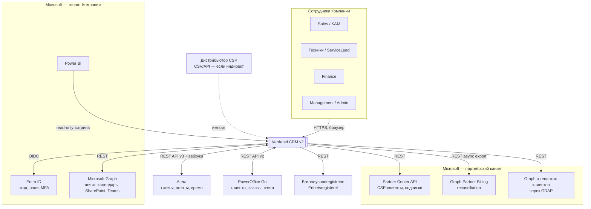
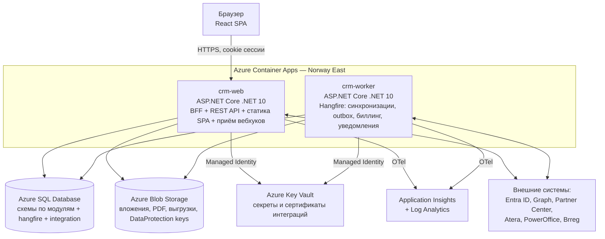
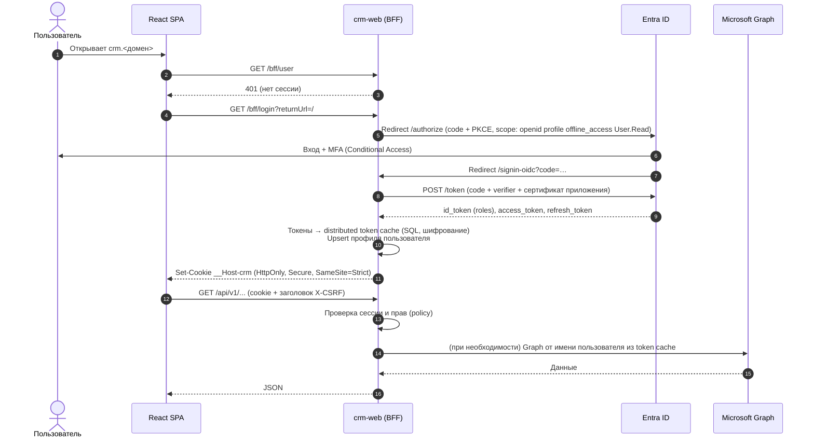
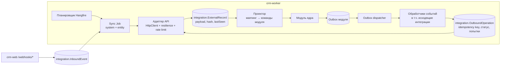
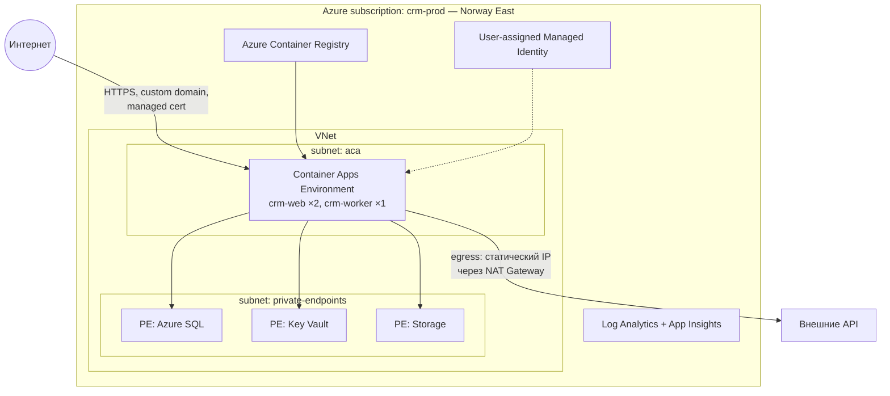

# 03. Архитектура решения

## 1. Архитектурные драйверы

| Драйвер | Следствие для архитектуры |
|---|---|
| Команда 2–4 разработчика, 10–100 пользователей | Модульный монолит, минимум инфраструктурных компонентов |
| Компания живёт в экосистеме Microsoft | Entra ID, Azure, Fluent UI, Graph, Power BI; .NET как основной стек |
| 5 внешних систем с разными API и лимитами | Выделенный интеграционный слой (anti-corruption layer), асинхронные синхронизации, устойчивость к сбоям |
| Деньги: биллинг должен быть точным и повторяемым | Транзакционность, идемпотентность выгрузок, неизменяемые основания, аудит |
| Персональные данные клиентов, GDPR | Хранение в Norway East, минимизация, аудит доступа |
| Требование «вход только Microsoft» | OIDC через Entra ID, роли из Entra, никаких локальных паролей |

**Ограничения:** облако — Microsoft Azure; идентификация — Entra ID тенант Компании; бухгалтерия остаётся в PowerOffice Go; сервис-деск остаётся в Atera.

## 2. Контекст системы (C4, уровень 1)



## 3. Контейнеры (C4, уровень 2)



| Контейнер | Ответственность | Масштабирование |
|---|---|---|
| `crm-web` | Вход/выход (BFF), REST API `/api/v1`, раздача SPA, приём вебхуков `/webhooks/*` (валидация и запись во входящую очередь, без бизнес-логики) | 2+ реплики, autoscale по HTTP |
| `crm-worker` | Регулярные синхронизации, обработка outbox/inbox, биллинг-прогоны, дохранение и очистка документов предложений, уведомления, ночные проверки | 1–2 реплики (Hangfire распределяет задачи) |
| Azure SQL | Единственное хранилище состояния; схемы по модулям; temporal tables для истории | Serverless / General Purpose 2–4 vCore |
| Blob Storage | Документы предложений (контейнер `documents`, приватный, ключи не переиспользуются — ADR-017), манифесты стираний, переключатель обслуживания, журнал внешних эффектов и отчёты сверки (`operations/…`, ADR-021), снимки закрытых месяцев для BI (`reports/snapshots/…`, ADR-022), файлы, выгрузки Excel, ключи DataProtection | — |
| Key Vault | API-ключ Atera, ключи PowerOffice, сертификаты приложений Entra | — |

Оба контейнера собираются из одного репозитория и разделяют модули; отличаются только хостом (`Crm.Web` / `Crm.Worker`).

## 4. Технологический стек

| Слой | Выбор | Обоснование |
|---|---|---|
| Backend runtime | .NET 10 (LTS), ASP.NET Core, C# 14 | LTS до ноября 2028; экосистема Microsoft Identity и Graph SDK первого класса |
| ORM | EF Core 10 | Миграции, temporal tables, rowversion для оптимистичной блокировки |
| Аутентификация | Microsoft.Identity.Web (OIDC + token cache) | Официальная библиотека Entra ID, OBO и кэш токенов |
| Фоновые задачи | Hangfire (SQL storage) | Повторы, расписания, дашборд; не требует отдельной шины |
| HTTP-устойчивость | Microsoft.Extensions.Http.Resilience (Polly v8) + System.Threading.RateLimiting | Ретраи, circuit breaker, таймауты, лимиты под квоты API |
| Валидация | FluentValidation | Декларативные правила |
| Маппинг | Mapperly (source generator) | Без рефлексии; AutoMapper с 2025 г. распространяется по коммерческой лицензии |
| Обработчики | Собственные `ICommandHandler/IQueryHandler` | Без MediatR (коммерческая лицензия с 2025 г.), меньше магии |
| PDF | Собственный писатель (`Crm.SharedKernel/Documents/PdfBuilder`) | Документ простой (шапка, таблица позиций, суммы, условия): ~250 строк на ядровых шрифтах Helvetica — без внешней зависимости, без нативных библиотек в контейнере и без вопросов о лицензии (QuestPDF Community — только при обороте < 1 млн USD) |
| Excel | ClosedXML | MIT |
| Клиенты API | Microsoft Graph SDK; Kiota/NSwag по OpenAPI для PowerOffice и Atera (иначе типизированный HttpClient) | Типобезопасность, быстрая адаптация к изменениям API |
| Наблюдаемость | OpenTelemetry + Azure Monitor Distro | Трассировка через web → worker → внешние API |
| Локальная разработка | .NET Aspire AppHost (SQL Server в контейнере, web, worker, моки API) | Одна команда запуска, дашборд телеметрии |
| Frontend | React 19, TypeScript, Vite | Зрелая экосистема, широкий рынок разработчиков |
| UI-кит | Fluent UI React v9 | Внешний вид Microsoft 365, доступность из коробки |
| Данные на клиенте | TanStack Query; клиент API генерируется из OpenAPI (orval) | Кэш, инвалидация, типы из бэкенда |
| Роутинг / формы | React Router 7; react-hook-form + zod | — |
| i18n | i18next (nb-NO, en) | — |
| Тесты | xUnit, Testcontainers (SQL Server), WireMock.Net, Playwright, k6, NetArchTest | См. [07](07-nfr-devops.md#6-стратегия-тестирования) |
| IaC / CI/CD | Bicep, GitHub Actions (OIDC federation в Azure) | Без долгоживущих секретов в CI; Azure DevOps — равноценная альтернатива |

## 5. Модульная структура

### 5.1 Модули и границы

| Модуль | Схема БД | Владеет | Публикует события |
|---|---|---|---|
| Identity | `identity` | Пользователи, настройки, сопоставление с Atera | `UserDeactivated` |
| Customers | `customers` | Организации, контакты, адреса, клиентские среды | `OrganizationCreated`, `OrganizationUpdated`, `ContactChanged`, `OrganizationsMerged` |
| Sales | `sales` | Лиды, сделки, предложения | `OpportunityWon`, `QuoteAccepted` |
| Catalog | `catalog` | Продукты, прайс-листы, сопоставления | `PriceListActivated` |
| Contracts | `contracts` | Контракты, позиции, SLA, пакеты часов | `ContractActivated`, `ContractEnding`, `HourBankLow` |
| Licensing | `licensing` | CSP-клиенты, подписки, снимки «куплено/назначено», строки затрат Microsoft | `SubscriptionChanged`, `RenewalApproaching` |
| Service | `service` | Зеркало тикетов, агентов, алертов | `TicketSynced`, `DeviceCountSnapshotTaken` |
| TimeTracking | `time` | Записи времени, согласования, правила тарификации | `TimeEntriesApproved`, `PeriodClosed` |
| Billing | `billing` | Прогоны, основания, выгрузки, зеркало счетов | `BillingRunApproved`, `InvoiceSynced` |
| Projects | `projects` | Проекты, этапы, задачи | `ProjectPhaseBillable`, `ProjectPhaseBillingCancelled` |
| Activities | `activities` | Задачи, заметки, встречи, письма (метаданные), уведомления | — |
| CustomFields | `customfields` | Определения своих полей и ответы по записям | — |
| Reporting | — | Дашборды, маржа и витрина для Power BI; собираются из контрактов модулей, своей схемы нет | — |
| Integrations | `integration` | Внешние связи, сырые записи, курсоры, журнал синхронизаций, outbox/inbox | — |
| Audit | `audit` | Журнал аудита | — |
| Privacy | `privacy` | Запросы субъектов данных, юридические удержания, блокировки повторного импорта, манифесты удаления, прогоны хранения; модули участвуют через `Crm.Privacy.Contracts` (DEV-11, [ADR-020](adr/ADR-020-data-subject-requests-and-retention.md)) | — |

### 5.2 Правила взаимодействия модулей
1. Модуль обращается к другому модулю **только** через его проект `*.Contracts` (интерфейсы запросов и DTO) или через события.
2. Нет прямых JOIN и внешних ключей между схемами разных модулей; ссылки — по ID. Для чтения «через модули» (карточка 360°, отчёты) используется модуль Reporting с read-only представлениями.
3. Модуль ядра **не знает** о внешних системах. Интеграции подписываются на события ядра и вызывают команды ядра через контракты.
4. Правила проверяются архитектурными тестами (NetArchTest) в CI.

### 5.3 Структура репозитория

```
Vardahei_CRM_V2/
├── src/
│   ├── Hosts/
│   │   ├── Crm.Web/                 # BFF, API endpoints, вебхуки, статика SPA
│   │   ├── Crm.Worker/              # Hangfire server, расписания
│   │   └── Crm.AppHost/             # .NET Aspire — локальная оркестрация
│   ├── BuildingBlocks/
│   │   ├── Crm.SharedKernel/        # Entity, ValueObject, Result, DomainEvent, Money, Period
│   │   ├── Crm.Infrastructure/      # EF базовые классы, outbox, аудит-перехватчик, текущий пользователь
│   │   └── Crm.Authorization/       # Политики, permission-модель, фильтр финансовых полей
│   ├── Modules/
│   │   ├── Customers/
│   │   │   ├── Crm.Customers/            # Domain + Application + Infrastructure (vertical slices)
│   │   │   └── Crm.Customers.Contracts/  # Публичный API модуля
│   │   ├── Sales/ Catalog/ Contracts/ Licensing/ Service/
│   │   ├── TimeTracking/ Billing/ Projects/ Activities/
│   │   └── Identity/ Reporting/ Audit/
│   └── Integrations/
│       ├── Crm.Integrations.Core/          # Движок синхронизации, ExternalLink, rate limiter
│       ├── Crm.Integrations.Atera/
│       ├── Crm.Integrations.PowerOffice/
│       ├── Crm.Integrations.PartnerCenter/ # Partner Center + Partner Billing + GDAP
│       ├── Crm.Integrations.MicrosoftGraph/
│       └── Crm.Integrations.Brreg/
├── web/                                    # React SPA (Vite)
│   └── src/{app,features/<module>,shared,api,i18n}
├── tests/
│   ├── Crm.ArchitectureTests/
│   ├── Crm.<Module>.Tests/
│   ├── Crm.Integrations.<System>.Tests/    # WireMock + записанные фикстуры
│   └── e2e/                                # Playwright
├── infra/                                  # Bicep: main.bicep, modules/, env/*.bicepparam
├── docs/
└── .github/workflows/
```

### 5.4 Внутреннее устройство модуля (vertical slice)

```
Crm.Contracts/
├── Domain/            # Contract, ContractLine, HourBank, SlaPolicy, правила, доменные события
├── Features/
│   ├── ActivateContract/   # Command, Validator, Handler, Endpoint
│   ├── GetContract/        # Query, Handler, Endpoint, Response DTO
│   └── ...
├── Persistence/       # ContractsDbContext (схема contracts), конфигурации EF, миграции
└── ContractsModule.cs # Регистрация DI, эндпоинтов, подписок на события
```

Каждый модуль имеет собственный `DbContext` на общей БД. Транзакция команды включает запись в outbox своей схемы — событие не теряется при сбое.

### 5.1 Доставка событий (DEV-07, [ADR-016](adr/ADR-016-outbox-delivery.md))
- crm-worker выбирает сообщения outbox каждого модуля; захват — аренда с собственным токеном (`LeaseOwner`), продлеваемая, пока работают обработчики. Отметить прогресс, завершить или вернуть сообщение может только держатель токена (compare-and-set); исполнитель, чья аренда истекла и перешла другому, ничего не меняет.
- Каждый обработчик — в своей области и транзакции. Обработчик модуля начинает её квитанцией `InboxReceipts (MessageId, Handler)` в схеме своего модуля, обработчик адаптера интеграции получает её при первом сохранении. Эффект и квитанция фиксируются вместе; повторная доставка находит квитанцию и ничего не делает. Сообщение помнит завершённые обработчики — повтор выполняет только остальных.
- **Обработчик меняет только один модуль.** Нужен эффект в другом модуле — тот подписывается на событие своим обработчиком (пример: часы отмечает TimeTracking по `BillingBasisExported`, начисления — Billing).
- Ошибка — повтор с растущей паузой (10 с … 1 ч, jitter); после 10 попыток — dead letter, нечитаемый payload — карантин. Повтор вручную — «Администрирование → Интеграции → Доставка событий» ([runbook 09](runbooks/09-event-delivery.md)): ≤ 100 сообщений, причина, подтверждённое количество, аудит; payload не меняется.
- Внешние вызовы из обработчиков не делаются: карточки Teams ставятся в очередь `notifications.ChannelPosts`, изменения во внешних системах — в `integration.OutboundOperations` (тоже с арендой и токеном).

### 5.4 BI и снимки (DEV-14, [ADR-022](adr/ADR-022-bi-read-api-and-snapshots.md))
- Отчётность по-прежнему схемы не имеет и читает модули через контракты. Для Power BI Service есть отдельное API `/api/v1/bi/v1`: схема `BiBearer` (подпись, issuer, audience, срок), политика `bi` (tenant, клиент из списка, роль приложения или scope). Только GET, лимит на приложение-клиент.
- Снимок закрытого месяца — create-only объект с хешем в хранилище документов (`reports/snapshots/…`): ежедневная задача `reports-snapshot` и ручной вызов Finance; исправление — новая ревизия; `Captured` или `Reconstructed`.

### 5.5 Режим обслуживания и журнал внешних эффектов (DEV-13, [ADR-021](adr/ADR-021-maintenance-and-restore.md))
- **Переключатель.** «Только чтение» — объект в хранилище документов (`operations/maintenance/`), а не строка бизнес-базы: восстановление его не откатывает, миграция не блокирует. Его видят все реплики crm-web и crm-worker.
  - Запросы и записи в базу смотрят кэш процесса (≤ 5 с).
  - Каждая внешняя отправка читает состояние заново и при недоступном хранилище не отправляет ничего.
- **Где действует.**
  - Middleware до аутентификации отвечает на любое изменение, выгрузку и вход `503 MAINTENANCE_READ_ONLY` (вход — `303` на `/?maintenance=signin`).
  - Перехватчики EF отклоняют SaveChanges, `ExecuteUpdate/Delete` и `ExecuteSql` без `MaintenanceScope`.
  - Фильтр Hangfire выполняет только privacy replay, heartbeat и полную проверку аудита.
- **Журнал внешних эффектов.** Пишется в хранилище документов (`operations/effects/…`, только id): `Sending` до запроса, `Sent`/`Failed`/`Skipped` после.
  - `BeginAsync` журнала и есть последняя проверка переключателя.
  - Обработчик заказа PowerOffice не отправляет второй заказ, если журнал знает первый.
  - Сверка после восстановления (`IRestoreParticipant` модулей) удерживает то, что ушло после точки восстановления, и сохраняет отчёт ([runbook 03](runbooks/03-database-restore.md)).

## 6. Аутентификация и сессия (BFF)



Ключевые моменты:
- Регистрация приложения **single-tenant**; учётные данные приложения — **сертификат** из Key Vault (не client secret).
- Сессия: скользящая 8 ч, абсолютная 12 ч. Каждые 60 мин BFF переполучает токен через refresh token; `invalid_grant` (аккаунт отключён, пароль сброшен, сессия отозвана) → сессия уничтожается. Это обеспечивает FR-AUTH-03.
- Сессия и роли — серверные (DEV-10, [ADR-019](adr/ADR-019-sessions-and-privilege-freshness.md)): cookie несёт только id сессии (`identity.UserSessions`); на каждом запросе BFF берёт состояние сессии, активность пользователя и подтверждённые каталогом роли (`identity.Users`, `identity.DirectoryRoleConfirmations`) из кэша реплики не старше 30 с и заменяет ими роли cookie. Роли подтверждает синхронизация назначений приложения CRM в crm-worker каждые 2 минуты или вход. Выход закрывает сессию для всех реплик. Привилегированное изменение или экспорт без подтверждения не старше 5 минут — `403 AUTH_REVERIFY_REQUIRED`; без подтверждения дольше 8 часов сессия требует входа.
- Приложение объявляет поддержку Continuous Access Evaluation (claim `xms_cc=cp1`) для Graph — отзыв доступа применяется почти мгновенно на вызовах Graph.
- Ключи ASP.NET Data Protection хранятся в Blob и шифруются ключом Key Vault — cookie валидны на всех репликах и после деплоя. В production crm-web без этой конфигурации не запускается (DEV-10).
- Защита от CSRF: `SameSite=Strict` + обязательный заголовок `X-CSRF: 1` на изменяющих запросах (как в Duende BFF-паттерне).
- Делегированные вызовы Graph (календарь, почта — S10) берут токен пользователя из того же кэша: интеграция просит его через `IDelegatedTokenSource`, который реализован только в `crm-web`. В worker и при входе в режиме разработки токена нет, и эти функции сообщают «не подключено».

## 7. Интеграционная архитектура

### 7.1 Принципы
- **Anti-corruption layer:** модели внешних API не проникают в модули ядра; каждый адаптер переводит данные в команды/DTO ядра.
- **Опрос как основа, вебхуки как ускоритель:** надёжная инкрементальная синхронизация по расписанию; вебхуки (если есть) лишь инициируют внеочередную синхронизацию конкретной записи.
- **Идемпотентность:** всякая исходящая операция имеет ключ идемпотентности; перед созданием — поиск по внешней ссылке.
- **Изоляция отказов:** сбой внешней системы не ломает UI; данные показываются с отметкой «синхронизировано N мин назад».
- **Лимиты:** токен-бакет на систему (например, Atera — 600 запросов/мин при квоте 700).

### 7.2 Компоненты интеграционного слоя



| Таблица | Назначение |
|---|---|
| `integration.ExternalLink` | Связь `(EntityType, EntityId) ↔ (System, ExternalType, ExternalId)`; уникальна в обе стороны |
| `integration.ExternalRecord` | Последний полученный payload внешней записи + SHA-256 хэш; проекция запускается только при смене хэша |
| `integration.SyncCursor` | Курсор инкрементальной синхронизации (`lastChangedDateTimeOffset`, номер страницы, дата) |
| `integration.SyncRun` / `SyncRunItemError` | Журнал запусков и ошибок по записям, повтор из Admin |
| `integration.OutboundOperation` | Исходящие команды (создать клиента в Atera, заказ в PowerOffice) со статусом и ключом идемпотентности |
| `integration.InboundEvent` | Принятые вебхуки (дедупликация по ID события / хэшу) |

### 7.3 Разрешение конфликтов
Для каждого поля определена система-мастер ([04-data-model § 3](04-data-model.md#3-владение-данными-system-of-record)). Входящее изменение поля, мастером которого является CRM, **не применяется**, а фиксируется как расхождение; при следующей исходящей синхронизации значение CRM перезаписывает внешнее. Изменение поля, мастером которого является внешняя система, в CRM запрещено на уровне API.

## 8. Данные

- **Одна БД Azure SQL**, схема на модуль, отдельные схемы `hangfire`, `integration`, `audit`, `reporting`.
- **Идентификаторы:** `uniqueidentifier`, генерируются в приложении (`SequentialId`) последовательными в порядке сортировки SQL Server — нет утечки количества записей и фрагментации кластерного индекса. UUID v7 не подходит: SQL Server сравнивает GUID с последних байтов.
- **Оптимистичная блокировка:** `rowversion` + `ETag`/`If-Match` в API.
- **История:** system-versioned temporal tables для контрактов, позиций, цен, подписок; журнал аудита (`audit.AuditEntry`) — для всех сущностей через EF `SaveChangesInterceptor` (кто, когда, операция, JSON diff, correlation ID).
- **Мягкое удаление** для бизнес-сущностей (`IsDeleted`, глобальный фильтр EF). Персональные данные стирает дело модуля Privacy: псевдонимизация с сохранением ключей, ведь ссылки предложений, тикетов и истории остаются целыми. Историю аудита и сохранённые документы физически очищают процедуры оператора `crm_privacy`; стёртые записи представления скрывают сразу. Манифест удаления лежит вне базы и применяется заново после восстановления (DEV-11, [ADR-020](adr/ADR-020-data-subject-requests-and-retention.md)).
- **Поиск:** модули регистрируют `ISearchProvider`; хост опрашивает только провайдеров, на которые у пользователя есть право. R1 — `LIKE` по нормализованным полям (оргномер, цифры телефона, домен), этого хватает для объёмов NFR-04; Full-Text Search Azure SQL — при росте данных (локальный образ SQL Server не содержит FTS), Azure AI Search — при > 1 млн документов или потребности в нечётком поиске.
- **Витрина для Power BI (R2):** схема `reporting` с представлениями; отдельный read-only пользователь БД (Entra-группа), подключение через Power BI Gateway не требуется — Azure SQL с приватным доступом через VNet data gateway либо реплика только для чтения.
- **Деньги:** `decimal(19,4)` + код валюты; все суммы в основаниях хранят и сумму, и цену, и курс на дату.

## 9. API

- REST, `/api/v1/{module}/{resource}`, JSON (camelCase), OpenAPI 3.1 генерируется из кода (Microsoft.AspNetCore.OpenApi).
- Ошибки — `application/problem+json` (RFC 9457) с `traceId` и кодами бизнес-ошибок (`CUS_DUPLICATE_ORGNR`).
- Списки: `?filter`, `?sort`, пагинация курсором (`?cursor=&limit=`, по умолчанию 50, максимум 200). Ответ — `items`, `nextCursor` и `totalCount` всего фильтра (DEV-12). Сортировка устойчива: последний ключ — `Id`, курсор несёт значения всех ключей сортировки, условие продолжения повторяет `ORDER BY`; enum, хранимый строкой, в курсоре заменяет ранг через `CASE`. Деньги и счётчики (долг, просрочка, прогноз воронки, SLA, лицензии) считаются в SQL по всему фильтру до страницы, тем же фильтром и с теми же правами, что и строки; страница их не ограничивает. Итог относится к последнему ответу: записи, добавленные между запросами, видны при перезагрузке, строгого снимка нет. Виджеты «топ-N» (продления, загрузка техников, нарушения SLA, лучшие пары дубликатов) подписывают «показано N из M». Фоновые проходы (застывшие сделки, окна лицензий, дайджест) не берут «первые K»: выборку сужает SQL-условие, а не обрезка. Предупреждения импорта ограничены 20 строками, последняя говорит, сколько ещё.
- Изменения: `PUT` (полная замена ресурса), `If-Match` обязателен (без него — `428`, при устаревшей версии — `412`). ETag строится из `rowversion` отслеживаемой сущности.
- Долгие операции (прогон, экспорт) — `202 Accepted` + `Location: /api/v1/operations/{id}`; прогресс через polling или Server-Sent Events.
- Команды с побочными эффектами во внешних системах принимают `Idempotency-Key`.
- Вебхуки: `/webhooks/atera/{secretPath}` — проверка секретного пути/заголовка, IP allowlist (если Atera публикует диапазоны), ограничение размера, ответ `202` за < 1 с.

## 10. Frontend

```
web/src/
├── app/            # Роутер, провайдеры (Fluent, Query, i18n), layout, проверка сессии
├── api/            # Сгенерированный клиент + обёртка с X-CSRF и обработкой 401
├── shared/         # UI-компоненты: DataGrid с фильтрами, EntityHeader, SyncBadge, MoneyInput, PeriodPicker
├── features/
│   ├── customers/  # pages, components, hooks, i18n
│   ├── sales/ contracts/ licensing/ service/ time/ billing/ ...
└── i18n/           # nb-NO.json, en.json
```

- Права приходят с `/bff/user` (роли + список permissions, записевой охват `recordScope` — DEV-09) и используются только для отображения; что пользователь видит из предложений и проектов, решает сервер (`IRecordScope`, ADR-018). При смене пользователя в браузере и при выходе кэш запросов очищается.
- Код-сплиттинг по модулям; целевой начальный бандл ≤ 300 КБ gzip.
- PWA-манифест для быстрого доступа техников с телефона (без офлайн-режима в R1).

## 11. Развёртывание



- Статический исходящий IP (NAT Gateway) — для allowlist у внешних систем, если потребуется.
- Окружения: `dev` (локально, Aspire), `test` (Azure, данные PowerOffice Demo), `prod`. Отдельные регистрации приложений Entra и отдельные ключи интеграций на окружение.
- Геораспределение не требуется; резервирование — zone redundancy Azure SQL (опционально) + geo-backup в Norway West.

## 12. Наблюдаемость
- Трассы OpenTelemetry: входящий запрос → команда → outbox → job → внешний HTTP; `correlationId` сохраняется в аудите и журнале синхронизаций.
- Метрики: длительность и ошибки синхронизаций по системам, остаток квоты API, глубина очереди outbox, возраст последней успешной синхронизации, длительность биллинг-прогона.
- Алерты (Azure Monitor → e-mail/Teams Workflows): синхронизация не проходила > 2 интервалов; > 5 % ошибок API за 15 мин; outbox старше 10 мин; ошибки выгрузки биллинга; 5xx > 1 %.

## 13. Архитектурные решения (ADR)

| ADR | Решение | Альтернативы | Обоснование / последствия |
|---|---|---|---|
| ADR-001 | **Разработка собственной CRM** | Dynamics 365 Sales + Power Platform; HubSpot/Pipedrive; PSA-системы (HaloPSA, ConnectWise) | Ключевая ценность — биллинг, сшивающий Atera + CSP + PowerOffice, и это требует разработки в любом варианте. Коробочные CRM дают воронку, но не биллинг MSP; PSA дублируют Atera. **Проверить на Этапе 0:** стоимость лицензий D365 × пользователей + кастомизация против разработки. |
| ADR-002 | **Модульный монолит** | Микросервисы; serverless (Functions) | Малая команда и нагрузка; простые деплой и транзакции. Границы модулей и схемы позволяют выделить сервис позже (например, Integrations). |
| ADR-003 | **.NET 10 + React/Fluent UI v9** | Blazor + Fluent UI Blazor; Next.js | Fluent UI React v9 — наиболее зрелая реализация Fluent 2; .NET — лучшая поддержка Microsoft Identity/Graph. Blazor допустим, если команда полностью .NET и не планирует портал с высокими требованиями к UX. |
| ADR-004 | **BFF, токены на сервере** | SPA + MSAL.js с токенами в браузере | Рекомендация IETF «OAuth 2.0 for Browser-Based Apps»; нет токенов в JS (XSS), простой CSRF-контроль, Graph-вызовы с сервера. Цена — сессионное состояние на сервере (token cache в SQL). |
| ADR-005 | **Azure SQL Database** | PostgreSQL Flexible Server | Temporal tables, FTS, Entra-аутентификация без паролей, привычно команде. PostgreSQL дешевле при росте — EF Core оставляет путь миграции. |
| ADR-006 | **Hangfire + transactional outbox в SQL** | Azure Service Bus + Functions | Меньше компонентов, транзакционная гарантия доставки событий, дашборд задач. Service Bus вводится при выделении сервисов или > 50 событий/с. |
| ADR-007 | **Опрос как основа синхронизации, вебхуки — ускоритель** | Только вебхуки | Вебхуки Atera доступны не на всех тарифах и завязаны на правила автоматизации тикетов; у PowerOffice Go v2 вебхуков в публичной документации не найдено. Опрос с `lastChanged`-курсорами надёжен и восстанавливается после простоев. |
| ADR-008 | **CRM — мастер клиентов, контрактов и прайса; внешние системы — мастера своих доменов** | PowerOffice — мастер клиентов | Клиент появляется в CRM на этапе лида, задолго до первого счёта. Финансовые реквизиты (адрес для счетов, EHF) можно переключить в режим «мастер — PowerOffice» настройкой. |
| ADR-009 | **Хостинг в Azure Norway East** | West Europe | Резидентность данных в Норвегии, минимальная задержка для пользователей; геобэкап в Norway West. |
| ADR-010 | **Роли через App Roles, назначенные группам Entra** | Роли в БД CRM | Единое управление доступом в Entra, аудит назначения в Entra, автоматический отзыв при увольнении. Требует Entra ID P1 для назначения групп приложению (обычно уже есть в M365 Business Premium / E3). |
| ADR-011 | **Идентичность начисления в основании** ([подробно](adr/ADR-011-charge-identity.md)) | Удаление и повторное добавление собранных строк при каждом сборе; совпадение по описанию или сумме | Пересборка сопоставляет строки по стабильному ключу источника и интервала, решения Finance (исправление, исключение) хранятся с причиной и сигнатурой источника и переживают сборы один раз; изменение источника — видимый конфликт перед утверждением. Межпрогонный реестр начислений — DEV-03. |
| ADR-012 | **Согласование конкретной ревизии расчёта** ([подробно](adr/ADR-012-revision-bound-approvals.md)) | Две подписи полями прогона без связи с содержанием; порог только при сборе | Каждый акт согласования хранит ревизию, канонический digest и правило; сбор и изменение строк аннулируют прежние акты с причиной; порог пересчитывается при утверждении; две подписи — разные активные люди в любом порядке; команды требуют If-Match. Реестр начислений между прогонами — DEV-03. |
| ADR-013 | **Реестр начислений между прогонами** ([подробно](adr/ADR-013-charge-register.md)) | Ключ основания `{period}-{org}-{run}` как защита от повторного выставления; повтор POST при неизвестном исходе | Одна действующая обязанность на ключ (фильтрованный уникальный индекс), сбор под applock вычитает уже занятые дни серии договора; статусы Reserved → Committed → ExportConfirmed, ReconciliationRequired при неизвестном исходе отправки; дополнительный прогон закрытого периода; корректировка со ссылкой на выгруженную строку; legacy-начисления для недоказуемой истории решает Finance. |
| ADR-021 | **Режим обслуживания вне бизнес-базы, журнал внешних эффектов, сверка после восстановления** ([подробно](adr/ADR-021-maintenance-and-restore.md)) | Флаг в базе; только переменная среды; остановить worker и оставить веб | Решение живёт в хранилище документов: восстановление его не откатывает, миграция не блокирует. Отправки читают его заново и при недоступности не отправляют (fail closed). Журнал эффектов вне базы помнит отправленное после точки восстановления; сверка удерживает это для человека. Окно кэша запросов ≤ 5 с — runbook ждёт его перед точкой восстановления. |
| ADR-022 | **Защищённое API чтения для BI и снимки закрытых месяцев** ([подробно](adr/ADR-022-bi-read-api-and-snapshots.md)) | Cookie или личный токен в Power BI; bearer на всём API; чтение SQL; таблицы снимков в новой схеме | Entra-токен приложения только на `/api/v1/bi`, права на наборы по ролям приложения, типизированные версионированные наборы со страницами и `asOf`; снимки месяцев — объекты с хешем, которые не меняются от поздних правок; остаток не называется оплатой. Плановое обновление Power BI Service подтверждает EXT-08. |

## 14. Эволюция
- **R3 — клиентский портал:** отдельный хост `Crm.Portal` (тот же монолит, отдельный ingress), вход через Entra External ID; доступ только к данным организации пользователя, отдельные политики.
- **Выделение Integrations в сервис** — при росте числа систем/нагрузки, через Service Bus.
- **AI-функции:** Azure OpenAI (EU Data Zone), RAG по тикетам и заметкам клиента с учётом прав; без отправки данных за пределы EU.
