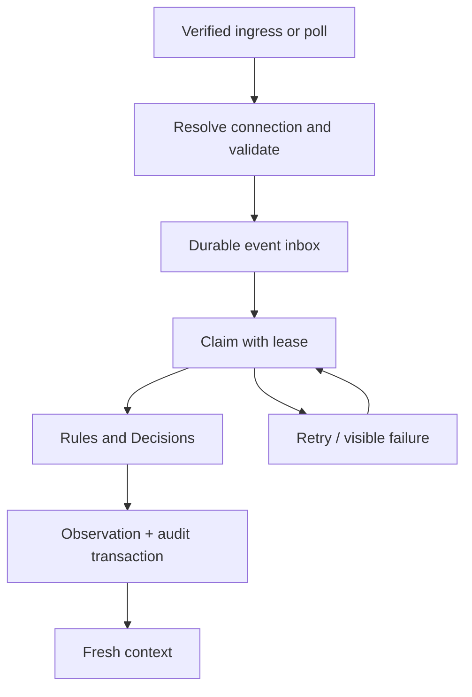

# 03 — Connectors, sync and event pipeline

## Нормативный интерфейс

См. `connectors/contracts.ts`: AtlasConnector предоставляет system, healthCheck, sync и resolveExternalEntity. Адаптер получает `ResolvedConnection` — scope, connectionId и **уже проверенный `externalTenantId`** (mapped customer/organization), по которому обязан фильтровать upstream-запрос. Передача этого параметра не заменяет проверку принадлежности в ConnectionsModule, которая его и выдала; tenant ID из request body или AI-вывода адаптер не принимает. SecretResolver получает secretRef и тот же `ResolvedConnection`; `secretRef` — стабильное имя секрета, ротация значения происходит в vault без изменения строк `Connection`. Никакие auth credentials не сериализуются в контекст AI.

В файлах normalizer.ts используются **synthetic Atlas DTOs**. Они не являются Atera/Huntress webhook schemas. Перед live coding надо открыть account/vendor documentation, проверить реальные payloads, pagination, filter semantics и ограничения API. Ни одного vendor URL или write endpoint пакет не выдумывает. Нормализатор переносит **severity источника** по задокументированному маппингу и никогда не выводит её из порога Atlas (например, «диск ≥ 98 % ⇒ HIGH»): порог — политика, живёт в versioned config, а не в адаптере.

Каждое нормализованное событие несёт `resourceType` самого объекта (`alert`, `ticket`, `incident`) и `externalDevice: { resourceType: 'agent', externalId }` — ссылку на устройство, если источник её даёт.

## Mapping

| Atlas | Atera | Huntress |
|---|---|---|
| Client | Customer ID | Organization ID |
| Device | Agent ID | Agent ID |
| Person | Contact ID при наличии | Только подтверждённые данные; hostname не доказывает пользователя |
| Connection | Customer mapping + vault ref | Organization mapping + vault ref |

Уникальность внешнего объекта — connection + resourceType + externalId. Для MSP-wide credential connection хранит явный client filter: read all tenants followed by post-filter недостаточен для изоляции. Предпочитайте vendor-supported customer/organization filtering. Если его нет, изолируйте connection/job и не допускайте данные чужих клиентов в API/AI context.

## Live resources первой версии

| Atera | Huntress |
|---|---|
| customers, agents, active alerts, open tickets | organizations, agents, incident reports |

Signals/escalations/remediations можно добавить после отдельной проверки фактического API/MCP contract. Huntress в этой Stage 1 — только источник evidence. M365/PowerOffice directories содержат scope notes для следующих slices.

## Sync-порядок

1. Проверить connection status и mapping.
2. Разрешить credential в памяти по secretRef.
3. Получить страницу в customer/organization scope.
4. Validate vendor DTO → normalize → upsert external entities/events.
5. Transaction: сохранить страницу и новый cursor только после успешной записи.
6. После всех страниц обновить lastSuccessAt. Failure не обновляет success timestamp.
7. Reconciliation сопоставляет актуальное состояние с локальным snapshot. Отсутствие записи на неполной странице не означает deletion/resolution.

Не предполагайте, что любой resource поддерживает delta cursor или webhooks. При отсутствии используйте bounded polling с overlap watermark и durable dedup. Интервалы задаются connection/resource config и лимитами vendor, не произвольной частотой 30 секунд.

## Event inbox и worker

Webhook acknowledgement только после durable write. Подпись/секрет проверяются по реально поддержанному vendor protocol; запроса с неподтверждённым источником недостаточно для создания scoped event. ClientId/connectionId из body сами по себе не удостоверяют клиента.

Event key (`eventKeyVersion = v2`): SHA256(JSON array of `v2`/workspace/client/source/connection/**resourceType**/externalEventId/revision). Alert `123` и ticket `123` одной connection — разные события; уникальный индекс `RawEvent` включает `resourceType`. `payloadHash` — SHA256 канонического JSON нормализованного события без `receivedAt`. Если vendor не имеет revision, adapter определяет стабильный source update timestamp или canonical content hash. Правило версионируется: смена формулы — новая версия ключа, не тихая замена. При повторе ID/revision с новым payloadHash каноническое содержание сохраняется; новое содержание записывается **отдельным** событием с ключом `conflictEventKey(canonicalKey, payloadHash)` и ссылкой `conflictOfEventKey`, фиксируется audit `event.revision_conflict`, а observation этого варианта получает `HUMAN_REVIEW`, `REVISION_PAYLOAD_CONFLICT` и срочность по своей severity. Одинаковое конфликтное содержание, доставленное повторно, — дубликат. Сравнение hash идёт до объединения с in-flight обработкой канонического события.

### Классы ошибок после durable-записи

Подтверждение приёма — только после надёжной записи события. Дальше ни одна ошибка не теряет событие; класс ошибки (`AtlasError.kind`) определяет исход:

| Класс | Примеры | Обработка |
|---|---|---|
| `CONFLICT` | `AMBIGUOUS_DEVICE_LINK`, противоречивые данные | Observation создаётся: `HUMAN_REVIEW`, `entityId = null`, исходная severity/priority, причина в `reasonCodes`, audit |
| `TRANSIENT` | сеть, 429/5xx, недоступная БД | Статус `RETRY`, `attempts` сохраняются, bounded retry с backoff; при исчерпании — dead letter |
| `PERMANENT` / неизвестная ошибка | неисправимые данные, баг | Статус `DEAD_LETTER` с `lastErrorCode`, audit `event.dead_lettered`, видимая очередь оператора |
| `SCOPE` / `VALIDATION` | чужой клиент, malformed DTO | Отказ **до** записи; для актора — security audit / client audit |

Сбой advisory-провайдера — не ошибка pipeline: он даёт `DecisionRun(status=FAILED, safeErrorCode, requestedModel/responseModel)` и applied-run с `HUMAN_REVIEW` (контракт docs/04). Dead letter не переобрабатывается неявно; возврат в очередь — явное действие оператора с audit.

### Две фазы обработки

Фаза 1 — один раз на событие: разрешение устройства, получение решения, запись `DecisionRun` как **не применённых**. Фаза 2 — повторяемая целиком: observation, флаг `applied`, audit и завершение inbox в одной транзакции; в reference-коде порядок — durable write (`commitHook`), затем `audit.append`, и только после обоих публикуются applied/observation/inbox, так что сбой записи audit тоже не оставляет применённого решения. Повтор фазы 2 после `TRANSIENT`-ошибки не вызывает провайдера снова и не создаёт второго applied-run. Reference-pipeline реализует это через сохранённое `PreparedDecision`; durable-версия хранит его в `DecisionRun`/`RawEvent`.

Worker использует DB claim/lease или SELECT FOR UPDATE SKIP LOCKED. Unique keys обеспечивают один observation при гонке нескольких workers. Decision call выполняется вне длинной DB transaction; результат сохраняется как DecisionRun (`applied` — тот, чей маршрут использован; shadow-результат AI — `applied = false`). В shadow-режиме baseline фиксируется **не дожидаясь** AI: observation на rules создаётся сразу, AI-вызов идёт отдельной фоновой задачей (в durable-версии — отдельная job того же worker), его результат привязывается к событию как non-applied run и никогда не меняет applied baseline. Финальная transaction атомарно создаёт Observation (с `entityId` и `decisionRunId`), AuditEvent, event status и outbox, если используется. Recovery должен повторно применить сохранённое решение, а не зависеть от старого process memory. Reference-pipeline (`packages/events/pipeline.ts`) воспроизводит этот порядок в памяти; `commitHook` — stand-in финальной транзакции для тестов RETRY/DEAD_LETTER.

Retry: transient network/429/5xx с Retry-After/backoff и лимитом попыток. Malformed DTO → quarantine/review, а не бесконечные retries. Refusal → visible review. Logs содержат safeErrorCode и correlation, но не токены и upstream response body.

## Freshness и context

Каждый resource имеет fetchedAt/asOf, lastSuccessAt, status, source ID. `0 incidents` допустимо только после успешного полного чтения ресурса; ERROR/MISSING/STALE — отдельное состояние. Failure одного connector не скрывает evidence другого. Не смешивайте stale counts со свежими без метки.

Context bounded: top active observations, counts, source references и compact device/person mapping. Детали запрашиваются read-tool по конкретному source ID. Нет причины передавать модели весь client inventory или 200 tools.
