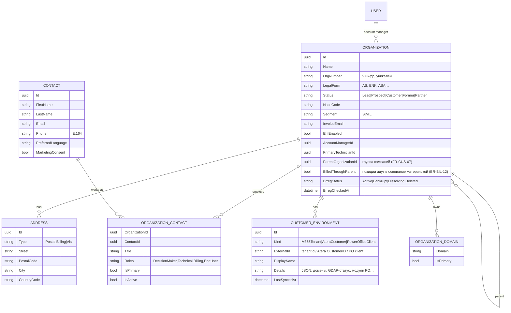
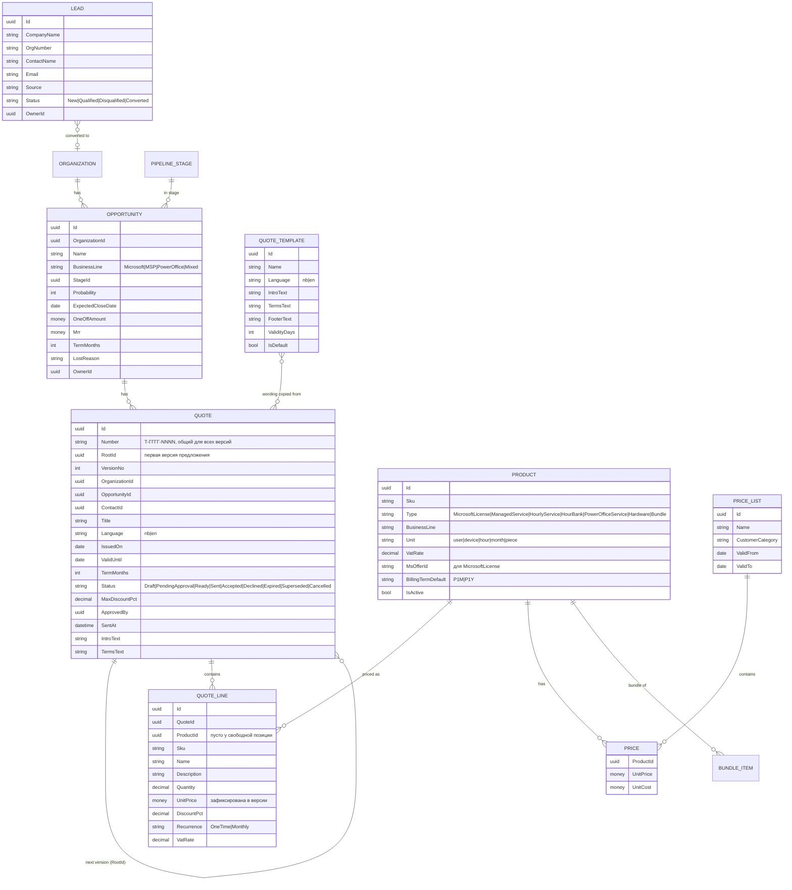
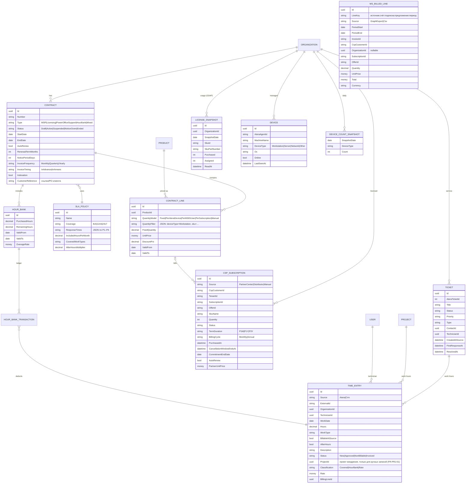
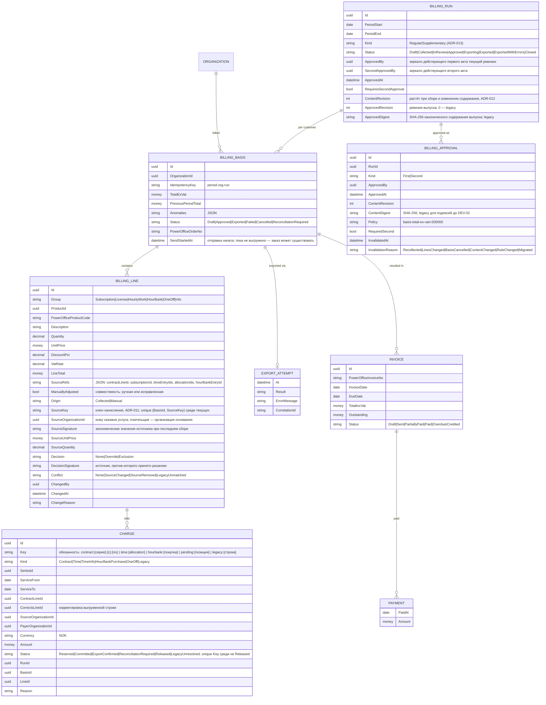
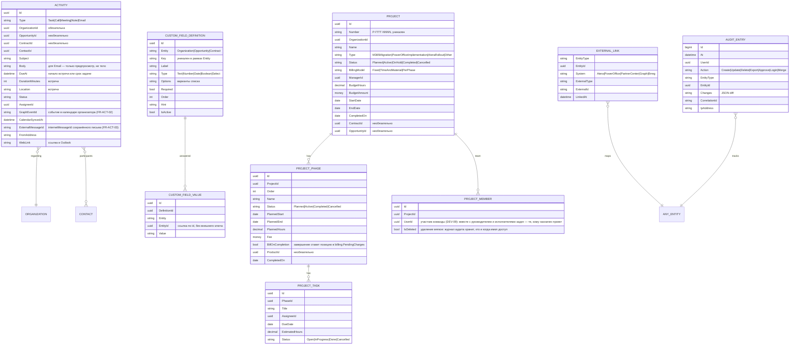

# 04. Модель данных

Логическая модель. Физические таблицы разнесены по схемам модулей ([03 § 5.1](03-architecture.md#51-модули-и-границы)); связи между схемами — по ID без внешних ключей.

**Общие поля всех бизнес-сущностей:** `Id` (последовательный GUID, см. [03 § 8](03-architecture.md#8-данные)), `CreatedAt`, `CreatedBy`, `ModifiedAt`, `ModifiedBy`, `RowVersion`, `IsDeleted`. Даты — `datetimeoffset` (UTC), отображение в Europe/Oslo. Деньги — `decimal(19,4)` + `Currency` (ISO 4217, по умолчанию NOK).

## 1. Клиенты, контакты, среды

## 2. Продажи и каталог

Документ предложения (DEV-08) — `sales.QuoteDocuments`: ревизия на версию предложения, происхождение (Issued/Reconstructed), состояние (Preparing/Ready), снимок всех полей документа (JSON) и его SHA-256, ключ объекта в хранилище, имя файла, длина, SHA-256 PDF, версия рендера. Готовый документ не меняется и не удаляется (триггер `trg_QuoteDocuments_Protect`, запрет DELETE для ролей приложения); байты PDF — в контейнере `documents` (Azure Blob, приватный) или в папке хранилища при разработке.

## 3. Владение данными (system of record)

| Данные | Мастер | CRM | Atera | PowerOffice | Partner Center |
|---|---|---|---|---|---|
| Организация: название, оргномер, адрес | CRM (+ Brreg как источник) | RW | ← получает | ← получает | — |
| Адрес и e-mail для счетов, EHF | CRM (настраиваемо: PowerOffice) | RW | — | ← получает | — |
| Контакты | CRM | RW | ↔ (новые контакты из Atera импортируются) | ← контакт для счетов | — |
| Продукты и цены продажи | CRM | RW | — | ← код продукта (сопоставление) | — |
| Цены партнёра Microsoft | Partner Center / дистрибьютор | R | — | — | мастер |
| Контракты, SLA, пакеты часов | CRM | RW | — | — | — |
| CSP-подписки | Partner Center (или дистрибьютор) | R | — | — | мастер |
| Лицензии в тенанте клиента | Тенант клиента (Graph/GDAP) | R | — | — | — |
| Тикеты | Atera | R + создание | мастер | — | — |
| Агенты/устройства, алерты | Atera | R | мастер | — | — |
| Записи времени по тикетам | Atera | R + статус биллинга | мастер | — | — |
| Записи времени по проектам | CRM | RW | — | — | — |
| Основания для счетов | CRM | RW до утверждения, затем неизменяемы | — | ← заказы | — |
| Счета, кредит-ноты, оплаты, задолженность | PowerOffice | R | — | мастер | — |
| Пользователи, роли | Entra ID | R (+ настройки профиля) | сопоставление техников | — | — |

## 4. Контракты, лицензии, сервис, время

## 5. Биллинг

**Неизменяемость:** после утверждения `BILLING_BASIS` и `BILLING_LINE` защищены на уровне домена (исключение при попытке изменения) и триггером БД; корректировки — только новыми позициями в следующем прогоне.

**Реестр начислений** (`billing.Charges`, [ADR-013](adr/ADR-013-charge-register.md)): одна действующая обязанность на ключ между всеми прогонами; сбор под блокировкой реестра вычитает уже занятые дни серии договора, утверждение фиксирует, выгрузка подтверждает, неизвестный исход отправки требует сверки, отмена до отправки освобождает.

**Разовые позиции из принятых предложений и завершённых этапов проектов** (`billing.PendingCharges`): организация, продукт, описание, количество, цена, скидка, ставка МВА, источник (`SourceType` = `quote` или `project-phase`, `SourceId`, `SourceLineId` — уникальны вместе) и дата, с которой позицию можно выставлять. Прогон включает все незакрытые позиции, а закрывает их (`InvoicedBasisId`) только когда основание действительно выгружено, поэтому отменённый или пересобранный прогон ничего не теряет и не выставляет дважды (BR-SAL-07).

## 6. Активности, проекты, интеграции, аудит

## 7. Индексы и ограничения (ключевые)

| Таблица | Индекс / ограничение |
|---|---|
| `customers.Organization` | UNIQUE (`OrgNumber`) WHERE `IsDeleted = 0 AND OrgNumber IS NOT NULL`; FTS (`Name`) |
| `customers.OrganizationDomain` | UNIQUE (`Domain`) |
| `customers.Contact` | INDEX (`Email`); FTS (`FirstName`, `LastName`, `Email`) |
| `integration.ExternalLink` | UNIQUE (`System`, `ExternalType`, `ExternalId`); UNIQUE (`EntityType`, `EntityId`, `System`, `ExternalType`) |
| `time.TimeEntry` | UNIQUE (`Source`, `ExternalId`); INDEX (`OrganizationId`, `WorkDate`, `Status`) |
| `service.Ticket` | UNIQUE (`AteraTicketId`); INDEX (`OrganizationId`, `Status`) |
| `licensing.CspSubscription` | UNIQUE (`Source`, `SubscriptionId`); INDEX (`CommitmentEndDate`) |
| `customfields.CustomFieldDefinition` | UNIQUE (`Entity`, `Key`) WHERE `IsDeleted = 0`; INDEX (`Entity`, `Order`) |
| `customfields.CustomFieldValue` | UNIQUE (`DefinitionId`, `EntityId`) WHERE `IsDeleted = 0`; INDEX (`Entity`, `EntityId`) |
| `projects.Project` | UNIQUE (`Number`); INDEX (`OrganizationId`, `Status`) |
| `projects.ProjectPhase` | INDEX (`ProjectId`) |
| `projects.ProjectTask` | INDEX (`PhaseId`); INDEX (`AssigneeId`, `Status`) |
| `projects.ProjectMember` | UNIQUE (`ProjectId`, `UserId`) WHERE `IsDeleted = 0`; INDEX (`UserId`) |
| `time.TimeEntry` (проект) | INDEX (`ProjectId`) WHERE `ProjectId IS NOT NULL` |
| `customers.Organization` (группа) | INDEX (`ParentId`) WHERE `ParentId IS NOT NULL` |
| `licensing.LicenseSnapshot` | UNIQUE (`OrganizationId`, `SnapshotDate`, `SkuId`); INDEX (`SnapshotDate`) |
| `licensing.MsBilledLine` | UNIQUE (`LineKey`); INDEX (`PeriodStart`, `OrganizationId`) |
| `billing.BillingBasis` | UNIQUE (`IdempotencyKey`) |
| `billing.BillingRun` | UNIQUE (`PeriodStart`) WHERE `Status <> 'Closed'` |
| `audit.AuditEntry` | Кластерный по `At`; INDEX (`EntityType`, `EntityId`); секционирование по году |

## 8. Сроки хранения

| Данные | Срок | Основание |
|---|---|---|
| Основания для счетов, прогоны, аудит финансовых действий | 5 лет после окончания отчётного года | Bokføringsloven |
| Контакты бывших клиентов | 3 года после окончания отношений, затем анонимизация | GDPR, законный интерес |
| Лиды без конверсии | 2 года без активности, затем удаление | GDPR, минимизация |
| Зеркало тикетов | 3 года (источник — Atera) | Минимизация |
| `ExternalRecord` (сырые payload) | 90 дней | Отладка |
| Журнал синхронизаций | 180 дней | Эксплуатация |
| Журнал аудита (нефинансовый) | 5 лет | Безопасность |

Уточнить у заказчика и юриста на Этапе 0 ([09](09-assumptions-questions.md)).
