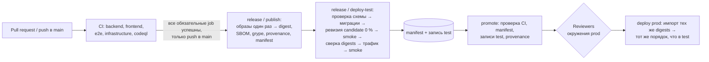

# 07. Нефункциональные требования, DevOps и эксплуатация

## 1. Нефункциональные требования

### 1.1 Производительность и объёмы

| ID | Требование | Метод проверки |
|---|---|---|
| NFR-01 | p95 API чтения ≤ 500 мс, записи ≤ 1 с при 50 одновременных пользователях | k6, сценарий «рабочий день» |
| NFR-01a | Карточка клиента 360° (первый полезный контент) ≤ 2 с; вкладки с внешними данными грузятся независимо | Playwright + Web Vitals (LCP ≤ 2,5 с) |
| NFR-01b | Глобальный поиск ≤ 1 с на 5 000 организаций / 50 000 контактов | k6 |
| NFR-01c | Биллинг-прогон на 500 клиентов: сбор ≤ 5 мин, выгрузка ≤ 30 мин | Нагрузочный тест в `test` |
| NFR-01d | Отставание данных Atera (тикеты) ≤ 15 мин, PowerOffice (оплаты) ≤ 90 мин | Метрика «возраст последней синхронизации» |
| NFR-04 | Объёмы на 5 лет: 100 пользователей, 5 000 организаций, 50 000 контактов, 1 млн тикетов, 1 млн записей времени, 10 млн записей аудита | Генерация данных + нагрузочный тест |

### 1.2 Надёжность

| ID | Требование |
|---|---|
| NFR-02 | Доступность ≥ 99,5 % в рабочие часы (пн–пт 07:00–18:00 Europe/Oslo), ≥ 99 % в остальное время |
| NFR-03 | RPO ≤ 1 ч (фактически 5–10 мин PITR), RTO ≤ 4 ч |
| NFR-08 | Недоступность любой внешней системы не влияет на работу функций CRM, не зависящих от неё; пользователь видит баннер «Atera недоступна, данные на HH:mm» |
| NFR-08a | Ни одно событие outbox и ни одна исходящая операция не теряются при перезапуске/деплое (at-least-once + идемпотентность) |
| NFR-08b | Деплой без простоя (rolling update, миграции БД обратно совместимы — expand/contract) |

### 1.3 Удобство и доступность

| ID | Требование |
|---|---|
| NFR-06 | Языки интерфейса: norsk bokmål, English; все строки через i18n-ключи |
| NFR-07 | Адаптивность ≥ 360 px; ключевые сценарии техника (карточка клиента, тикеты, ввод времени) оптимизированы для телефона |
| NFR-07a | WCAG 2.1 AA: навигация с клавиатуры, контраст, aria-метки (axe-core в E2E-тестах) |
| NFR-07b | Браузеры: последние 2 версии Edge, Chrome, Firefox, Safari (macOS/iOS) |
| NFR-07c | Обучение нового пользователя своим сценариям ≤ 1 ч |

### 1.4 Сопровождаемость

| ID | Требование |
|---|---|
| NFR-10 | Покрытие тестами доменной логики биллинга, тарификации и контрактов ≥ 90 %, остального backend ≥ 70 % |
| NFR-11 | Время от merge в `main` до production ≤ 1 ч (при прохождении гейтов) |
| NFR-12 | Все настройки интеграций (расписания, лимиты, сопоставления) меняются без деплоя |
| NFR-13 | Архитектурные правила модульности проверяются автоматически в CI |
| NFR-14 | Feature flags (Azure App Configuration или таблица настроек) для постепенного включения модулей R2 |

### 1.5 Соответствие
- NFR-05 — данные в Norway East; NFR-09 — хранение финансовых оснований 5 лет; GDPR — [06 § 8](06-security.md#8-gdpr-и-персональные-данные).

## 2. Окружения

| Окружение | Где | Данные | Внешние системы | Кто деплоит |
|---|---|---|---|---|
| `local` | Ноутбук разработчика, .NET Aspire | Сиды + обезличенный снимок | WireMock-моки; по флагу — PowerOffice Demo | Разработчик |
| `pr-<n>` (опционально) | Container Apps revision с отдельной БД | Сиды | Моки | CI при открытии PR |
| `test` | Azure, подписка `crm-nonprod` | Сиды + обезличенный снимок prod (ежемесячно) | PowerOffice Demo, Atera тестовый клиент, Partner Center — только чтение | CI при merge в `main` |
| `prod` | Azure, подписка `crm-prod` | Боевые | Боевые | CI после ручного approve (GitHub Environments) |

Обезличивание снимка: скрипт замены имён, e-mail, телефонов, сумм ±случайный коэффициент; выполняется внутри `prod`-подписки, в `test` попадает только результат.

## 3. CI/CD

Реализация — DEV-05, [ADR-015](adr/ADR-015-release-pipeline.md); процедуры — [runbook 01](runbooks/01-first-deployment.md) §6 и §9.

- **Git-процесс:** trunk-based, короткие ветки, обязательный PR и required status checks — настройки репозитория, проверяются в EXT-11 (`tools/release/release-settings.sh`).
- **Покрытие (NFR-10):** unit- и integration-тесты собирают Cobertura через `Microsoft.Testing.Extensions.CodeCoverage`; `tools/coverage/coverage-gate.py` объединяет отчёты, печатает denominator и исключения (миграции, сгенерированный код, AppHost) и роняет CI ниже порога. Архитектурные тесты обнаруживают модули по `src/` и падают, если проект не входит в solution или в хосты.
- **Сканеры fail-closed:** пакеты .NET (`release.py vulnerable-dotnet`: High/Critical, ошибки источника, неполный охват — отказ), npm со сборочными зависимостями (`release.py npm-audit`), образ релиза (grype, High/Critical), CodeQL.
- **Артефакт:** crm-web и crm-worker собираются один раз; test и prod работают с одними digests; migrator — образ crm-web того же digest. Release manifest — commit, digests, версии схемы, разрывы схемы, SBOM, результаты job'ов, ссылка на прогон.
- **Миграции БД:** задача Container Apps под identity мигратора внутри VNet, до любых изменений ревизий и трафика; сбой останавливает выпуск. Только expand (архитектурный тест); contract — отдельным релизом с ADR. Миграции, ломающие прежний релиз без смены колонок (триггеры), регистрируются в `tools/release/schema-breaks.json`; проверка схемы не пускает откат ниже разрыва и требует maintenance window для разрыва поверх старого релиза.
- **Инфраструктура:** Bicep-модули в `infra/`, параметры окружений `*.bicepparam` (PowerOffice зафиксирован: test — Demo, prod — Production; приложение проверяет соответствие при старте). Автоматический what-if в PR не реализован.
- **Аутентификация CI в Azure:** федеративные учётные данные GitHub OIDC → отдельные identities для `test` и `prod`, subject `environment:<env>`; actions закреплены SHA.
- **Откат:** трафик на предыдущую ревизию Container Apps (≤ 5 мин) или Promote с `rollback` (digests прежнего релиза без миграций). Совместимость прежнего релиза со схемой проверяется `tools/release/rollback-compat.sh`. Автооткат по алерту 5xx, ZAP baseline и релизные теги не реализованы.

## 4. Мониторинг и эксплуатация

### 4.1 Дашборд эксплуатации (Azure Workbook)
- Запросы, ошибки, латентность по эндпоинтам (p50/p95/p99).
- Состояние синхронизаций: последняя успешная, длительность, ошибки по системам.
- Квоты: Atera (запросов/мин), Partner Center 429, PowerOffice 429.
- Очереди: outbox, OutboundOperation (pending, dead letter), Hangfire failed jobs.
- Активные пользователи, входы, ошибки аутентификации.
- Стоимость ресурсов (Cost Management бюджет с алертом).

### 4.2 Алерты

| Алерт | Порог | Серьёзность | Канал |
|---|---|---|---|
| Health check `crm-web` недоступен | 2 проверки подряд (1 мин) | Sev1 | SMS/звонок дежурному + Teams |
| 5xx | > 1 % за 5 мин | Sev2 | Teams «Drift CRM» + e-mail |
| Синхронизация системы не успешна | > 2 интервалов подряд | Sev2 | Teams + e-mail Admin |
| Dead letter исходящих операций | ≥ 1 | Sev3 | Teams |
| Биллинг-выгрузка с ошибками | ≥ 1 клиент | Sev2 | Teams «Økonomi» + Finance |
| Сертификат/секрет истекает | ≤ 30 дней | Sev3 | E-mail Admin |
| Refresh token Partner Center не обновлялся | > 60 дней | Sev2 | E-mail Admin |
| БД: DTU/vCore > 80 % | 15 мин | Sev3 | Teams |
| Целостность аудита: `AUDIT_INTEGRITY_MISMATCH` в логах | ≥ 1 | Sev1 | по DEC-09 (получатели не назначены); [runbook 08 §5](runbooks/08-database-permissions.md#5-целостность-аудита) |

### 4.3 Health checks
- `/health/live` — процесс жив.
- `/health/ready` — SQL, Key Vault, Blob.
- `/health/integrations` (только для мониторинга, право `integrations.manage`) — по каждой внешней системе: включена ли, не на паузе ли, когда и чем закончился последний прогон, сколько исходящих операций с ошибкой; **не** влияет на readiness, поэтому сбой интеграции не выводит CRM из балансировщика.

### 4.4 Runbooks (обязательны к запуску R1)
1. Деплой и откат — [runbook 01](runbooks/01-first-deployment.md) (§ 6 и § 9).
2. Восстановление БД на момент времени — [runbook 03](runbooks/03-database-restore.md).
3. Интеграция не авторизована (ротация ключа Atera / Client Key PowerOffice / повторный consent Partner Center) — [runbook 02](runbooks/02-integrations.md).
4. Биллинг-выгрузка частично не прошла — [runbook 04](runbooks/04-billing-export.md).
5. Приостановка интеграции при инциденте (без деплоя) — [runbook 05](runbooks/05-pause-integration.md).
6. Инцидент безопасности / утечка персональных данных — [runbook 06](runbooks/06-security-incident.md).
7. Ручной биллинг при недоступности CRM — [runbook 07](runbooks/07-manual-billing.md).
8. Права БД, retention и целостность аудита, секреты поставщиков — [runbook 08](runbooks/08-database-permissions.md).

### 4.5 Поддержка
- L1 — Admin CRM внутри Компании (доступы, сопоставления, повтор синхронизаций).
- L2/L3 — команда разработки; SLA на дефекты: Blocker — начало работ ≤ 2 ч в рабочее время, Critical ≤ 1 рабочий день.
- Окно регламентных работ: вторник 19:00–21:00 Europe/Oslo (как правило, не требуется благодаря деплою без простоя).

## 5. Оценка ресурсов Azure (prod, ориентировочно)

| Ресурс | Конфигурация |
|---|---|
| Container Apps | `crm-web` 2 × 0,5 vCPU / 1 GiB (autoscale до 4), `crm-worker` 1 × 1 vCPU / 2 GiB |
| Azure SQL Database | General Purpose Serverless, 2–4 vCore, 50 ГБ, geo-redundant backup |
| Storage | Standard ZRS, ≤ 100 ГБ |
| Key Vault | Standard |
| Application Insights / Log Analytics | Сбор ≤ 5 ГБ/мес., sampling 20 % для успешных запросов, 100 % для ошибок |
| NAT Gateway + Public IP | 1 |
| ACR | Basic |

Точная стоимость рассчитывается в Azure Pricing Calculator на Этапе 0 (цены зависят от соглашения Компании — CSP/EA/MCA).

## 6. Стратегия тестирования

| Уровень | Инструменты | Что покрывается | Когда |
|---|---|---|---|
| Unit | xUnit, FluentAssertions-альтернатива (Shouldly / AwesomeAssertions — проверить лицензию), Bogus | Домен: тарификация времени, расчёт оснований, количества по контрактам, продления, proration, суммы и версии предложений; писатель PDF (структура файла, таблица xref, кодировка норвежских букв, ширина текста); разбор событий и писем Graph, имя папки SharePoint, карточка Teams | Каждый PR |
| Архитектурные | NetArchTest | Границы модулей, отсутствие ссылок ядра на интеграции, политики на эндпоинтах | Каждый PR |
| Интеграционные | Testcontainers (SQL Server), WebApplicationFactory | Эндпоинты + БД + авторизация по ролям (тестовый аутентификационный хендлер) | Каждый PR |
| Контрактные (внешние API) | WireMock.Net + записанные фикстуры | Маппинг, пагинация, ошибки 429/5xx, идемпотентность выгрузки, делегированные вызовы Graph (календарь, почта), SharePoint и вебхуки Teams | Каждый PR |
| Smoke интеграций | Реальные test-учётки | Доступность и формат ответов Atera, PowerOffice Demo, Partner Center | Ночью |
| E2E | Playwright (+ axe-core) | Реальные crm-web/crm-worker + SQL + заглушки внешних API (`tools/dev-mocks`). Сейчас: организации из реестра, контакты, права ролей, поиск, экспорт, дубликаты, сопоставления PowerOffice, язык, каталог и контракты, сервис и время, лиды/сделки/лицензии, предложения (согласование скидки, PDF, новая версия, шаблоны), биллинг от прогона до счёта, дашборд и уведомления, поверхности Microsoft 365 без подключённого Graph (календарь, почта, документы); axe WCAG 2.1 AA в светлой и тёмной теме; клавиатура; ширина телефона | Каждый PR (CI) |
| Нагрузочные | k6 — сценарий «рабочий день» [`tools/load-test/workday.js`](../tools/load-test/workday.js) с порогами p95 чтения < 500 мс и поиска < 1 с | NFR-01, NFR-01b, NFR-04 | Перед каждым релизом |
| Безопасность | CodeQL, ZAP, пентест | ASVS L2 | PR / еженедельно / перед R1 и ежегодно |
| UAT | Сценарии из [02](02-functional-spec.md) | Приёмка заказчиком | Конец каждого релиза |
| Параллельный биллинг | Сравнение сумм | Корректность биллинга | 1 полный месяц до отказа от старого процесса |

**«Золотые» тесты биллинга:** набор из ~30 эталонных клиентов (все модели количества, пакеты часов, работы в нерабочее время, изменения цены в середине периода, отсутствие сопоставлений) с ожидаемыми основаниями в виде snapshot-файлов; любое изменение результата требует явного обновления эталона в PR.
